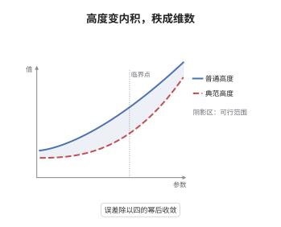

# Néron-Tate 高度

> **一句话大白话**：把普通高度稍作修正，它就成了严格的二次函数，点的加法也随之变成内积，于是椭圆曲线的秩就等于这个内积空间的维数。
>
> **小例子**：在 $E:y^2=x^3+1$ 上取 $P=(2,3)$，直接算得 $2P=(0,1)$、$3P=(-1,0)$、$6P=O$，故 $\hat h(P)=\hat h(2P)=0$；若换成同一条曲线上的非挠点，则必有 $\hat h(2Q)=4\hat h(Q)$ 且 $\hat h(Q)>0$。

## 介绍

Néron-Tate 高度（典范高度）是 Weil 高度的"极限修正版"：$\hat h(P)=\lim_n 4^{-n}h(2^nP)$。它满足严格的二次关系 $\hat h(2P)=4\hat h(P)$，从而可以用极化公式造出一个双线性配对。这个配对在模去挠子群后正定，于是 $E(K)$ 的秩被解释为该内积空间的维数，regulator 就是配对矩阵的行列式。它是 Mordell-Weil 定理的定量版本，也是 BSD 猜想中所有"算术量"的度量尺。

## 几何直观

图意在说明：折线是普通高度 $h(2^nP)$ 的归一化值，它围绕光滑曲线上下抖动但偏差有界；除以 $4^n$ 后抖动被压平，极限曲线严格按 $4$ 的幂增长，这就是 $\hat h$。

## 分析

**前置依赖**：高度函数、Weil 猜想（Hasse 界）；补充：椭圆曲线的倍点公式、Northcott 有限性定理。

**数学内涵**：
- 定义 $\hat h(P)=\lim_{n\to\infty}4^{-n}h(2^nP)$。存在性只依赖 $h(2P)=4h(P)+O(1)$，误差按 $4^{-n}$ 几何衰减。
- 严格二次性：$\hat h(2P)=4\hat h(P)$，且满足平行四边形律 $\hat h(P+Q)+\hat h(P-Q)=2\hat h(P)+2\hat h(Q)$；由极化公式 $\langle P,Q\rangle=\frac12\big(\hat h(P+Q)-\hat h(P)-\hat h(Q)\big)$ 得到对称双线性配对。
- 半正定与非退化：$\hat h(P)\ge0$，且 $\hat h(P)=0$ 当且仅当 $P$ 是挠点；因此在 $E(K)/E(K)_{\mathrm{tors}}$ 上配对正定，$\operatorname{rank}E(K)$ 等于配对矩阵的秩，任意基下的 Gram 行列式（regulator）非零。
- 常见误区：把 $\hat h$ 当成"整值高度"或以为 $\hat h(P)=0$ 就表示 $P=O$；它取实值，零空间恰是挠子群。另外 $\hat h$ 与 $h$ 只差一个有界常数，因此 $\hat h$ 的取值一般不能靠有限次计算得到，需要局部高度。
- Hasse 界在这里的作用是控制 $\#E(\mathbb F_v)$ 相对 $q_v$ 的偏差不超过 $2\sqrt{q_v}$，使写成各素点局部贡献之和的高度误差有一致界。

**结构**：
1. 用倍点公式与高度的近似二次性证明极限存在，得到 $\hat h$ 及有界差估计。
2. 由 $\hat h(2P)=4\hat h(P)$ 与平行四边形律推出极化配对的双线性。
3. 用非负性加 Northcott 定理证明零空间等于挠子群，得到正定与秩等式。

## 思考过程

Weil 在证明 Mordell-Weil 定理时已经感到需要一个"严格二次"的高度，因为普通高度只满足 $h(2P)=4h(P)+O(1)$，误差项让下降论证处处要补常数。Tate 的想法是把误差一路推到无穷：每次倍点把误差放大四倍，反过来除以 $4^n$ 就把误差压成几何级数，极限自然存在且严格二次。Néron 则从另一侧给出构造，用局部高度逐素点求和，使典范高度成为整体定义的量。障碍在于 $h$ 只有近似二次性，无法直接做线性代数；关键想法是"用极限换严格性"，代价是失去可计算性，于是实际计算总要回到局部高度。一旦配对正定，Mordell-Weil 的有限生成就有了度量的解释，BSD 猜想也才能把 regulator 写进公式。

## 证明过程

**定理**：设 $E/K$ 为椭圆曲线，$h$ 为 Weil 高度，则 (i) 极限 $\hat h(P)=\lim_n4^{-n}h(2^nP)$ 存在，且 $|\hat h-h|$ 有界；(ii) $\hat h(2P)=4\hat h(P)$；(iii) 极化配对 $\langle P,Q\rangle$ 对称双线性、半正定，$\hat h(P)=0$ 当且仅当 $P\in E(K)_{\mathrm{tors}}$；(iv) $\operatorname{rank}E(K)=\operatorname{rank}\big(\langle P_i,P_j\rangle\big)$。

**证明**：

### 1. 极限存在

由倍点公式与射影直线上的高度性质，存在常数 $C_0$ 使 $|h(2P)-4h(P)|\le C_0$ 对所有 $P\in E(\bar K)$ 成立。令 $a_n=4^{-n}h(2^nP)$，则

$$
|a_n-a_{n-1}|=4^{-n}\big|h(2^nP)-4h(2^{n-1}P)\big|\le C_0\,4^{-n},
$$

故 $\{a_n\}$ 是 Cauchy 列，极限存在，且 $|\hat h(P)-h(P)|\le C_0/3$。

### 2. 二次性与极化

把 $a_{n+1}$ 的定义改写为 $4^{-n}h(2\cdot2^nP)$，由 $h(2A)=4h(A)+O(1)$ 取极限即得 $\hat h(2P)=4\hat h(P)$。另一方面，高度的平行四边形不等式 $h(P+Q)+h(P-Q)=2h(P)+2h(Q)+O(1)$ 除以 $4^n$ 并令 $n\to\infty$，得

$$
\hat h(P+Q)+\hat h(P-Q)=2\hat h(P)+2\hat h(Q).
$$

由此 $\langle P,Q\rangle=\frac12(\hat h(P+Q)-\hat h(P)-\hat h(Q))=\frac14(\hat h(P+Q)-\hat h(P-Q))$，右端对 $P,Q$ 对称；再用平行四边形律对 $Q\pm R$ 展开，可验证 $\langle P,Q+R\rangle+\langle P,Q-R\rangle=2\langle P,Q\rangle$ 与 $\langle P,2Q\rangle=2\langle P,Q\rangle$，标准的极化论证给出双线性。

### 3. 非退化与秩等式

由 $h\ge0$ 与有界差得 $\hat h\ge0$。若 $\hat h(P)=0$，则 $\hat h(2^nP)=0$，结合 $|\hat h-h|\le C_0/3$ 得 $h(2^nP)\le C_0/3$，于是 $\{2^nP\}$ 落在有限集内（Northcott），存在 $n<m$ 使 $2^nP=2^mP$，即 $(2^m-2^n)P=O$，故 $P$ 挠。反过来若 $NP=O$，由二次性 $\hat h(P)=\hat h(NP)/N^2=0$。于是配对在 $E(K)/E(K)_{\mathrm{tors}}$ 上正定。写 $E(K)\cong\mathbb Z^r\oplus T$，则 $E(K)\otimes\mathbb R\cong\mathbb R^r$ 上带有正定内积，Gram 矩阵可逆，故

$$
r=\operatorname{rank}E(K)=\dim_{\mathbb R}\big(E(K)\otimes\mathbb R\big)=\operatorname{rank}\big(\langle P_i,P_j\rangle\big).
$$

$\square$

## 课堂问答

**老师**：为什么定义里除以 $4^n$ 而不是 $2^n$？

**学生**：因为倍点让高度按平方增长，$\hat h(2P)=4\hat h(P)$ 才是"二次齐次"的正确含义。用 $4$ 作比例，误差 $|h(2P)-4h(P)|\le C_0$ 在迭代后以 $4^{-n}$ 衰减，级数收敛；若用 $2$，极限对应次数 $1$，与二次型不相容。

**老师（追问）**：$\hat h(P)=0$ 为什么只能推出 $P$ 是挠点，而不能直接推出 $P=O$？

**学生**：因为 $\hat h$ 只是半正定，零空间恰好是整个挠子群。例如 $E:y^2=x^3+1$ 上 $P=(2,3)$ 是 $6$ 阶点，$\hat h(P)=0$ 但 $P\ne O$。真正正定的是商群 $E(K)/E(K)_{\mathrm{tors}}$，秩等式也必须在这个商上陈述。

**老师（拓展）**：秩等式在逻辑上依赖 Mordell-Weil 定理吗？

**学生**：依赖。要先有 $E(K)\cong\mathbb Z^r\oplus T$ 这个有限生成结构，才能把 $\hat h$ 限制到 $\mathbb Z^r$ 上谈正定内积与 regulator；它是有限生成的推论，而不是证明有限生成的工具。若 $E(K)$ 不是有限生成，$\hat h$ 仍可定义，但"秩"与 regulator 都失去意义。
