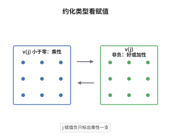

# Néron 模型

> **一句话大白话**：把数域上的椭圆曲线整体地摊在一个整模型上，模掉一个素点后看它退化成什么，就得到这条曲线在该素点的约化类型。
>
> **小例子**：取 $p\ne2,3,31$ 与 $E:y^2=x^3+p^2x+p^3$，则 $c_4=-48p^2$、$\Delta=-496p^6$、$j=6912/31$。$j$ 是单位（$v(j)=0$），可约化后是 $y^2=x^3$ 的尖点，属于加性约化；可见 $j$ 整并不等于好约化。

## 介绍

Néron 模型是椭圆曲线的"最佳整模型"：它在整基上光滑、分离、有限型，特殊纤维带群结构，并且任何从光滑整概形出发的有理态射都能唯一延拓上去。它把局部域上的椭圆曲线分解成"一般纤维是原来的曲线、特殊纤维是退化群"的两层结构，特殊纤维的恒等分支只有三种可能：椭圆曲线、乘法群、加法群，分别对应好、乘性、加性约化。判别这三种情形只需看极小 Weierstrass 模型的判别式与 $c_4$ 的赋值，而 $j$ 不变量的赋值给出更粗但更直观的信号。

## 几何直观

图意在说明：左栏结点曲线的光滑部分是乘法群，对应乘性约化；右栏上半的光滑三次曲线对应好约化，带尖点的那条其光滑部分是加法群，对应加性约化。$j$ 的赋值负只把左栏单独标出，右栏两种情况要靠判别式再分。

## 分析

**前置依赖**：整概形、奇点消解、椭圆曲线；补充：离散赋值环与极小 Weierstrass 方程、Tate 算法。

**数学内涵**：
- 定义：设 $R$ 为离散赋值环，$K=\operatorname{Frac}R$，$E/K$ 为椭圆曲线。Néron 模型是光滑、分离、有限型的 $R$-群概形 $\mathcal E$，满足 $\mathcal E_K\cong E$，并满足 Néron 映射性质：任何从光滑 $R$-概形到 $E$ 的 $K$-态射唯一延拓为到 $\mathcal E$ 的 $R$-态射。
- 存在与唯一：Néron 用光滑化构造，Artin 用代数空间给出另一证明；模型在同构意义下唯一。特殊纤维的恒等分支 $E_s^0$ 光滑连通，连通分支群 $\Phi=E_s/E_s^0$ 有限。
- 三种类型：$E_s^0$ 为椭圆曲线即好约化，为 $\mathbb G_m$ 即乘性约化（分裂与否看 $-c_6$ 是否为平方），为 $\mathbb G_a$ 即加性约化。
- 判别式判据：令 $v$ 为赋值，$\Delta_{\min}$ 为极小判别式。好约化等价于 $v(\Delta_{\min})=0$；乘性约化等价于 $v(\Delta_{\min})>0$ 且 $v(c_4)=0$；加性约化等价于 $v(\Delta_{\min})>0$ 且 $v(c_4)>0$。
- $j$ 的符号：由 $j=c_4^3/\Delta$ 得 $v(j)=3v(c_4)-v(\Delta)$。乘性时 $v(j)=-v(\Delta_{\min})<0$；好约化时 $v(j)\ge0$；加性时 $v(j)$ 可正可负，$j=0$ 的加性曲线给出 $v(j)=\infty$，而 $I_n^*$ 型（$n\ge1$）加性曲线给出 $v(j)=-n<0$。
- 常见误区：以为"$j$ 是整数就有好约化"。$j=6912/31$ 的例子已经否证；反过来"$v(j)<0$ 就是乘性"也不严谨，它只保证坏约化与潜在乘性，要断言乘性还需 $v(c_4)=0$。

**结构**：
1. 在 $R$ 上取极小 Weierstrass 方程，用判别式是否为单位判断特殊纤维是否光滑。
2. 说明极小模型的光滑轨迹给出 Néron 模型的恒等分支，坏纤维的奇点类型决定是结点还是尖点。
3. 用 $j=c_4^3/\Delta$ 的赋值关系把三种类型翻译成 $v(\Delta)$、$v(c_4)$ 与 $v(j)$ 的条件。

## 思考过程

Néron 在 1950 年代研究 Abel 簇上的高度与局部紧性时发现，直接取极小 Weierstrass 模型行不通：它在坏约化处有奇点，既不是群概形，也不满足延拓性质。Néron 的办法是允许模型变大，把奇点吹开并光滑化，再用一条映射性质把对象唯一确定下来，这就是后来的 Néron 模型。Artin 后来用代数空间重写了存在性，使它不再依赖具体的消解。真正的算术收获在特殊纤维：它的恒等分支只有椭圆曲线、乘法群、加法群三种，于是"约化类型"成为一个离散不变量。Tate 把这些类型整理成算法，用 $(\Delta,c_4,c_6)$ 的赋值逐步判定，Néron-Ogg-Shafarevich 则用惯性群在 Tate 模上的作用给出不依赖模型的刻画。

## 证明过程

**定理**：设 $R$ 为完备离散赋值环，$K=\operatorname{Frac}R$，$E/K$ 为椭圆曲线，取极小 Weierstrass 方程并记其判别式为 $\Delta_{\min}$、系数为 $c_4$，$\mathcal E/R$ 为 Néron 模型。则 (i) 好约化当且仅当 $v(\Delta_{\min})=0$；(ii) 乘性约化当且仅当 $v(\Delta_{\min})>0$ 且 $v(c_4)=0$，此时 $v(j)=-v(\Delta_{\min})<0$；(iii) 加性约化当且仅当 $v(\Delta_{\min})>0$ 且 $v(c_4)>0$；(iv) 因此 $v(j)<0$ 蕴含坏约化，若同时 $v(c_4)=0$ 则为乘性。

**证明**：

### 1. 极小模型与恒等分支

在 $R$ 上取极小 Weierstrass 方程，得到平坦整模型 $\mathcal W/R$，其特殊纤维是一条三次曲线。由判别式判据，$\mathcal W_s$ 光滑当且仅当 $\Delta_{\min}$ 是单位，即 $v(\Delta_{\min})=0$。$\mathcal W$ 的光滑轨迹 $\mathcal W^{\mathrm{sm}}$ 是光滑 $R$-群概形，一般纤维为 $E$；用 Néron 映射性质可证它就是 Néron 模型的恒等分支 $E_s^0$，而 $\mathcal E$ 由 $\mathcal W^{\mathrm{sm}}$ 的光滑化得到。

### 2. 奇异纤维的类型

设 $v(\Delta_{\min})>0$，则 $\mathcal W_s$ 奇异。在剩余特征 $p\ne2,3$ 时，奇异点由 $v(c_4)$ 判定：$v(c_4)=0$ 时是结点，$v(c_4)>0$ 时是尖点。结点的光滑部分是 $\mathbb G_m$ 或非分裂环面，故 $E_s^0$ 是乘法群，对应乘性约化；尖点的光滑部分是 $\mathbb G_a$，对应加性约化。若 $p=2,3$，同一结论由 Tate 算法的逐阶换元得到，只是中间要多做几次平移与缩放。

### 3. $j$ 的赋值与符号

由 $j=c_4^3/\Delta$ 得 $v(j)=3v(c_4)-v(\Delta)$。在乘性情形 $v(c_4)=0$、$v(\Delta_{\min})>0$，故

$$
v(j)=-v(\Delta_{\min})<0 .
$$

在好约化情形 $v(\Delta_{\min})=0$，故 $v(j)=3v(c_4)\ge0$；在加性情形 $v(c_4)>0$ 而 $v(\Delta_{\min})>0$，两项相减可正可负。反过来，若 $v(j)<0$，则 $3v(c_4)<v(\Delta)$，必有 $v(\Delta)>0$，故约化是坏的；若此时还有 $v(c_4)=0$，就落在乘性判据上，若 $v(c_4)>0$ 则是潜在乘性的加性类型。$\square$

## 课堂问答

**老师**：为什么不能只用 $j$ 是否整来判断好约化？

**学生**：因为 $j$ 整只是必要条件。$y^2=x^3+p^2x+p^3$ 的 $j=6912/31$ 是单位，但 $\Delta=-496p^6$ 的赋值是 $6$，特殊纤维是尖点，属于加性约化。好约化要求极小判别式为单位，即 $v(\Delta_{\min})=0$。

**老师（追问）**：Néron 模型为什么要求光滑？直接用极小 Weierstrass 模型不行吗？

**学生**：极小模型在坏约化处特殊纤维有奇点，不是群概形，无法承载群运算，也不满足延拓性质。Néron 模型要求光滑、分离、有限型并满足映射性质，坏纤维上的奇点被吹开；极小模型的光滑轨迹正好是它的恒等分支，连通分支群 $\Phi$ 则记录被吹开的部分。

**老师（拓展）**：乘性约化的分裂与否怎么判定？有没有不依赖模型的刻画？

**学生**：分裂乘性等价于特殊纤维的结点切方向在剩余域中有理，也等价于 Tate 参数 $q$ 落在 $K$ 中，或在 $p\ne2,3$ 时 $-c_6$ 是 $K$ 中的平方；非分裂情形在二次扩域上变分裂。不依赖模型的版本是 Néron-Ogg-Shafarevich：好约化等价于惯性群在 $T_\ell(E)$ 上作用平凡，乘性约化等价于该作用非平凡但幂单，加性约化则两者都不是。
