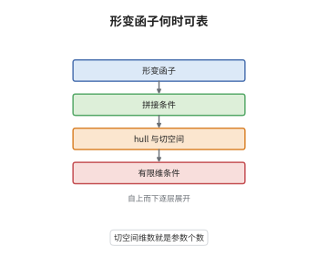

# Schlessinger 形变理论

> **一句话大白话**：一个形变问题只要在"拼接"和"一阶"两件事上表现良好，就能被一个形式概形完整描述，而它的参数个数就是一阶形变的维数。
>
> **小例子**：对亏格 $g\ge2$ 的光滑射影曲线，形变函子的切空间是 $H^1(X,T_X)$，维数 $3g-3$；由于 $H^2(X,T_X)=0$ 无形变障碍，形式 moduli 就是 $\mathrm{Spf}\,k[[t_1,\dots,t_{3g-3}]]$，这正是模空间维数 $3g-3$ 的来源。

## 介绍

Schlessinger 形变理论回答一个很基本的问题：给定一个"按交换环参数化对象"的函子，什么时候它能被某个形式概形代表，从而谈得上"形变空间"？答案是三条函子性条件：基点唯一、纤维积上的拼接映射满射、以及一阶方向上的拼接双射，再加上切空间有限维。满足这些条件时函子有 hull，切空间同构于形式环的余切空间对偶，参数个数等于切空间维数。它把代数几何里"模空间是否存在、维数多少"的问题，化归为对函子本身的三条可检验性质，是 Artin 逼近与形变障碍理论的前置框架。

## 几何直观

图意在说明：最底层是取值在集合上的形变函子，往上是拼接条件，它保证形变能一层层粘起来；再往上是 hull 与切空间，切空间读出的维数就是参数个数；最上层是有限维条件，它让形式环有限生成。

## 分析

**前置依赖**：范畴论、Artin 局部环、上同调；补充：形式概形、余切复形与障碍理论。

**数学内涵**：
- 设定：$k$ 为域，$\mathrm{Art}_k$ 是剩余域为 $k$ 的 Artin 局部 $k$-代数范畴；形变函子 $F:\mathrm{Art}_k\to\mathrm{Set}$ 满足 $F(k)$ 是单点集。
- 切空间：$t_F=F(k[\varepsilon])$，其中 $k[\varepsilon]=k\oplus\varepsilon k$ 且 $\varepsilon^2=0$。一个 $k[\varepsilon]$-形变就是一阶形变，等价于一个切向量。
- 条件：H0 是 $F(k)$ 单点；H1 是对任意 $A'\to A\leftarrow A''$，拼接映射 $F(A'\times_AA'')\to F(A')\times_{F(A)}F(A'')$ 满射；H2 是当 $A''=k[\varepsilon]\to k$ 且 $A'\to A$ 为小扩张时该映射双射；H3 是 $\dim_kt_F<\infty$。
- 定理：H0、H1、H2 加 H3 保证 $F$ 有 hull，即存在形式概形 $\mathrm{Spf}\,R$ 与光滑态射 $h_R\to F$ 在切空间上诱导同构；若 H2 对所有小扩张成立，则 $h_R\to F$ 本身是同构，$F$ 被 $R$ pro-代表。
- 切空间描述：此时 $t_F\cong\mathrm{Hom}_k(\mathfrak m_R/\mathfrak m_R^2,k)=(\mathfrak m_R/\mathfrak m_R^2)^\vee$，故 $\dim_kt_F$ 等于 $R$ 的最小生成元个数；若无障碍（每个小扩张都能提升），则 $R\cong k[[t_1,\dots,t_n]]$，$n=\dim_kt_F$。
- 常见误区：以为 H1、H2 会自动成立，其实"带等价的形变"这类自然函子经常在拼接处失败；也以为 hull 就是 moduli 概形，它只给形式对象，代数化还要 Artin 逼近与可代数化条件。

**结构**：
1. 用 $k[\varepsilon]$ 定义切空间，把一阶形变看成线性数据。
2. 用 H1 的满射性逐阶提升形变，用 H2 保证一阶方向上的提升唯一，得到相容系统即 hull。
3. 用 Hom 计算切空间的对偶，H3 保证有限生成，强 H2 或无障碍给出可表性与幂级数模型。

## 思考过程

Grothendieck 把模空间问题改写成"函子是否可表"，但形式形变只在一个点附近有信息，未必来自真正的概形。Schlessinger 在 1968 年把问题降到 Artin 局部环上，发现可表性其实等价于函子是否尊重纤维积：若 $F$ 由某个环 $R$ 的 Hom 给出，Hom 自然把纤维积送到纤维积；反过来要在 $F$ 上重建环结构，只能要求 $F$ 也算对纤维积。障碍在于形变可能"局部能拼、整体有障"，于是他把拼接拆成满射与双射两条，分别负责存在性与唯一性。切空间则是最小的一阶测试，它的维数直接数出参数。Artin 后来把这些形式结论与逼近定理结合，得到代数空间意义下的可表性，形变理论由此成为模空间研究的通用语言。

## 证明过程

**定理**：设 $F:\mathrm{Art}_k\to\mathrm{Set}$ 满足 $F(k)$ 为单点集。若 $F$ 满足 H0、H1、H2 且 $t_F$ 有限维，则 $F$ 有 hull；若 H2 对所有小扩张成立，则 $F$ 被该 hull pro-代表，且 $t_F\cong(\mathfrak m_R/\mathfrak m_R^2)^\vee$。

**证明**：

### 1. 切空间与一阶延拓

把 $k[\varepsilon]$ 看作最薄的厚化。对任意 $A\in\mathrm{Art}_k$ 与 $A\to k$，由 H2 得

$$
F\big(A\times_k k[\varepsilon]\big)\;\cong\;F(A)\times t_F ,
$$

即"沿一阶方向延拓"没有歧义，一阶形变就是切向量。这一步说明 $t_F$ 是一个 $k$-向量空间：把 $k[\varepsilon]$ 中的 $\varepsilon$ 换成 $\lambda\varepsilon$，由函子性给出数乘。

### 2. 归纳构造 hull

取 $t_F$ 的一组基 $v_1,\dots,v_n$（有限性由 H3 保证），令 $R=k[[t_1,\dots,t_n]]$。先从 $F(k)$ 的唯一元素出发，用 H1 的满射性把形变沿 $R/\mathfrak m^2\to k$ 提升一次，得到 $\xi_2\in F(R/\mathfrak m^2)$，其在切空间上的像恰为 $(v_1,\dots,v_n)$；再对每个 $j$，用 $R/\mathfrak m^{j+1}\to R/\mathfrak m^j$ 与小扩张 $k[\varepsilon]\to k$ 的纤维积，配合 H2 的唯一性把 $\xi_j$ 提升为 $\xi_{j+1}$。这些 $\xi_j$ 相容，给出一个元素 $\xi\in\varprojlim F(R/\mathfrak m^j)$，即态射 $h_R\to F$。

### 3. 切空间对偶与可表性

对 $R=k[[t_1,\dots,t_n]]$，有

$$
h_R(k[\varepsilon])=\mathrm{Hom}_{k\text{-alg}}\big(R,k[\varepsilon]\big)\cong\big(\mathfrak m_R/\mathfrak m_R^2\big)^\vee\cong k^n ,
$$

而 $\xi$ 在切空间上诱导同构 $t_R\to t_F$，故 $\dim_kt_F=n$ 恰是 $R$ 的最小生成元个数，$h_R\to F$ 是光滑态射。若 H2 对所有小扩张成立，则可对 Artin 环的长度作归纳，证明 $h_R(A)\to F(A)$ 对每个 $A$ 都是双射，于是 $F$ 被 $R$ pro-代表。若进一步所有小扩张都能提升（无障碍），则 $R$ 无需关系，可取成幂级数环；否则关系式编码了障碍，障碍住在二阶上同调类的空间中。$\square$

## 课堂问答

**老师**：为什么"可表"要用 H1、H2 这种看似技术性的拼接条件来刻画？

**学生**：因为可表意味着 $F$ 由某个形式环 $R$ 的 Hom 给出，而 Hom 把纤维积送到纤维积。反过来要在 $F$ 上重建环结构，只能要求 $F$ 也把纤维积算对：H1 给满射，保证形变能拼起来；H2 给一阶方向上的双射，保证拼接不产生多余歧义；H3 让 $R$ 有限生成。

**老师（追问）**：切空间为什么取 $F(k[\varepsilon])$，而不是 $F(k)$？

**学生**：$F(k)$ 只是一个基点，没有信息；$k[\varepsilon]$ 是最小的非平凡 Artin 局部环，一个 $k[\varepsilon]$-形变就是沿一阶方向移动，正好是一个切向量。若 $F$ 有 hull $R$，则 $F(k[\varepsilon])=\mathrm{Hom}(R,k[\varepsilon])\cong(\mathfrak m_R/\mathfrak m_R^2)^\vee$，维数就是参数个数。

**老师（拓展）**：障碍具体住在哪里？什么时候形变无阻碍？

**学生**：障碍住在二阶信息里。典型情形是光滑簇的形变：切空间是 $H^1(X,T_X)$，障碍在 $H^2(X,T_X)$；若 $H^2=0$，每个小扩张都能提升，hull 就是幂级数环，维数为 $h^1$。亏格 $g\ge2$ 的曲线满足 $H^2(X,T_X)=0$，所以形式 moduli 光滑、维数 $3g-3$；反之若 $H^2\ne0$，hull 会出现关系式，维数大于参数个数。
