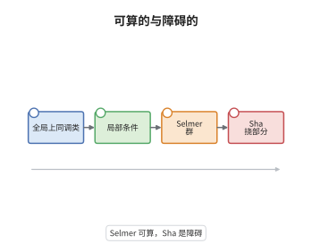

# Tate-Shafarevich 群与 Selmer 群

> **一句话大白话**：Selmer 群是"每个素点局部都过得去"的候选类集合，Tate-Shafarevich 群则是其中"局部处处有解、整体偏偏无解"的那部分障碍。
>
> **小例子**：Selmer 在 1951 年给出的平面三次曲线 $3X^3+4Y^3+5Z^3=0$ 在 $\mathbb Q$ 的每个完备化上都有非平凡点，却没有非平凡有理点；它的 Jacobian 是一条椭圆曲线，这个"局部全通、整体不通"的现象正是该曲线 Tate-Shafarevich 群中的非零元素。

## 介绍

对椭圆曲线 $E/K$，Tate-Shafarevich 群 $\text{Ш}(E/K)$ 收集那些在每处局部完备化上都可解、却无整体 $K$-点的主齐性空间，它精确度量了椭圆曲线上的局部-整体原理失效程度。Selmer 群 $\mathrm{Sel}_m(E/K)$ 则是可以真正计算的那一半：它是 $H^1(K,E[m])$ 中满足所有局部条件的类。两者由一条短正合列连接，左端是 $E(K)/mE(K)$。这条正合列把"求有理点"拆成"算 Selmer 群"与"测 Ш 的障碍"两件事，是下降法与 BSD 猜想的公共入口。

## 几何直观

图意在说明：最左是全体全局上同调类，第二步用每个素点的局部可解性筛出一个子群，这就是 Selmer 群；再把其中来自整体点的部分商掉，剩下的正是 Tate-Shafarevich 群的 $m$-挠部分。

## 分析

**前置依赖**：Galois 上同调、弱 Mordell-Weil 定理；补充：局部域的上同调、类域论与主齐性空间。

**数学内涵**：
- 定义：$\text{Ш}(E/K)=\ker\left(H^1(K,E)\to\prod_v H^1(K_v,E)\right)$，其中 $v$ 跑遍 $K$ 的所有素点。它的元素对应亏格 $1$ 曲线（$E$ 的主齐性空间），处处有局部点但无 $K$-点。
- Selmer 群：$\mathrm{Sel}_m(E/K)$ 定义为 $H^1(K,E[m])$ 中那些在每个 $v$ 处的像都落在 $E(K_v)/mE(K_v)$ 的像里的类，等价地是复合映射 $H^1(K,E[m])\to\prod_v H^1(K_v,E)$ 的核。
- 正合列：$0\to E(K)/mE(K)\to\mathrm{Sel}_m(E/K)\to\text{Ш}(E/K)[m]\to0$，对每个 $m\ge2$ 成立；这里的 $\text{Ш}(E/K)[m]$ 表示 $m$-挠子群。
- 有限性：$\mathrm{Sel}_m$ 只允许在 $m$ 的素因子、坏约化素点与无穷素点处分歧，再配合类群与单位群有限、$E(K_v)/mE(K_v)$ 有限，即可枚举，故 $\mathrm{Sel}_m$ 有限。这一有限性正是弱 Mordell-Weil 定理的来源。
- 常见误区：以为"局部处处有解就整体有解"。这对亏格 $0$（Hasse-Minkowski）成立，对亏格 $1$ 不成立，$\text{Ш}$ 就是反例的仓库；另外 $\text{Ш}[m]$ 只是 $m$-挠部分，$\text{Ш}$ 本身可能无限，$\mathrm{Sel}_m$ 也不随 $m$ 单调。

**结构**：
1. 写出整体与每个局部的 Kummer 正合列，确认连接映射都是单射。
2. 用局部正合性把 Selmer 群识别为"局部像条件"的核，把 Ш 的挠部分识别为"局部为零"的核。
3. 比较两个核，验证左端单射、复合为零、核相等与满射，得到短正合列。

## 思考过程

Selmer 在研究三次曲面的有理点时发现，局部可解性完全不能保证整体可解，这个现象需要一个上同调容器来存放，Tate 与 Shafarevich 后来把它定义为 $H^1(K,E)$ 中局部平凡的子群。困难在于这个群无法直接计算：$H^1(K,E)$ 本身太大。Selmer 的洞察是把问题降一级，只问模 $m$ 的类，此时类落在 $H^1(K,E[m])$ 这个较小的地方，可以用有限多个局部条件切出一个有限群。剩下的问题就是"切掉了什么"，答案恰是 $E(K)/mE(K)$ 与 $\text{Ш}[m]$。Kolyvagin 与 Gross-Zagier 后来证明解析秩不超过 $1$ 时 $\text{Ш}$ 有限，把这条正合列从描述工具变成了定理机器；BSD 猜想则进一步断言 $\text{Ш}$ 的阶就是 $L$ 函数展开式中的那个整数因子。

## 证明过程

**定理**：设 $K$ 为数域，$E/K$ 为椭圆曲线，$m\ge2$。则有正合列

$$
0\to E(K)/mE(K)\to\mathrm{Sel}_m(E/K)\to\text{Ш}(E/K)[m]\to0 .
$$

**证明**：

### 1. 整体与局部的 Kummer 序列

对 $E$ 取 $m$-倍正合列的上同调，得全局正合列 $0\to E(K)/mE(K)\xrightarrow{\delta}H^1(K,E[m])\to H^1(K,E)[m]\to0$；对每个素点 $v$ 同样有 $0\to E(K_v)/mE(K_v)\xrightarrow{\delta_v}H^1(K_v,E[m])\to H^1(K_v,E)[m]\to0$。把局部序列取乘积，并用限制映射与全局序列相连，得到一张交换图，其中所有行都正合。

### 2. 两个核的识别

由局部正合性，$\operatorname{im}\delta_v=\ker\left(H^1(K_v,E[m])\to H^1(K_v,E)[m]\right)$。于是

$$
\mathrm{Sel}_m(E/K)=\ker\left(H^1(K,E[m])\to\prod_v H^1(K_v,E)\right),
$$

即"局部都落在 $\operatorname{im}\delta_v$ 内"的类。同理，$\text{Ш}(E/K)[m]$ 是 $H^1(K,E)[m]$ 中局部为零的类，也就是 $\ker\left(H^1(K,E)[m]\to\prod_v H^1(K_v,E)\right)$。

### 3. 正合性

左端单射来自全局 Kummer 序列。若 $c$ 来自 $P\in E(K)$，则它在每处限制都等于 $\delta_v(P)$，在 $H^1(K_v,E)$ 中为零，故复合映射 $E(K)/mE(K)\to\text{Ш}(E/K)[m]$ 为零。反之若 $c\in\mathrm{Sel}_m$ 在 $H^1(K,E)[m]$ 中的像为零，由全局正合性 $c\in\operatorname{im}\delta$，故核恰为 $E(K)/mE(K)$。

最后证满射：取 $x\in\text{Ш}(E/K)[m]$，由全局序列的满射性取 $c\in H^1(K,E[m])$ 映到 $x$。因 $x$ 在每个 $v$ 处为零，$c$ 的局部像落在 $\ker(H^1(K_v,E[m])\to H^1(K_v,E)[m])=\operatorname{im}\delta_v$ 内，故 $c\in\mathrm{Sel}_m$，它映到 $x$。正合列得证。$\square$

## 课堂问答

**老师**：Selmer 群与 Tate-Shafarevich 群，哪个可算，哪个是障碍？

**学生**：Selmer 群可算。它由有限多个局部条件切出，只需在 $m$ 的素因子、坏约化素点与无穷素点做局部计算，再配合类群和单位群就能枚举，因此是有限群。Ш 是商，度量局部到整体的障碍；Ш 为零就表示"局部处处可解蕴含整体可解"。

**老师（追问）**：为什么正合列左端是 $E(K)/mE(K)$，而不是 $E(K)$？

**学生**：因为 Kummer 序列只记录模 $m$ 的信息，连接映射天然落在 $H^1(K,E[m])$，$E(K)$ 中的 $m$ 倍关系被商掉了。要恢复整群，需要把所有 $m$ 的 Selmer 群装成逆系统，或直接对 $H^1(K,E)$ 定义 Selmer 群再取极限。

**老师（拓展）**：举一个 Ш 非零的例子，并说明它与 BSD 的关系。

**学生**：Selmer 的曲线 $3X^3+4Y^3+5Z^3=0$ 处处局部有解而无非平凡有理点，其 Jacobian 的 Ш 含非平凡元素。BSD 猜想把 Ш 的阶写进 $L$ 函数在中心的值：$\frac{L^{(r)}(E,1)}{r!}=\frac{\#\text{Ш}(E/\mathbb Q)\cdot\Omega_E\cdot\operatorname{Reg}(E)\cdot\prod_p c_p}{(\#E(\mathbb Q)_{\mathrm{tors}})^2}$，其中 $r$ 是秩，$c_p$ 是局部 Tamagawa 数。正合列中的 $\mathrm{Sel}_m$ 正是检验这个公式的有限可算对象。
