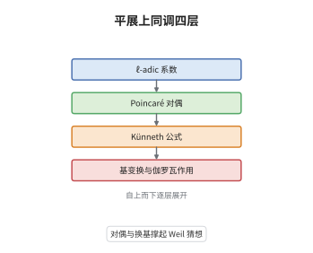

# 平展上同调

> **一句话大白话**：把拓扑里的层上同调搬到概形的平展拓扑上，用 $\ell$-adic 系数记录代数簇的形状，并让 Galois 群作用在上面，于是点数可以写成一串迹的和。
>
> **小例子**：对 $E:y^2=x^3-x$ 与 $p=5$，$H^1_{\text{ét}}(E_{\bar{\mathbb F}_5},\mathbb Q_\ell)$ 是二维的，Frobenius 的两个特征值为 $-1\pm2i$，于是 $\#E(\mathbb F_5)=1-(-2)+5=8$，与逐点计数完全一致。

## 介绍

平展上同调是 Grothendieck 为 Weil 猜想打造的拓扑机器：概形上没有经典的开集拓扑，但有"平展映射"这套 Grothendieck 拓扑，可以在其上定义层与上同调。取 $\ell$-adic 系数后，光滑紧合簇的上同调是有限维向量空间，满足 Poincaré 对偶与 Künneth 公式，并在基变换下稳定。当基域不是可分闭时，绝对 Galois 群作用在这些空间上，Frobenius 的特征值承载了点数信息，Lefschetz 迹公式把点数写成迹的交替和。于是"数点"这个算术问题变成了"算线性变换的迹"这个线性代数问题。

## 几何直观

图意在说明：最底层是 $\ell$-adic 系数与有限性，往上依次加上对偶、乘积公式与换基，最上层得到带 Galois 作用的表示；Weil 猜想要求的特征值大小就活在这一层。

## 分析

**前置依赖**：概形、Galois 表示、层上同调；补充：Grothendieck 拓扑与平展拓扑、Lefschetz 迹公式。

**数学内涵**：
- 定义：$H^i_{\text{ét}}(X,\mathbb Q_\ell)=\left(\varprojlim_n H^i_{\text{ét}}(X,\mathbb Z/\ell^n)\right)\otimes_{\mathbb Z_\ell}\mathbb Q_\ell$。当 $X$ 在可分闭域上有限型时，这是有限维 $\mathbb Q_\ell$-向量空间，且 $i>2\dim X$ 时为 $0$。
- Poincaré 对偶：$X$ 光滑紧合、维数 $d$ 时，杯积给出完美配对 $H^i_{\text{ét}}(X,\mathbb Q_\ell)\times H^{2d-i}_{\text{ét}}(X,\mathbb Q_\ell)\to H^{2d}_{\text{ét}}(X,\mathbb Q_\ell)\cong\mathbb Q_\ell(-d)$。
- Künneth 公式：对光滑紧合簇 $X,Y$ 有 $H^n_{\text{ét}}(X\times Y,\mathbb Q_\ell)\cong\bigoplus_{i+j=n}H^i_{\text{ét}}(X,\mathbb Q_\ell)\otimes H^j_{\text{ét}}(Y,\mathbb Q_\ell)$。
- 基变换：对可分闭域扩张 $k\subset k'$ 有 $H^i_{\text{ét}}(X_{k'},\mathbb Q_\ell)\cong H^i_{\text{ét}}(X,\mathbb Q_\ell)$；对一般基域，$H^i_{\text{ét}}(X_{\bar k},\mathbb Q_\ell)$ 带连续 $G_k$ 作用，构成 Galois 表示。
- 与奇异上同调的差别：$X/\mathbb C$ 有限型时有比较同构 $H^i_{\text{ét}}(X,\mathbb Q_\ell)\cong H^i(X(\mathbb C),\mathbb Q)\otimes\mathbb Q_\ell$，但整 $\ell$-adic 系数会带 torsion，可能与奇异上同调的 $\ell$-adic 完备化不同；正特征没有经典拓扑，对偶与 Künneth 必须靠 proper 与 smooth 假设，去掉就要改用紧支上同调或对偶化复形。
- 常见误区：把 $H^i_{\text{ét}}$ 当成"换个名字的奇异上同调"。比较同构只在复域且有限型时成立；平展上同调还附带 Frobenius 作用与权重，这是拓扑版本没有的信息。

**结构**：
1. 先在曲线上把 $H^1$ 认成 Tate 模的 $\ell$-adic 化，得到有限性与对偶的原型。
2. 用诺特归纳与 Leray 谱序列把曲线情形推到一般维数，得到有限性与消失。
3. 用 trace map 与杯积证明对偶，用投影公式证明 Künneth，再用光滑基变换处理换基。

## 思考过程

Weil 在 1949 年提出猜想时，手里只有有限域上的计数与函数方程的类比，缺少一个能承载"黎曼假设"的上同调。Grothendieck 的突破口是换掉拓扑：既然代数簇上没有足够多的开集，就用平展映射作覆盖，得到一套 Grothendieck 拓扑。障碍很快出现，平展拓扑整体截面太少，普通层论不够用，必须引入下降与上同调下降。另一个障碍是系数：整系数行为恶劣，取逆极限再张成 $\mathbb Q_\ell$ 才能得到有限维空间与完美对偶。关键一步是与经典上同调作比较，把复域上已知的结论当作模型，再在正特征用 Lefschetz 迹公式把点数写成迹。这样 Weil 猜想的三个部分就各自对应到上同调的有限性、对偶与 Frobenius 特征值的绝对值。

## 证明过程

**定理**：设 $k$ 可分闭，$X/k$ 光滑紧合、维数 $d$，$\ell\ne\operatorname{char}k$。则 (i) 每个 $H^i_{\text{ét}}(X,\mathbb Q_\ell)$ 有限维，且 $i\notin[0,2d]$ 时为 $0$；(ii) 存在完美的 Poincaré 对偶配对；(iii) 对光滑紧合 $Y$ 有 Künneth 分解；(iv) 对可分闭扩张 $k\subset k'$ 有自然同构 $H^i_{\text{ét}}(X_{k'},\mathbb Q_\ell)\cong H^i_{\text{ét}}(X,\mathbb Q_\ell)$。

**证明**：

### 1. 曲线情形

设 $X$ 为光滑紧合曲线。此时 $H^0$ 与 $H^2$ 都是一维，$H^1_{\text{ét}}(X,\mathbb Q_\ell)$ 是 Tate 模 $T_\ell(\mathrm{Jac}X)\otimes\mathbb Q_\ell$ 的对偶，而 Tate 模是秩 $2g$ 的自由 $\mathbb Z_\ell$-模，故有限维。对偶由 Tate 模上的 Weil 配对给出：$H^1\times H^1\to H^2\cong\mathbb Q_\ell(-1)$ 非退化。

### 2. 诺特归纳与 Leray 谱序列

对维数归纳：取 $X$ 到低维基的光滑射影纤维化 $f:X\to S$，用 Leray 谱序列 $E_2^{p,q}=H^p_{\text{ét}}(S,R^qf_*\mathbb Q_\ell)\Rightarrow H^{p+q}_{\text{ét}}(X,\mathbb Q_\ell)$。由归纳假设基上的系数有限维，纤维上的上同调由第 1 步有限维，谱序列收敛即得 $H^i_{\text{ét}}(X,\mathbb Q_\ell)$ 有限维；当 $i>2d$ 时 $E_2^{p,q}$ 全为零，故上同调消失。

### 3. 对偶与 Künneth

对偶用 trace map $H^{2d}_{\text{ét}}(X,\mathbb Q_\ell(d))\to\mathbb Q_\ell$ 与杯积构造，先在第 1 步的曲线上验证非退化，再用相对曲线与 Leray 谱序列做归纳。Künneth 则由投影公式与 $X\times Y\to Y$ 的 Leray 谱序列退化得到：$R^qf_*\mathbb Q_\ell$ 在光滑紧合情形局部常值，谱序列在 $E_2$ 处退化，故

$$
H^n_{\text{ét}}(X\times Y,\mathbb Q_\ell)\cong\bigoplus_{i+j=n}H^i_{\text{ét}}(X,\mathbb Q_\ell)\otimes H^j_{\text{ét}}(Y,\mathbb Q_\ell).
$$

### 4. 基变换与结论

光滑基变换定理给出 $g^*R^qf_*\mathbb Q_\ell\cong R^qf'_*\mathbb Q_\ell$，取整体截面即得 $H^i_{\text{ét}}(X_{k'},\mathbb Q_\ell)\cong H^i_{\text{ét}}(X,\mathbb Q_\ell)$。把四条合起来，再与复域奇异上同调作比较，就得到 Lefschetz 迹公式 $\#X(\mathbb F_q)=\sum_i(-1)^i\operatorname{tr}\big(F\mid H^i_{\text{ét}}(X_{\bar{\mathbb F}_q},\mathbb Q_\ell)\big)$。 $\square$

## 课堂问答

**老师**：既然在 $\mathbb C$ 上与奇异上同调同构，为什么还要另造一套理论？

**学生**：因为比较同构只在复域成立。平展上同调对任意基域都有定义，并自带绝对 Galois 群作用；Frobenius 在 $H^i$ 上的特征值给出 Weil 猜想。奇异上同调在正特征既没有定义，也没有 Frobenius 作用。

**老师（追问）**：为什么必须取 $\mathbb Q_\ell$ 系数，直接用 $\mathbb Z/\ell$ 不行吗？

**学生**：$\mathbb Z_\ell$ 上同调可能带 torsion，$\mathbb Z/\ell^n$ 系统也不保证给出有限维的"好"对象；取逆极限再张成 $\mathbb Q_\ell$ 才得到有限维向量空间、完美对偶与 Künneth。代价是丢掉 torsion 信息，那部分要靠平坦上同调等工具另行处理。

**老师（拓展）**：Poincaré 对偶与 Künneth 需要什么假设？去掉会怎样？

**学生**：需要 $X$ 紧合且光滑。紧合保证 $H^{2d}$ 上有 trace，光滑保证对偶层是 $\mathbb Q_\ell(d)$ 的扭转。若只紧合不光滑，就要用对偶化复形；若不紧合，则改用紧支上同调，此时是 $H^i$ 与 $H^{2d-i}_c$ 配对，$H^i$ 本身可以无限维，例如仿射直线的 $H^1$。
