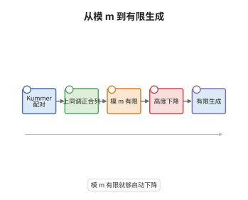

# 弱 Mordell-Weil 定理

> **一句话大白话**：椭圆曲线上的有理点可能无穷多，但只要"除以 $m$ 后只剩有限多种余类"，就能用一套下降程序把它们全部生成出来。
>
> **小例子**：取 $E:y^2=x^3+1$ 与 $m=2$。这条曲线满足 $E(\mathbb Q)\cong\mathbb Z/6$，于是 $E(\mathbb Q)/2E(\mathbb Q)\cong\mathbb Z/2$ 只有两个类；这两个类就是全部种子，高度下降负责从它们生成其余的点。

## 介绍

弱 Mordell-Weil 定理是 Mordell-Weil 定理的有限性一半：设 $E$ 是数域 $K$ 上的椭圆曲线，$m\ge2$，若商群 $E(K)/mE(K)$ 有限，则 $E(K)$ 是有限生成 Abel 群。它把"求全部有理点"这个几何问题先压缩成"数清模 $m$ 的有限多个类"，再用高度机器把有限个类扩张成整个群。真正算术的部分，即证明 $E(K)/mE(K)$ 有限，通常交给 Selmer 群完成，所以本条定理是整条证明链的枢纽：弱定理提供有限性的接口，Selmer 群提供可计算性。

## 几何直观

图意在说明：Kummer 配对先把"点的除法"翻译成 Galois 上同调里的类，正合列说明这些类被 $H^1(K,E[m])$ 接住；假设只保证模 $m$ 的类有限，真正把有限个类膨胀成整群的是后两步的高度下降。

## 分析

**前置依赖**：Galois 上同调、Kummer 配对；补充：Weil 高度、Northcott 有限性定理。

**数学内涵**：
- Kummer 配对定义为 $\langle P,\sigma\rangle=\sigma(Q)-Q$，其中 $Q\in E(\bar K)$ 满足 $mQ=P$；换一个 $Q$ 只差 $E[m]$ 中的元素，而 $E[m]$ 被 $G_K$ 固定，故配对与 $Q$ 的选取无关。
- 由正合列 $0\to E[m]\to E(\bar K)\xrightarrow{m}E(\bar K)\to0$ 得上同调正合列 $0\to E(K)/mE(K)\to H^1(K,E[m])\to H^1(K,E)[m]\to0$，其中连接映射正是 Kummer 配对的对偶描述，特别地 $E(K)/mE(K)\to H^1(K,E[m])$ 是单射。
- 有限性假设等价于说 $E(K)=\Lambda+mE(K)$，$\Lambda$ 由有限个代表元生成；它只给"模 $m$ 的有限性"，不给任何高度界，高度下降必须另行构造。
- 常见误区：以为 $H^1(K,E[m])$ 有限。它通常无限，例如 $H^1(K,\mu_m)=K^*/K^{*m}$ 就无限；能被证明有限的是 Selmer 群这个子群，而不是整个上同调群。

**结构**：
1. 用 Kummer 序列把商群嵌入上同调，确认"模 $m$ 有限"的确切含义。
2. 取代表元 $P_1,\dots,P_r$，对任意点做"减去代表元再除以 $m$"，配合高度不等式得到收缩。
3. 迭代到高度落入固定界内，用 Northcott 定理收尾，得到 $E(K)=\Lambda$ 加一个有限集。

## 思考过程

Mordell 在 1922 年对 $\mathbb Q$ 上的椭圆曲线证明了有限生成，Weil 在 1928 年把论证推广到数域与 Abel 簇。他们遇到的障碍很具体：椭圆曲线上的点构成群，但群运算与"大小"并不协调，$h(P+Q)$ 无法用 $h(P)+h(Q)$ 控制。关键想法是分两步走，先只问"模 $m$ 有多少类"，这是纯上同调问题，答案是有限；再问"有限个类能否生成全部"，这需要一条能反复使用的下降不等式。为了让下降收敛，必须让"除以 $m$"真的把高度压小，这正是 $m\ge2$ 与收缩因子 $2/m^2$ 的作用。后来 Néron 与 Tate 把高度改造成严格的二次型，下降的写法才变得干净，但逻辑骨架仍是这里的上同调加下降。

## 证明过程

**定理**：设 $K$ 为数域，$E/K$ 为椭圆曲线，$m\ge2$ 为整数。若 $E(K)/mE(K)$ 是有限群，则 $E(K)$ 是有限生成 Abel 群。

**证明**：

### 1. Kummer 配对与上同调嵌入

取 $G_K$ 模的正合列 $0\to E[m]\to E(\bar K)\xrightarrow{m}E(\bar K)\to0$，作 Galois 上同调得

$$
0\to E(K)/mE(K)\xrightarrow{\delta}H^1(K,E[m])\to H^1(K,E)[m]\to0 .
$$

对 $P\in E(K)$ 与 $\sigma\in G_K$，取 $Q$ 使 $mQ=P$，则 $m(\sigma Q-Q)=\sigma P-P=0$，故 $\sigma Q-Q\in E[m]$，且这个元素只依赖 $P$ 与 $\sigma$，记作 $\langle P,\sigma\rangle$。于是 $\delta(P)$ 就是同态 $\sigma\mapsto\langle P,\sigma\rangle$，Kummer 配对把商群实现为 $H^1(K,E[m])$ 的子群。

### 2. 代表元与高度下降

由假设，取 $P_1,\dots,P_r\in E(K)$ 使其像生成 $E(K)/mE(K)$，令 $\Lambda=\langle P_1,\dots,P_r\rangle$，则

$$
E(K)=\Lambda+mE(K).
$$

对任意 $P\in E(K)$，取整数 $0\le n_i<m$ 使 $P-R\in mE(K)$，其中 $R=\sum_i n_iP_i\in\Lambda$，再取 $Q\in E(K)$ 使 $mQ=P-R$。Weil 高度满足 $h(A+B)\le2h(A)+2h(B)+O(1)$ 与 $h(mQ)=m^2h(Q)+O(1)$，故存在与 $P$ 无关的常数 $C$ 使

$$
h(Q)\le\frac{2}{m^2}h(P)+C\le\frac12h(P)+C .
$$

这里 $m\ge2$ 保证 $2/m^2\le1/2$，即每一步都真的把高度压小。

### 3. 迭代与 Northcott 收尾

把上一步反复用于 $Q$ 本身，得到一列 $Q_0=P,Q_1,\dots,Q_k$，满足 $P-\sum_{i<k}m^iR_i=m^kQ_k$ 与 $h(Q_k)\le2^{-k}h(P)+2C$。取 $k$ 充分大，使 $h(Q_k)\le B_0$；由 Northcott 定理，高度不超过 $B_0$ 的点只有有限多个，记这个有限集为 $S$。于是每个 $P$ 都落在 $\Lambda+m^kS$ 中，特别地 $E(K)/\Lambda$ 有限。有限生成群模去有限指数子群仍有限生成，而 $\Lambda$ 由 $r$ 个元素生成，故 $E(K)$ 有限生成。 $\square$

## 课堂问答

**老师**：为什么不直接证明 $E(K)$ 有限生成，而要绕道"模 $m$ 有限"？

**学生**：因为 $E(K)$ 本身没有可直接使用的有限性，而模 $m$ 的商群是上同调能触及的对象。$E(K)/mE(K)$ 落在 $H^1(K,E[m])$ 里，可以用有限多个局部条件描述；有了这个有限的种子集合，高度下降才能启动。

**老师（追问）**：下降不等式里为什么必须 $m\ge2$？

**学生**：因为收缩因子是 $2/m^2$。$m\ge2$ 时 $2/m^2\le1/2<1$，高度每迭代一次至少减半，误差项按几何级数求和后仍有界；$m=1$ 时假设 $E(K)/E(K)$ 有限毫无信息，收缩因子也完全失去意义。

**老师（拓展）**：这套论证能推广到什么对象？有没有反例说明"数域"不能去掉？

**学生**：对任意 Abel 簇 $A/K$ 都一样，只要 $A(K)/mA(K)$ 有限就能下降，这是 Weil 的框架，也是 Mordell-Weil 定理对 Abel 簇的证明路线。去掉数域条件就不行，例如取 $K=\mathbb C(t)$ 这样的域，$E(K)/mE(K)$ 可以是无限的，有限性假设失效，结论也随之失效。
