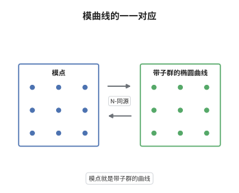

# 椭圆曲线的模曲线

> **一句话大白话**：模曲线是一张目录，每个点记录一条椭圆曲线，外加它上面挑出的一个 $N$ 阶循环子群。
>
> **小例子**：$N=2$ 时 $X_0(2)$ 亏格为 $0$，可用 Legendre 参数写成 $j=2^8\frac{(\lambda^2-\lambda+1)^3}{\lambda^2(\lambda-1)^2}$；$\lambda$、$1-\lambda$、$1/\lambda$ 给出同一条椭圆曲线，正对应"挑哪一个 $2$ 阶子群"。

## 介绍

模曲线 $Y_0(N)$ 是带 level 结构的椭圆曲线模空间：它的复点与"椭圆曲线连同 $N$ 阶循环子群"的同构类一一对应，补上尖点得到紧曲线 $X_0(N)$。这条曲线把模形式、Hecke 算子与椭圆曲线三者缝在一起：$X_0(N)$ 的 Jacobi 簇上的 Hecke 特征形式给出权 $2$ 新形式，而模性定理断言每条 $\mathbb Q$ 上的椭圆曲线都来自某个 $X_0(N)$ 的商。于是"逐素数点数相等"这种算术现象，被翻译成"存在一条定义在 $\mathbb Q$ 上的代数覆盖"这种几何陈述。

## 几何直观

图意在说明：左栏每个模点在上半平面里有可数多个代表，右栏的同构类只有一个；$\Gamma_0(N)$ 的轨道把代表与同构类缝在一起，双向箭头就是"模点对应带子群的椭圆曲线"这一一对应。

## 分析

**前置依赖**：模形式、模空间、椭圆曲线；补充：同余子群、紧化与尖点。

**数学内涵**：
- 解析定义：$Y_0(N)(\mathbb C)=\mathfrak H/\Gamma_0(N)$，其中 $\Gamma_0(N)$ 由 $\mathrm{SL}_2(\mathbb Z)$ 中满足 $c\equiv0\pmod N$ 的矩阵组成；紧化 $X_0(N)=Y_0(N)\cup\{\text{尖点}\}$ 是紧 Riemann 面，尖点对应 $\mathbb P^1(\mathbb Q)/\Gamma_0(N)$。
- 模解释：$Y_0(N)$ 是粗模空间，参数化 $(E,C)$ 的同构类，$C\subset E[N]$ 为 $N$ 阶循环子群；等价地参数化核为 $C$ 的 $N$-同源 $E\to E/C$。
- 亏格公式：$g(X_0(N))=1+\frac{\psi(N)}{12}-\frac{\nu_2}{4}-\frac{\nu_3}{3}-\frac{\nu_\infty}{2}$，其中 $\psi(N)=N\prod_{p\mid N}(1+1/p)$，$\nu_2,\nu_3,\nu_\infty$ 分别是二阶椭圆点、三阶椭圆点与尖点的个数。
- 模性定理（Wiles 与 Taylor 1995；Breuil、Conrad、Diamond、Taylor 2001）：对 $\mathbb Q$ 上每条椭圆曲线 $E$，存在 $N$（可取为导子）与定义在 $\mathbb Q$ 上的满射 $X_0(N)\to E$；等价地存在权 $2$ 新形式 $f$ 使 $L(E,s)=L(f,s)$，且 $a_p(E)=a_p(f)$ 对所有素数 $p$ 成立。本条只作陈述，不证明。
- 常见误区：$Y_0(N)$ 不是"所有椭圆曲线"的模空间；忘掉 level 结构就退回 $Y(1)=\mathbb A^1$，只由 $j$ 参数化。另外覆盖 $X_0(N)\to E$ 不唯一，把 level 乘上素数再复合仍得到新的覆盖。

**结构**：
1. 把 $\tau$ 送到格子 $\Lambda_\tau=\mathbb Z+\tau\mathbb Z$ 与子群 $\langle1/N\rangle$，构造从上半平面到模空间点的映射。
2. 验证 $\Gamma_0(N)$ 作用不改变同构类，并用同构的显式形式证明单射。
3. 用"格子基的选取"证明满射，再补尖点完成紧化。

## 思考过程

Klein 与 Fricke 的时代已经熟知模函数与基本域，但那些只是函数论对象。Hecke 发现 Hecke 算子作用在模形式空间上，特征形式的特征值恰好是 $a_p$，这才让模形式带上算术信息。Shimura 与 Taniyama 提出每条椭圆曲线都应来自模形式，Weil 给出可检验的判别方式，Wiles 在 1995 年证明半稳定情形，其余情形由后续工作补全。障碍在于要把"逐素数点数相等"升级为"存在代数覆盖"，前者是无穷多个等式，后者是一个几何对象。关键想法是看 $X_0(N)$ 的 Jacobi 簇：Hecke 特征形式给出它的 Abel 商，一旦 $L$ 函数匹配，这个商就只能是 $E$。必须用模形式，是因为只有它能把无穷多个 $a_p$ 组织成同一个特征形式。

## 证明过程

**定理**：设 $N\ge1$。映射 $\tau\mapsto\left(\mathbb C/\Lambda_\tau,\langle1/N\rangle\right)$ 诱导双射

$$
\mathfrak H/\Gamma_0(N)\longrightarrow\{(E,C)\}/\cong,
$$

右端是复椭圆曲线连同 $N$ 阶循环子群 $C\subset E[N]$ 的同构类。

**证明**：

### 1. 映射良定义

取 $\gamma$ 为 $\mathrm{SL}_2(\mathbb Z)$ 中满足 $c\equiv0\pmod N$ 的矩阵。乘 $(c\tau+d)$ 给出同构 $\mathbb C/\Lambda_{\gamma\tau}\to\mathbb C/\Lambda_\tau$，它把 $\frac1N$ 送到 $\frac{c\tau+d}{N}$。由 $c\equiv0\pmod N$ 得 $\frac{c\tau}{N}\in\Lambda_\tau$；由 $ad-bc=1$ 得 $\gcd(d,N)=1$，故 $\frac dN$ 与 $\frac1N$ 生成同一个循环子群。于是 $\gamma$ 不改变同构类，映射下降到商。

### 2. 单射

设 $\left(\mathbb C/\Lambda_\tau,\langle1/N\rangle\right)\cong\left(\mathbb C/\Lambda_{\tau'},\langle1/N\rangle\right)$。任何同构 $\mathbb C/\Lambda_\tau\to\mathbb C/\Lambda_{\tau'}$ 都是乘某个 $\alpha=c\tau+d$，且满足 $\alpha\Lambda_\tau=\Lambda_{\tau'}$、$\alpha\tau=a\tau+b$，矩阵属于 $\mathrm{SL}_2(\mathbb Z)$。保子群要求 $\frac{\alpha}{N}\equiv\frac kN\pmod{\Lambda_\tau}$，比较 $\tau$ 的系数得 $c\equiv0\pmod N$。于是 $\tau'=\gamma\tau$ 且 $\gamma\in\Gamma_0(N)$，两个点在同一个轨道里。

### 3. 满射与紧化

给定 $(E,C)$，写 $E=\mathbb C/\Lambda$。子群 $C$ 对应中间格子 $\Lambda\subset\Lambda'\subset\frac1N\Lambda$，且 $\Lambda'/\Lambda$ 循环 $N$ 阶；取 $\Lambda$ 的基 $\omega_1,\omega_2$ 使 $\Lambda'=\langle\frac{\omega_1}{N},\omega_2\rangle$，则 $C=\langle\frac{\omega_1}{N}\rangle$。令 $\tau=\omega_1/\omega_2\in\mathfrak H$，$(E,C)$ 就同构于 $\left(\mathbb C/\Lambda_\tau,\langle1/N\rangle\right)$。最后补上尖点 $\mathbb P^1(\mathbb Q)/\Gamma_0(N)$，得到紧 Riemann 面 $X_0(N)$。 $\square$

## 课堂问答

**老师**：$Y_0(N)$ 与 $Y(1)$ 的差别到底在哪里？

**学生**：$Y(1)$ 只记住椭圆曲线的同构类，$j$ 给出同构 $Y(1)\cong\mathbb A^1$；$Y_0(N)$ 额外记住一个 $N$ 阶循环子群，也就是一条 $N$-同源的核，因此它覆盖 $Y(1)$，覆盖次数等于 $\psi(N)=N\prod_{p\mid N}(1+1/p)$。

**老师（追问）**：为什么同余条件是 $c\equiv0\pmod N$，而不是别的条件？

**学生**：因为同构由乘 $(c\tau+d)$ 给出，要让它把 $\langle1/N\rangle$ 送回自身，需要 $\frac{c\tau}{N}\in\Lambda_\tau$，即 $c\equiv0\pmod N$；同时 $\frac dN$ 必须仍是生成元，故 $\gcd(d,N)=1$，而 $ad-bc=1$ 与 $c\equiv0$ 自动保证这一点。

**老师（拓展）**：模性定理为什么用 $X_0(N)\to E$ 而不是 $X_1(N)$？

**学生**：$X_0(N)$ 的 Jacobi 簇上 Hecke 特征形式对应权 $2$ 新形式，其 $L$ 函数与 $E$ 的一致时，对应的 Abel 商就给出 $E$，于是得到满射 $X_0(N)\to E$；对 $\mathbb Q$ 上的椭圆曲线，最优曲线正是某个 $X_0(N)$ 的商，$N$ 取导子最自然。$X_1(N)$ 也能用，但 level 与导子的匹配以 $\Gamma_0$ 最直接。这里只是陈述，不涉及证明。
