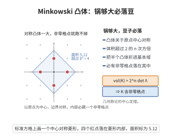

# Minkowski 凸体定理

> **一句话大白话**：一个以原点为中心的中心对称凸体，只要体积超过格子基本体积的 $2^n$ 倍（即 $\operatorname{vol}(K)>2^n\det\Lambda$），里面就必然含有一个非零格点。"锅够大、豆子必落"。
>
> **小例子**：二维 $\mathbb{Z}^2$（$\det\Lambda=1$），中心对称圆只要面积 $>4$（半径 $>\frac2{\sqrt\pi}\approx1.13$），圆心为非原点的整点必落入，如 $(1,0),(0,1)$。

## 一、定理介绍

> **前置依赖**：格与行列式、中心对称凸体、Blichfeldt 定理、凸性与中点论证。

Minkowski 凸体定理是几何数论的中心定理，把"体积足够大的中心对称凸体必含非零格点"这个直觉严格化。它以 Minkowski 命名的几何数论方法，成为代数数论（类数有限、Dirichlet 单位定理）与丢番图逼近的工具。

## 几何直观

图意在说明：中心对称凸体体积一旦超过 2 的 n 次方倍基本域体积，内部就必然藏有非零格点。

## 二、原理思路

从 Blichfeldt 定理出发：令 $S=\frac12 K$，则 $\operatorname{vol}(S)=\frac{\operatorname{vol}(K)}{2^n}>\det\Lambda$，故存在不同 $x',y'\in S$ 使 $x'-y'\in\Lambda$。取 $x=2x',\ y=2y'\in K$。因 $K$ 中心对称且凸，$\frac{x-y}{2}=x'-y'\in K$（作为 $x$ 与 $-y$ 的中点），且非零。故 $K$ 含非零格点 $x'-y'$。

## 三、定理的严格表述

设 $\Lambda\subset\mathbb{R}^n$ 为格，$K\subset\mathbb{R}^n$ 为中心对称凸体（$K=-K$，凸、有界、非空内部）。若
$$\operatorname{vol}(K)>2^n\det(\Lambda),$$
则 $K$ 含非零格点 $x\in\Lambda\setminus\{0\}$。当 $\operatorname{vol}(K)\ge2^n\det(\Lambda)$ 且 $K$ 紧时结论仍成立（边界小心）。

## 四、证明过程

**证明：**

**步骤 1：缩放。** 考虑 $S=\frac12K=\{x\mid 2x\in K\}$，仍为凸体，体积
$$\operatorname{vol}(S)=\frac{1}{2^n}\operatorname{vol}(K)>\det(\Lambda).$$

**步骤 2：应用 Blichfeldt。** 存在不同 $x',y'\in S$ 使 $x'-y'\in\Lambda$。因 $x'\neq y'$，$x'-y'\neq0$。$\blacksquare$

**步骤 3：回到 $K$。** 令 $x=2x',y=2y'\in K$。由 $K$ 对称性 $-y\in K$；由凸性，中点 $\frac{x+(-y)}2=\frac{x-y}2=x'-y'\in K$。$\blacksquare$

**步骤 4：结论。** $x'-y'\in\Lambda\cap(K\setminus\{0\})$，故 $K$ 含非零格点。$\square$

## 五、应用与意义

Minkowski 定理是几何数论的基石，能导出关键代数数论定理：Minkowski 界给出理想类群的有限性（类数有限）与判别式下界；线性型定理给出丢番图逼近存在性；配合对数嵌入给出 Dirichlet 单位定理。在扩展中它还联系 Siegel 均值、最密堆积、编码与格的几何，是研究格点分布与数论结构不可或缺的工具。

## 课堂问答

**老师**：Minkowski 凸体定理的结论与阈值是什么？

**学生**：设 $\Lambda$ 为格、$K$ 为中心对称凸体，若 $\operatorname{vol}(K)>2^n\det\Lambda$，则 $K$ 含非零格点；当 $K$ 紧时 $\operatorname{vol}(K)\ge2^n\det\Lambda$ 也可（边界要小心）。

**老师（追问）**：怎么从 Blichfeldt 定理推出来？

**学生**：令 $S=\frac12K$，则 $\operatorname{vol}(S)=\operatorname{vol}(K)/2^n>\det\Lambda$，Blichfeldt 给出不同 $x',y'\in S$ 使 $x'-y'\in\Lambda$ 且非零。令 $x=2x',y=2y'\in K$，由 $K$ 对称得 $-y\in K$，由凸性得中点 $\frac{x+(-y)}2=x'-y'\in K$，即 $K$ 含非零格点。

**老师（拓展）**：它是怎样支撑代数数论的？

**学生**：用 Minkowski 界可得理想类群有限（类数有限）与判别式下界，配合对数嵌入给出 Dirichlet 单位定理，并直接推出线性型定理。误区是忽略"中心对称"这个前提——一般凸体的阈值并不是 $2^n\det\Lambda$。
