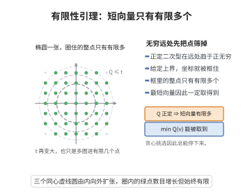

# 有限性引理

> **一句话大白话**：正定二次型在整数点上"越长越大"，所以给定一个上界后，满足条件的整点只有有限多个——这保证了"最短向量"能被取到、贪心挑选能停下来。
>
> **小例子**：$Q(x,y)=x^2+y^2$ 上满足 $Q\le 5$ 的整点只有 $(\pm1,\pm2),(\pm2,\pm1)$ 等有限多个；于是 $\min_{v\ne0}Q(v)=1$ 存在，最短向量有限多。

## 一、定理介绍

> **前置依赖**：二次型与正定性、欧氏范数、$\mathbb{R}^n$ 中"有界闭集紧"（Bolzano–Weierstrass）、格 $\mathbb{Z}^n$ 的离散性、连续函数在紧集上取到最小值

有限性引理是几何数论中最基础的引理之一，它把"正定性"这一连续条件翻译为"格点上只有有限多个短向量"这一离散结论。它是 Minkowski 约化理论、Hermite 定理、Siegel 平均公式中求和收敛性、以及一切"取最短向量"论证的前提。

正定二次型 $Q$ 满足 $Q(x)>0$ 对一切 $x\ne0$。直觉上，$Q$ 在无穷远处趋于 $+\infty$，因此超出任何给定长度上界的向量只能是有限多个坐标组合，从而只有有限多个。

## 几何直观

图意在说明：正定二次型在远处趋于无穷，给定上界就把坐标框住，框内整点有限，最短向量必能取到。

## 二、原理思路

关键想法是把"二次型的大小"与"欧氏长度"比较。正定二次型可以用标准欧氏范数双向控制：存在常数 $c>0$ 使

$$
Q(x)\ge c\,|x|^2\qquad (x\in\mathbb{R}^n).
$$

于是条件 $Q(x)\le C$ 蕴含 $|x|\le\sqrt{C/c}$，即集合被限制在一个有界区域（甚至一个坐标箱）里。而 $\mathbb{Z}^n$ 是离散的，任一有界区域只含有限多个整点（因为每个坐标都落在有限整数区间内）。这样就得到了有限性。再由有限性加上离散性，即可保证最小值被取到。

## 三、定理的严格表述

（有限性引理）设 $Q:\mathbb{R}^n\to\mathbb{R}$ 是正定二次型，即 $Q(x)=\sum_{i,j=1}^n q_{ij}x_ix_j$，矩阵 $(q_{ij})$ 对称正定。则

1. 存在常数 $c>0$ 使 $Q(x)\ge c|x|^2$ 对一切 $x\in\mathbb{R}^n$ 成立；
2. 对任意 $C>0$，集合 $\{x\in\mathbb{Z}^n: Q(x)\le C\}$ 有限；
3. $\displaystyle \lambda_1(Q):=\min_{x\in\mathbb{Z}^n\setminus\{0\}}Q(x)$ 存在（可达），且取到该最小值的向量只有有限多个。

## 四、证明过程

**步骤 1：正定性给出范数下界。** $Q$ 是连续函数，单位球面 $S^{n-1}=\{x: |x|=1\}$ 是紧集，且 $Q>0$ 在其上处处成立。由连续性，$Q$ 在 $S^{n-1}$ 上取到最小值

$$
c:=\min_{|u|=1}Q(u)>0 .
$$

对任意 $x\ne0$，令 $u=x/|x|\in S^{n-1}$，由 $Q$ 的二次齐次性

$$
Q(x)=|x|^2\,Q\!\Big(\frac{x}{|x|}\Big)\ge c\,|x|^2 .
$$

（$x=0$ 时两端为 $0$，结论平凡。）

**步骤 2：有界整点集有限。** 若 $Q(x)\le C$，由步骤 1 得 $|x|^2\le C/c$，故 $|x|\le R:=\sqrt{C/c}$。于是每个坐标满足 $|x_i|\le|x|\le R$，即

$$
x\in\{-\lfloor R\rfloor,\ldots,\lfloor R\rfloor\}^n .
$$

右端是有限集，共有 $\big(2\lfloor R\rfloor+1\big)^n$ 个元素，故 $\{x\in\mathbb{Z}^n: Q(x)\le C\}$ 是有限集。

**步骤 3：最小值可达。** 取任意非零整向量 $v_0$（例如 $e_1$），令 $C_0=Q(v_0)>0$。集合

$$
S_0=\{x\in\mathbb{Z}^n\setminus\{0\}: Q(x)\le C_0\}
$$

非空（含 $v_0$）且由步骤 2 有限。$Q$ 在有限集 $S_0$ 上取到最小值，记

$$
\lambda_1(Q)=\min_{x\in S_0}Q(x).
$$

若存在 $x$ 使 $Q(x)<\lambda_1(Q)$，则 $Q(x)<\lambda_1(Q)\le C_0$，从而 $x\in S_0$，与 $\lambda_1(Q)$ 是 $S_0$ 上最小值矛盾。故 $\lambda_1(Q)$ 就是全体非零整点上的最小值，且取到它的向量含于有限集 $S_0$，故只有有限多个。$\blacksquare$

## 五、应用与意义

**理论意义：**

1. **Minkowski 约化定理**：归纳地确定"第一最短向量"后将其收缩，必须在每一步调用本引理保证最短向量存在且只有有限多种选择，从而使贪心构造有限步终止。

2. **Hermite 定理与 $\gamma_n$**：正定二次型的最小值 $\lambda_1$ 与 $\det Q$ 的比值给出 Hermite 常数，其有限性由本引理保证。

3. **格点求和的收敛性**：Siegel 平均公式、格点计数与 Theta 级数中，$\sum_{v\ne0}f(v)$ 的收敛性依赖于"短向量只有有限个"。

**应用领域：** 二次型与格的约化算法（LLL 等）、编码理论中格的译码、数的几何与二次域类数问题。

**推广：** 把 $\mathbb{Z}^n$ 换成任一离散子群、把 $Q$ 换成一般的"强制（coercive）"函数，结论仍成立：紧下水平集与离散集的交为有限集，这正是所有"最小元存在性"论证的通用模板。

## 课堂问答

**老师**：有限性引理把"正定"这个连续条件翻译成了什么离散结论？

**学生**：正定二次型满足 $Q(x)\ge c|x|^2$（某 $c>0$）；于是对任意 $C>0$，集合 $\{x\in\mathbb{Z}^n:Q(x)\le C\}$ 有限，从而 $\lambda_1(Q)=\min_{x\ne0}Q(x)$ 可达，且取到最小值的向量只有有限多个。

**老师（追问）**：常数 $c$ 从哪里来？为什么有界区域内整点有限？

**学生**：$Q$ 连续，在紧的单位球面 $S^{n-1}$ 上取到最小值 $c=\min_{|u|=1}Q(u)>0$；由二次齐次性 $Q(x)=|x|^2Q(x/|x|)\ge c|x|^2$。故 $Q(x)\le C$ 蕴含 $|x|\le\sqrt{C/c}$，每个坐标 $|x_i|\le\sqrt{C/c}$，被限制在一个有限坐标箱里。

**老师（拓展）**：它保证了谁的合法性？

**学生**：它保证 Minkowski 约化中"最短向量存在"、贪心构造有限步终止，也保证 Siegel 平均公式与 Theta 级数求和的收敛、Hermite 常数的定义有意义。误区是把结论误用到连续集合——$\mathbb{Z}^n$ 的离散性是结论成立的关键，推广到一般离散子群与"强制函数"仍然成立。
