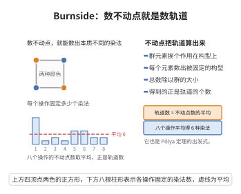

# Burnside 引理

> **一句话大白话**：群作用下的轨道数目，等于"每个群元素的不动点数目"的平均值——用数不动点的方式把轨道数算出来。
>
> **小例子**：用两种颜色给正方形的四个顶点染色，在旋转与翻转群 $D_4$（共 $8$ 个元素）作用下共有 $\frac{1}{8}(16+2+2+4+8+8+4+4)=6$ 种不同的染法（即 6 种本质不同的项链）。

## 一、定理介绍

> **前置依赖**：群作用、轨道与稳定化子、轨道-稳定子定理、双计数（double counting）

Burnside 引理（又称 Cauchy–Frobenius 引理或轨道计数引理）是有限群作用的基本计数工具。它把"数不同的构型"这一几何问题，转化为"数每个对称操作固定了多少构型"这一纯代数求和问题。

历史上该引理常被归于 Burnside（1897 年其著作中给出），但更早已由 Cauchy 与 Frobenius 知晓，故亦称 Cauchy–Frobenius 引理。它是 Pólya 计数定理（带权版本）与组合计数、化学同分异构体计数、编码理论中"不等价对象计数"的直接基础。

## 几何直观

图意在说明：把每个群元素固定的构型数加起来再除以群的大小，就得到轨道的个数。

## 二、原理思路

设有限群 $G$ 作用在有限集 $X$ 上。考虑集合

$$
\Phi=\{(g,x)\in G\times X: gx=x\}.
$$

用两种方式数 $|\Phi|$：按 $g$ 收集得 $\sum_{g}|{\rm Fix}(g)|$；按 $x$ 收集得 $\sum_{x}|{\rm Stab}(x)|$。而同一轨道内各点的稳定化子大小相同，且由轨道-稳定化子定理 $|{\rm Stab}(x)|=|G|/|{\rm Orb}(x)|$，于是对每条轨道 $O$ 求和恰得 $|G|$。两条计数途径相等即得结论。核心就是把"轨道数"通过"每轨道贡献定值 $|G|$"变成不动点之和。

## 三、定理的严格表述

（Burnside 引理）设有限群 $G$ 作用在有限集 $X$ 上，$X/G$ 为轨道集合。对 $g\in G$ 记 ${\rm Fix}(g)=\{x\in X: gx=x\}$。则

$$
|X/G|=\frac{1}{|G|}\sum_{g\in G}|{\rm Fix}(g)| .
$$

## 四、证明过程

**步骤 1：建立双计数。** 令 $\Phi=\{(g,x)\in G\times X: gx=x\}$。按第一坐标分组，

$$
|\Phi|=\sum_{g\in G}|\{x\in X: gx=x\}|=\sum_{g\in G}|{\rm Fix}(g)|.
$$

按第二坐标分组，

$$
|\Phi|=\sum_{x\in X}|\{g\in G: gx=x\}|=\sum_{x\in X}|{\rm Stab}(x)|.
$$

故 $\sum_{g}|{\rm Fix}(g)|=\sum_{x}|{\rm Stab}(x)|$。

**步骤 2：按轨道分组。** 稳定化子是 $x$ 的共轭类不变量：若 $y=hx$，则 ${\rm Stab}(y)=h\,{\rm Stab}(x)\,h^{-1}$，故 $|{\rm Stab}(y)|=|{\rm Stab}(x)|$。因此对同一轨道 $O$ 内的点，稳定化子阶相同，记为 $s_O$。由轨道-稳定化子定理

$$
|O|\cdot|{\rm Stab}(x)|=|G|,\qquad \forall x\in O,
$$

即 $|O|\cdot s_O=|G|$，故 $\sum_{x\in O}|{\rm Stab}(x)|=|O|\cdot s_O=|G|$。

**步骤 3：求和与结论。** 把 $\sum_{x\in X}|{\rm Stab}(x)|$ 按轨道分解：

$$
\sum_{x\in X}|{\rm Stab}(x)|=\sum_{O\in X/G}\;\sum_{x\in O}|{\rm Stab}(x)|=\sum_{O\in X/G}|G|=|G|\cdot|X/G| .
$$

结合步骤 1 得 $\sum_{g\in G}|{\rm Fix}(g)|=|G|\cdot|X/G|$，两边除以 $|G|$ 即得

$$
|X/G|=\frac{1}{|G|}\sum_{g\in G}|{\rm Fix}(g)| .
$$

$\blacksquare$

## 五、应用与意义

**典型应用：**

1. **项链计数**：以两种颜色给 $m$ 个珠子的链环染色，在循环群 $\mathbb{Z}_m$ 作用下，轨道数为 $\frac{1}{m}\sum_{d\mid m}\varphi(d)\,2^{m/d}$。

2. **Pólya 计数**：给每个 $g$ 的不动点数配上颜色权，即得 Pólya 计数定理（母函数形式），可数带权构型。

**应用领域：** 组合计数与图的不等价计数（非同构图、非同构树）、化学中烷烃等分子的同分异构体计数、编码等价类与纠错码计数、晶体学与对称性分类。

**推广：** Burnside 引理是更一般的"轨道计数"的特例：对范畴化的作用，计数可由 Burnside 范畴的上同调给出；在表示论中，它等价于置换特征在平凡表示上的内积计算。

## 课堂问答

**老师**：群作用在有限集 $X$ 上，轨道数怎么算？

**学生**：轨道数等于各群元素不动点数的平均值，$|X/G|=\frac{1}{|G|}\sum_{g}|{\rm Fix}(g)|$。关键是把 $\Phi=\{(g,x)\in G\times X: gx=x\}$ 双重计数：按 $g$ 得 $\sum_g|{\rm Fix}(g)|$，按 $x$ 得 $\sum_x|{\rm Stab}(x)|$；同一轨道内稳定化子共轭同阶，且 $|{\rm Stab}(x)|=|G|/|{\rm Orb}(x)|$，故每条轨道贡献恰为 $|G|$，于是 $\sum_x|{\rm Stab}(x)|=|G|\cdot|X/G|$。

**老师（追问）**：常见误区是以为要按"每个群元素的轨迹"求和，为什么不是？

**学生**：因为作用的是整群 $G$ 而非单个 $g$，单个 $g$ 的轨迹并不是 $X/G$ 的元素。被双计数的是二元关系 $gx=x$，它天然连接"群元素视角"与"点视角"。另一个坑是轨道-稳定化子定理要求 $G$ 有限，否则 $|G|/|{\rm Orb}(x)|$ 的整数性不成立。

**老师（拓展）**：若给不动点配上颜色权重，会变成什么？

**学生**：那就升级为 Pólya 计数定理的带权形式，$m^{{\rm cyc}(g)}$ 换成轮换指标 $\prod_{c}\big(\sum_a w(a)^{|c|}\big)$，可数带权构型。例如两种颜色染正方形四顶点、群为 $D_4$，得 $\frac{1}{8}(16+2+2+4+8+8+4+4)=6$ 种本质不同的染色。
