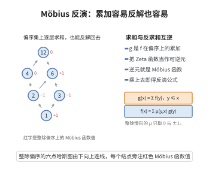

# Möbius 反演公式

> **一句话大白话**：若 $g(x)$ 是 $f$ 在"小于等于"关系上的部分和（$g(x)=\sum_{y\le x}f(y)$），就可通过偏序集的 Möbius 函数 $\mu$ 反解出 $f(x)=\sum_{y\le x}\mu(y,x)g(y)$。"求和-反求和"完美互逆。
>
> **小例子**：数论中 $g(n)=\sum_{d|n}f(d)$ 时，$f(n)=\sum_{d|n}\mu(d)g(n/d)$（囊性 Möbius 反演），$\mu$ 即整除偏序上的 Möbius 函数，取值 $0,\pm1$。

## 一、定理介绍

> **前置依赖**：局部有限偏序集、关联代数与卷积、Zeta 函数与 Möbius 函数的递归定义。

Möbius 反演公式是"包含-排除/累加"的偏序推广：在局部有限偏序集 $(P,\le)$ 上，若 $g(x)=\sum_{y\le x}f(y)$，则 $f(x)=\sum_{y\le x}\mu(y,x)g(y)$，其中 $\mu$ 由递归 $\mu(x,x)=1$、$\sum_{x\le z\le y}\mu(x,z)=0\ (x<y)$ 定义。它与关联代数中 $\mu=\zeta^{-1}$ 等价。

## 几何直观

图意在说明：累加与反解由互为逆元的 Zeta 函数与 Möbius 函数给出，反演只差乘一个 μ。

## 二、原理思路

在关联代数 $I(P)$（函数 $\alpha:\{(x,y):x\le y\}\to\mathbb{C}$，卷积 $(\alpha*\beta)(x,y)=\sum_{x\le z\le y}\alpha(x,z)\beta(z,y)$）中，Zeta 函数 $\zeta(x,y)=1_{x\le y}$，Möbius 函数 $\mu=\zeta^{-1}$。关系 $g=\sum_{y\le x}f(y)$ 即 $g=f*\zeta$，故 $f=g*\mu=f*\zeta*\mu$，展开得到反演公式。

## 三、定理的严格表述

设 $(P,\le)$ 为局部有限偏序集，$\mu$ 为 Möbius 函数。若 $f,g:P\to\mathbb{C}$ 满足 $g(x)=\sum_{y\le x}f(y)$（对所有 $x\in P$），则
$$f(x)=\sum_{y\le x}\mu(y,x)g(y)\qquad(\forall x\in P).$$

## 四、证明过程

**证明（关联代数）：**

**步骤 1：关联代数。** $I(P)=\{\alpha:\{(x,y):x\le y\}\to\mathbb{C}\}$，卷积 $(\alpha*\beta)(x,y)=\sum_{x\le z\le y}\alpha(x,z)\beta(z,y)$，单位元 $\delta(x,y)=\begin{cases}1,&x=y\\0,&x<y\end{cases}$。$\blacksquare$

**步骤 2：关键元素。** 定义 $\zeta(x,y)=\begin{cases}1,&x\le y\\0,&\text{否则}\end{cases}$，Möbius 函数 $\mu=\zeta^{-1}$ 即 $\zeta*\mu=\mu*\zeta=\delta$，展开得递归 $\mu(x,x)=1$，$x<y$ 时 $\sum_{x\le z\le y}\mu(z,y)=0\Rightarrow\mu(x,y)=-\sum_{x<z\le y}\mu(z,y)$。$\blacksquare$

**步骤 3：反演。** 设 $F(x)=\sum_{y\le x}f(y)$，写为 $F=f*\zeta$（即 $F(x)=\sum_{y\le x}f(y)\zeta(y,x)$，将 $f$ 视为对角化函数）。因 $\mu=\zeta^{-1}$，$f=F*\mu$，展开：
$$f(x)=\sum_{y\le x}F(y)\mu(y,x).$$
即 $f(x)=\sum_{y\le x}\mu(y,x)g(y)$。$\square$

**推论（整除偏序）：** 在 $\mathbb{Z}_{>0}$ 的整除偏序上 $\mu(m,n)=(-1)^k$ 若 $n/m$ 为 $k$ 个不同素数的乘积，为 $0$ 若 $n/m$ 含平方因子。这给出经典数论 Möbius 反演。

## 五、应用与意义

Möbius 反演是组合学最通用的计数工具之一，用于容斥、项链计数、划分计数、偏序集的 Möbius 函数计算（几何格、分区格）等。它对任意偏序集统一了容斥原理（子集格情形）与数论反演，是代数组合理（结合关联代数）、数论（算术函数）与现代组合枚举（尤其计算 Möbius 函数，如划分、拟阵）的通用语言与计算框架。

## 课堂问答

**老师**：容斥与数论里的"求和能反求和"，统一版本是什么？

**学生**：在局部有限偏序集 $(P,\le)$ 上，若 $g(x)=\sum_{y\le x}f(y)$，则 $f(x)=\sum_{y\le x}\mu(y,x)\,g(y)$，其中 $\mu$ 由 $\mu(x,x)=1$、$\sum_{x\le z\le y}\mu(x,z)=0\ (x<y)$ 递归定义。本质是关联代数里 $\zeta$ 的逆元：$\mu=\zeta^{-1}$，$g=f*\zeta$ 故 $f=g*\mu$。

**老师（追问）**：关联代数里的"反演"为什么不需要任何拓扑假设？

**学生**：因为局部有限保证每个区间 $[x,y]$ 有限，卷积 $\sum_{x\le z\le y}$ 是有限和，$\mu$ 按区间长度递归唯一确定。常见误区是把反演公式的方向写反：$\mu(y,x)$ 是"从下往上"取的；在整除偏序 $\mathbb{Z}_{>0}$ 上它化为经典数论 Möbius，$\mu(m,n)=(-1)^k$ 当 $n/m$ 是 $k$ 个不同素数之积，否则为 $0$。

**老师（拓展）**：这套语言统一了哪些计数？

**学生**：子集格给容斥原理，整除格给数论 Möbius 反演，划分格与几何格的 Möbius 函数给项链计数与各类组合恒等式，所以它是"包含-排除"的偏序推广与通用计数框架。
