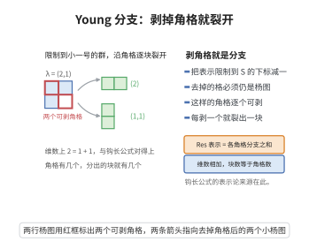

# Young 分支规则

> **一句话大白话**：把一个对称群的不可约表示"限制"到少一个字母的对称群上，它就像剥掉杨图的一个角格那样干净地裂开——沿着每一个可剥的角格各裂出一块，数目不多不少。
>
> **小例子**：取 $\lambda=(2,1)$，其杨图有两个可剥角格。于是限制表示分裂成两块，维数上 $2=1+1$。

$$
\mathrm{Res}^{S_3}_{S_2}S^{(2,1)}\cong S^{(2)}\oplus S^{(1,1)} ,
$$

这正是钩长公式给出 $f^{(2,1)}=2$ 的表示论来源。

## 一、定理介绍

> **前置依赖**：Schur函数的对称性与正交性、Robinson-Schensted对应、Littlewood-Richardson规则、分拆与杨图、标准杨表与半标准杨表、归纳法

**分支规则**（branching rule）是表示论中"限制表示如何分解"这一基本问题的答案。对对称群 $S_n$，当把它的不可约表示（Specht 模）$S^\lambda$ 限制到子群 $S_{n-1}$（固定某个字母，例如 $n$）时，得到的表示完全可约，且其不可约成分由**从杨图 $\lambda$ 去掉一个角格**所得的分拆 $\mu$ 精确标定。这就是 Young 分支规则（又称分支定理 / branching theorem）：

$$
\mathrm{Res}^{S_n}_{S_{n-1}}S^\lambda\ \cong\ \bigoplus_{\mu\nearrow\lambda}S^\mu ,
$$

其中 $\mu\nearrow\lambda$ 表示"$\mu\subseteq\lambda$ 且 $|\lambda/\mu|=1$"，即 $\mu$ 由 $\lambda$ 去掉一个角格（removable box）得到。这一规则由 Alfred Young（1900 年代）在对称群表示论的研究中给出，是对称群表示论"组合化"的典范；它把"表示的限制"这一线性代数问题变成了"在杨图上挪掉一格"这一组合问题。

**维数形式**（Gelfand–Tsetlin 型递推）是分支规则最常用的推论：

$$
f^\lambda=\sum_{\mu\nearrow\lambda}f^\mu,\qquad f^{(1)}=1 ,
$$

其中 $f^\lambda=\dim S^\lambda$ 是形状 $\lambda$ 的标准杨表个数。这个递推与钩长公式给出同一批数，并解释了为什么"标准杨表的删最大项"能给出表示的递推结构。

对一般线性群 $GL_n$ 也有平行的分支规则：把 $GL_n$ 的不可约多项式表示（Schur 函数 $s_\lambda$）限制到 $GL_{n-1}$（即令 $x_n=0$）时，只有满足"$\lambda/\mu$ 是垂直条（每行至多一格）"的 $\mu$ 出现。这条规则（Young 规则 / Pieri 规则的分支形式）与 Littlewood–Richardson 规则共同构成对称函数分支理论的核心。

## 几何直观

图意在说明：把表示限制到少一个字母的对称群，就沿每个可剥角格各裂出一块不可约表示。

## 二、原理思路

**组合层面。** 标准杨表 $\mathrm{SYT}(\lambda)$ 有一个显然的递归结构：把值 $n$ 所在的格子删掉，剩下的仍是标准杨表，形状为 $\lambda\setminus x$，其中 $x$ 必须是角格（右、下皆无格）。反之，任给形状 $\lambda\setminus x$ 的标准杨表，在其角格 $x$ 中填入 $n$，就得到形状 $\lambda$ 的标准杨表。由此得到双射

$$
\mathrm{SYT}(\lambda)\ \longleftrightarrow\ \bigsqcup_{\mu\nearrow\lambda}\mathrm{SYT}(\mu),\qquad T\mapsto T|_{n-1},
$$

其中 $T|_{n-1}$ 表示删去含 $n$ 的格子所得的杨表。取基数即得维数递推

$$
f^\lambda=\sum_{\mu\nearrow\lambda}f^\mu .
$$

**表示论层面。** 分支规则断言上式不只是"维数相等"，而是表示本身的分裂。证明有两条主流路线：

1. **置换模 + Kostka 三角性路线**：置换模 $M^\lambda=\mathbb C[S_n/S_\lambda]$ 分解为 $M^\lambda=\bigoplus_\mu K_{\mu\lambda}S^\mu$，其中 $K_{\mu\lambda}$ 为 Kostka 数。限制到 $S_{n-1}$ 时，$M^\lambda$ 有已知的（"诱导"）分解；比较两侧的分解并利用 Kostka 数的三角性（$K_{\mu\mu}=1$、$K_{\mu\lambda}=0$ 当 $\mu\not\trianglelefteq\lambda$），可逐步"剥离"出 $\bigoplus_{\mu\nearrow\lambda}S^\mu$。

2. **Specht 模 + 内积路线**：直接在 Specht 模上构造嵌入 $S^\mu\hookrightarrow\mathrm{Res}\,S^\lambda$（对每个 $\mu\nearrow\lambda$），再算特征标内积验证这些嵌入之和已经把 $\mathrm{Res}\,S^\lambda$ 铺满。

**对称函数层面（$GL_n$ 情形）**：Schur 函数是对称群特征标与 $GL_n$ 特征标的共同载体。令 $x_n=0$ 得到一个 $n-1$ 元对称函数；把它按 Schur 函数展开，只需用到"$s_\lambda$ 在半标准杨表上的权重和"这一组合定义：令 $x_n=0$ 之后，只有那些"每行至多含一个 $n$"的半标准杨表仍有非零贡献，即 $\lambda/\mu$ 为垂直条。这就给出 $GL_n$ 分支规则。

## 三、定理的严格表述

**（Young 分支规则）** 设 $\lambda$ 是 $n$ 的分拆，$S^\lambda$ 是 $S_n$ 的 Specht 模（不可约 $\mathbb C$-表示）。记

$$
\mu\nearrow\lambda\iff \mu\subseteq\lambda,\ \ |\lambda/\mu|=1\ \ \bigl(\text{即 }\lambda_i-\mu_i=\delta_{i,i_0}\text{ 对某 }i_0\bigr),
$$

等价地说 $\mu$ 由 $\lambda$ 去掉一个角格得到。则作为 $\mathbb C[S_{n-1}]$-模（$S_{n-1}=\{g\in S_n:g(n)=n\}$）有同构

$$
\mathrm{Res}^{S_n}_{S_{n-1}}S^\lambda\ \cong\ \bigoplus_{\mu\nearrow\lambda}S^\mu .
$$

**（维数递推）** 记 $f^\lambda=\dim_\mathbb C S^\lambda=\bigl|\mathrm{SYT}(\lambda)\bigr|$，则

$$
f^\lambda=\sum_{\mu\nearrow\lambda}f^\mu,\qquad f^{(1)}=1,\qquad f^\varnothing=1\ (\text{空分拆}),
$$

且迭代给出：对任意 $1\le k\le n$，

$$
\mathrm{Res}^{S_n}_{S_k}S^\lambda\ \cong\ \bigoplus_{\substack{\mu\subseteq\lambda\\ |\lambda/\mu|=n-k}}c^\lambda_\mu\,S^\mu,\qquad
\sum_{\mu:\,\mu\nearrow\cdots\nearrow\lambda}f^\mu=f^\lambda,
$$

其中求和取遍所有从 $\lambda$ 出发连续去掉 $n-k$ 个角格得到的分拆 $\mu$；多重集 $\{n-k+1,\dots,n\}$ 的删格链与标准杨表的"上段"一一对应（由 Robinson–Schensted 对应的逆对应所给）。

**（诱导形式 / Young 规则的对偶）** 对 $k\le n$，$S^\lambda$ 在 $S_k$ 上的限制也可由"删除大字母角格链"描述；把 $S_{n-1}$ 换成 $S_k$ 时，同样的组合规则成立，只是删格变为删 $n-k$ 个角格。

**（$GL_n$ 分支规则）** 设 $s_\lambda(x_1,\dots,x_n)$ 是 $n$ 元 Schur 函数。则

$$
s_\lambda(x_1,\dots,x_{n-1},0)=\sum_{\substack{\mu\subseteq\lambda\\ \lambda/\mu\ \text{为垂直条}}}s_\mu(x_1,\dots,x_{n-1}),
$$

即只有"每行至多一格"的差 $\lambda/\mu$ 才出现（垂直条条件）。等价地，$GL_n\downarrow GL_{n-1}$ 时 $s_\lambda$ 只分裂出满足垂直条条件的 $s_\mu$。

## 四、证明过程

**步骤 1：标准杨表的删最大项双射。**

设 $T$ 是形状 $\lambda$ 的标准杨表，$n$ 在其某格 $x$ 中。由于 $T$ 严格递增（行、列均递增）且 $n$ 最大，$x$ 的右侧与下方不可能有格子（否则该格的数 $>n$，矛盾），故 $x$ 是角格。删去 $x$ 后，行、列递增性保持，得形状 $\lambda\setminus x$ 的标准杨表 $\mu=\lambda\setminus x$，$|\lambda/\mu|=1$。

反之，给定 $\mu\nearrow\lambda$（$x$ 为 $\lambda$ 的角格、$\lambda\setminus x=\mu$）与 $\mathrm{SYT}(\mu)$ 的一张表 $U$，把 $n$ 填入 $x$：$x$ 是角格，其上方、左方的数都小于 $n$，故仍标准。两个操作互逆，得双射

$$
\mathrm{SYT}(\lambda)\ \cong\ \bigsqcup_{\mu\nearrow\lambda}\mathrm{SYT}(\mu).
$$

**步骤 2：取基数得维数递推。**

由步骤 1 的双射直接取基数，得 $f^\lambda=\sum_{\mu\nearrow\lambda}f^\mu$。初值 $f^{(1)}=1$ 显然（唯一的标准杨表是单格填 $1$）。迭代此式 $n-k$ 次即得限制到 $S_k$ 时的多重数公式。

**步骤 3：表示为直和（置换模路线）。**

设 $\lambda\vdash n$，$S_\lambda=\prod_i S_{\lambda_i}\le S_n$ 为 Young 子群。置换模 $M^\lambda=\mathbb C[S_n/S_\lambda]$（即"从 $S_\lambda$ 诱导到 $S_n$ 的平凡表示"）分解为

$$
M^\lambda=\bigoplus_{\mu\vdash n}K_{\mu\lambda}S^\mu ,
$$

其中 $K_{\mu\lambda}$ 是 Kostka 数（半标准杨表个数），满足三角性：$K_{\mu\mu}=1$；$K_{\mu\lambda}=0$ 当 $\mu\not\trianglelefteq\lambda$（支配序）。

另一方面，由 Mackey 公式（或直接组合观察），限制到 $S_{n-1}$ 时有

$$
\mathrm{Res}^{S_n}_{S_{n-1}}M^\lambda=\bigoplus_{\nu\nearrow\lambda}M^\nu ,
$$

其中 $\nu$ 取遍由 $\lambda$ 去掉一个角格所得的分拆。这是因为 $M^\lambda$ 的基可视为"$\lambda$-填数"，而把字母 $n$ 所在的位置删掉恰给出一个 $\nu\nearrow\lambda$ 的 $\nu$-填数。

把 $M^\lambda=\bigoplus_\mu K_{\mu\lambda}S^\mu$ 限制到 $S_{n-1}$：由归纳假设（对 $n-1$ 的 Young 分支规则）知 $\mathrm{Res}\,S^\mu=\bigoplus_{\mu'\nearrow\mu}S^{\mu'}$。比较两式并按支配序自下而上（"剥离"）逐个确定系数，利用 $K_{\mu\mu}=1$ 与 $K_{\mu\lambda}=0\ (\mu\not\trianglelefteq\lambda)$ 的三角结构，得到

$$
\mathrm{Res}^{S_n}_{S_{n-1}}S^\lambda=\bigoplus_{\mu\nearrow\lambda}S^\mu .
$$

（三角性保证"最高权"$\lambda$-成分的系数为 $1$，从而 $\mathrm{Res}\,S^\lambda$ 中确实出现且仅出现一次各 $\mu\nearrow\lambda$；再由步骤 2 的维数等式确认没有遗漏成分。）

**步骤 4：$GL_n$ 分支规则（对称函数路线）。**

由[Schur函数的对称性与正交性](./Schur函数的对称性与正交性.md)，$s_\lambda(x_1,\dots,x_n)=\sum_T x^{w(T)}$，求和遍历形状 $\lambda$ 的**半标准**杨表 $T$（行弱增、列严格增），$w(T)=(w_1,\dots,w_n)$ 是各字母出现次数。

令 $x_n=0$。则每一项 $x^{w(T)}$ 中若 $w_n>0$ 即被抹去，故只剩 $w_n=0$ 的项，即字母 $n$ 完全不出现的半标准杨表；等价地，所有非零项对应的 $\lambda$ 中"含 $n$ 的格子"必须每行至多一个且构成垂直条，删去这些格子后得 $\mu\subseteq\lambda$ 且 $\lambda/\mu$ 为垂直条，其权重 $x^{w}$ 正是 $n-1$ 元半标准杨表的权重。故

$$
s_\lambda(x_1,\dots,x_{n-1},0)=\sum_{\lambda/\mu\ \text{垂直条}}s_\mu(x_1,\dots,x_{n-1}).
$$

（这一步与 Littlewood–Richardson 规则中的 Pieri 情形 $s_\lambda=\sum_{\lambda/\mu\ \text{垂直条}}s_\mu\cdot e_k$ 相对偶：把 Pieri 规则中的"水平条/垂直条"用在 $x_n=0$ 处，即得分支规则。）$\square$

**步骤 5：与钩长公式的关系。**

步骤 2 的递推 $f^\lambda=\sum_{\mu\nearrow\lambda}f^\mu$ 与初值唯一确定全部 $f^\lambda$；而钩长公式给出的 $n!/\prod_c h_c$ 满足同一条递推（其证明中的 (BRHL) 恒等式正是这条递推的"归一化"形式），故两者给出同一个数。这说明分支规则是钩长公式的表示论骨架。$\square$

## 五、应用与意义

**1. 表示维数的递推计算。** 递推 $f^\lambda=\sum_{\mu\nearrow\lambda}f^\mu$ 给出了除钩长公式之外计算 $f^\lambda$ 的第二条途径，也是"杨图塔"上动态规划的算法基础。

**2. Gelfand–Tsetlin 基与量子化学。** 反复使用分支规则得到的"删格链"给出了 $S^\lambda$ 的一组典范基（Gelfand–Tsetlin / Young 正交基），在角动量耦合、谱分支与量子化学的对称性分析中广泛使用。

**3. 对称函数与 Schubert 演算。** $GL_n$ 分支规则是 Pieri 规则与 Littlewood–Richardson 规则的特例，用于计算 Grassmann 簇、旗流形上的 Schubert 类与表示的重数；在[Littlewood–Richardson 规则](./Littlewood-Richardson规则.md)的计算中反复出现。

**4. 与 RSK 对应的联系。** 删格链与 Robinson–Schensted 对应的逆过程把置换的"最长递减子序列"与杨表形状联系起来；分支规则给出这一对应的表示论解释。

**5. 推广。** 分支规则可推广到：从 $S_n$ 限制到任意 Young 子群（Young 规则）、从 $GL_n$ 限制到 $GL_k\times GL_{n-k}$（Littlewood–Richardson 系数）、从典型群（$O_n,Sp_{2n}$）限制到子群（Littlewood 分支规则），以及仿射与量子情形（仿射 Hecke 代数、量子群的晶体基）。

## 课堂问答

**老师**：把 $S_n$ 的不可约表示限制到 $S_{n-1}$，会怎样分解？

**学生**：完全可约，且 $\mathrm{Res}^{S_n}_{S_{n-1}}S^\lambda\cong\bigoplus_{\mu\nearrow\lambda}S^\mu$，其中 $\mu\nearrow\lambda$ 表示 $\mu\subseteq\lambda$ 且 $|\lambda/\mu|=1$，即从 $\lambda$ 删去一个角格。组合来源是标准杨表的删最大项双射：$n$ 必在角格，删去它得 $\mathrm{SYT}(\mu)$，故 $\mathrm{SYT}(\lambda)\cong\bigsqcup_{\mu\nearrow\lambda}\mathrm{SYT}(\mu)$，取基数得维数递推 $f^\lambda=\sum_{\mu\nearrow\lambda}f^\mu$。

**老师（追问）**：表示层面的"直和"比维数等式多了什么？

**学生**：多了分裂本身。证明走置换模路线：$M^\lambda=\mathbb{C}[S_n/S_\lambda]=\bigoplus_\mu K_{\mu\lambda}S^\mu$，限制到 $S_{n-1}$ 时比较两侧分解并用 Kostka 数的三角性（$K_{\mu\mu}=1$，$\mu\ntrianglelefteq\lambda$ 时为 $0$）逐层剥离，即得 $\bigoplus_{\mu\nearrow\lambda}S^\mu$。误区：只证维数相等不足以断言模同构。

**老师（拓展）**：$GL_n$ 的平行结论是什么？

**学生**：令 $x_n=0$，则 $s_\lambda(x_1,\dots,x_{n-1},0)=\sum s_\mu(x_1,\dots,x_{n-1})$，求和遍及 $\lambda/\mu$ 为垂直条（每行至多一格）的 $\mu$，因为含字母 $n$ 的半标准表格必须每行至多一个。它是 Pieri 规则的特例，与 LR 规则共同支撑对称函数的分支理论。
