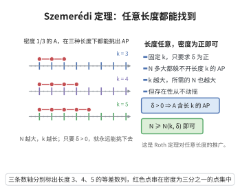

# Szemerédi 定理

> **一句话大白话**：$\{1,\dots,N\}$ 中任何正密度子集（$|A|\ge\delta N$）都藏着任意固定长度 $k$ 的等差数列（$k$ 可任意大，只要 $N$ 足够大）。"密度高，任意长的等差藏不住"。
>
> **小例子**：$k=4$、$\delta=0.1$，任意 10% 密度的子集都必含长度为 4 的等差；若把 $A$ 做完的长列充分稠密则必含任意长等差。

## 一、定理介绍

> **前置依赖**：超图正则性引理、计数引理、密度增量法、Gowers 范数、Furstenberg 多重回归。

Szemerédi 定理（Szemerédi 1975）是无穷级算术级数密度理论的最强核心：任意正密度整数集在任何区间内含任意长的算术级数。Szemerédi 原始证明用正则引理与密度增；后被跟踪为超图、Gowers 范数与遍历（Furstenberg）方法，是加法组合学中"结构 vs 随机"范式的里程碑，获 2012 年 Abel 奖（随 Green-Tao）。

## 几何直观

图意在说明：正密度集合不但含三项等差数列，还含任意指定长度的等差数列。

## 二、原理思路

诸多等价其力学思路：把长度 $k$ 的级数升为超图（$k-1$ 元棱）=超图 Turán 密度型问题；对超图用 Szemerédi 正则引理粗分大部分 $k$-部为正则，由正则计得的级数数下界 $c(\delta)N^2$。若无级数则用密度增（Furstenberg 遍历多重回归，或 Gowers 用 $\|f\|_{U^{k-1}}$ 的量子相位结构）迭代加密度。多种方法统一地得到"大密度⇒必含级数"。

## 三、定理的严格表述

对任意 $k\ge3$ 与 $\delta>0$，存在 $N(k,\delta)$，使对 $N>N(k,\delta)$，集合 $A\subseteq\{1,\dots,N\}$ 若 $|A|\ge\delta N$，则 $A$ 含长度为 $k$ 的算术级数。

## 四、证明过程

**证明思路（多法统览）：**

**步骤 1：化超图。** 把长度向超图：顶点 $\{1,\dots,N\}$，$k-1$ 元超边对应级数。密度为正 ⇒ 超图"稠密"。$\blacksquare$

**步骤 2：超图正则引理。** 对超图划分成 $O(1)$ 部分，使大部分 $k$-部为 $\varepsilon$-正则（密度在正则部相对稳定）。$\blacksquare$

**步骤 3：计数引理。** 在正则划分下，重叠的正则 $k$-部中，$A$ 的级数数至少 $c(\delta)N^2$（由正则性，积-密度约算自顶点）。故必有许多（$\ge c(\delta)N^2$）长度为 $k$ 的级数。$\blacksquare$

**步骤 4：密度增（若未得）。** 若 $A$ 无级数（实际对应正则部计数为 0 矛盾），则存在子结构（子格/子集）使 $A$ 在其中密度更大——即密度增迭代原理（Furstenberg 遍历多重回归、或 Gowers：$\|f\|_{U^{k-1}}\ge c(\delta)$ 时 $f$ 相关于 $(k-2)$ 次相位⇒子 $k$-格密度改）。$\blacksquare$

**步骤 5：终止。** 密度每次至少加 $\varepsilon$（$\varepsilon$ 与 $\delta,k$ 相关），$O(1/\delta)$ 次后必找到级数或密度达 1。因此存在 $N(k,\delta)$。$\square$

**注（方法谱系）：** 组合（正则引理+密度增，Szemerédi 原证）、Gowers 范数（傅里叶-量子）、超图 Turán（Gowers、Nagle-Rödl-Schacht、Tao）、遍历（Furstenberg 多重回归）各臻其成，证明统一在"密度⇒既充分规则又含结构"的框架。

## 五、应用与意义

Szemerédi 定理是整个加性/组合数学的基石：(1) 作为模/含 $k$-级数列的密度定理，其"结构 vs 随机"二分思想贯穿 additive combinatorics；(2) 强推理 Green-Tao 定理（素数中长等差）；(3) 正则引理与计数是我他应用（图非凡、性质检验）的常备；(4) 遍历多重回归链接动力系统与组合；(5) 作为 Ramsey 论与 Nirvanas 高等 additive number theory 的地基。

## 课堂问答

**老师**：Roth 定理能推广到任意长度的等差数列吗？

**学生**：能。Szemerédi 定理：对任意 $k\ge 3$ 与 $\delta>0$，存在 $N(k,\delta)$，当 $N>N(k,\delta)$ 时，$|A|\ge\delta N$ 的 $A\subseteq\{1,\dots,N\}$ 必含长度 $k$ 的等差数列。它是 Roth 定理（$k=3$）的推广，是"结构 vs 随机"范式的里程碑。

**老师（追问）**：主要证明路线有哪些？

**学生**：组合路线把长度升为 $(k-1)$ 元超图，用超图正则引理把大部分 $k$-部正则化，再由计数引理给出级数数下界 $c(\delta)N^2$；若无线数则用密度增迭代（每次抬升一个只依赖 $\delta,k$ 的量），有限步后得级数或密度达 $1$。此外还有 Gowers 范数（$\|f\|_{U^{k-1}}$ 的量子相位）与 Furstenberg 遍历多重回归两条等价路线。误区：以为需要几何进展；其实是纯组合/遍历的定量迭代。

**老师（拓展）**：它的意义与延伸？

**学生**：它是加性组合的基石，强推出 Green–Tao 定理（素数中任意长等差），并把正则引理、计数引理、Gowers 范数与遍历理论统一到"密度 $\Rightarrow$ 既规则又含结构"的框架；Szemerédi 因此随 Green–Tao 获 2012 年 Abel 奖。
