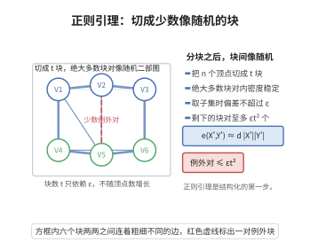

# Szemerédi 正则引理

> **一句话大白话**：任何足够大的图，都能被切成"有界多块"，使得绝大多数块对之间的边像随机图一样均匀——可谓"万图皆近似随机"。
>
> **小例子**：把 $N$ 个顶点的稠密图分成 $k$ 份，其中 $k$ 与 $N$ 无关、只依赖 $\varepsilon$；除至多 $\varepsilon k^2$ 对"坏对"外，其余块对中任意足够大的子块对，其边密度都几乎等于原块对的密度。

## 一、定理介绍

> **前置依赖**：图与二部边密度的定义、顶点划分与细分、容斥与双计数、全方差公式（条件期望的方差分解）、几何级数与迭代上界估计。

Szemerédi 正则引理（Szemerédi regularity lemma）由 Endre Szemerédi 于 1975 年为证明等差数列定理（Szemerédi 定理）而提出，1978 年推广到一般图。它断言：任何图都可被划分为有界多个近似等大的块，使几乎所有块对是 $\varepsilon$-正则的，即块对内部的边分布近似随机。这把"近似随机性"变成一般图的普适结构，是极值图论、组合数论与图性质检验的基石。

## 几何直观

图意在说明：大图可切成只依赖 ε 的少数块，绝大多数块对内部像随机二部图，例外极少。

## 二、原理思路

证明用**能量增量法**。把划分的能量定义为各块对密度的加权平方和（一个 $L^2$ 量），能量取值落在 $[0,1]$ 内。若当前划分不是 $\varepsilon$-正则的，就存在超过 $\varepsilon k^2$ 对"坏对"；对每对坏对取出见证其非正则的"大子集"，用所有见证子集同时细分各块，可证新划分的块数至多增长为 $k\,2^{k-1}$，而能量至少增加一个只依赖 $\varepsilon$ 的正常数 $c(\varepsilon)$。由于能量有上界 $1$，细分至多进行约 $1/c(\varepsilon)$ 次就必须停止，此时得到 $\varepsilon$-正则划分；最后把划分微调为近似等大即得结论。

## 三、定理的严格表述

设 $G=(V,E)$ 是 $n$ 个顶点的图。对不相交顶点集 $X,Y\subseteq V$，定义边密度
$$
d(X,Y)=\frac{e(X,Y)}{|X|\,|Y|},\qquad e(X,Y)=\big|\{(x,y)\in X\times Y:xy\in E\}\big|.
$$
称 $(X,Y)$ 是 $\varepsilon$-正则对（$\varepsilon$-regular pair），若对所有 $A\subseteq X,\ B\subseteq Y$ 且 $|A|\ge\varepsilon|X|,\ |B|\ge\varepsilon|Y|$，都有
$$
|d(A,B)-d(X,Y)|\le\varepsilon.
$$
称顶点划分 $\mathcal P=\{V_1,\dots,V_k\}$ 是 $\varepsilon$-正则划分，若其中非 $\varepsilon$-正则的块对 $(V_i,V_j)$（$i\ne j$）满足
$$
\sum_{(V_i,V_j)\ \text{非}\ \varepsilon\text{-正则}}|V_i|\,|V_j|\le\varepsilon n^2.
$$
称划分是等大的（equitable），若各块大小之差不超过 $1$。

**Szemerédi 正则引理**：对每个 $\varepsilon>0$ 与正整数 $m$，存在整数 $M=M(\varepsilon,m)$，使得任意顶点数 $n\ge m$ 的图 $G$ 都有一个等大的 $\varepsilon$-正则划分，其块数 $k$ 满足
$$
m\le k\le M.
$$

## 四、证明过程

**步骤 1（能量的定义与有界性）。** 对划分 $\mathcal P=\{V_1,\dots,V_k\}$（不必等大）定义其能量
$$
q(\mathcal P)=\sum_{i,j=1}^{k}\frac{|V_i|\,|V_j|}{n^2}\,d(V_i,V_j)^2 .
$$
因 $0\le d(V_i,V_j)\le 1$，而权重 $\frac{|V_i||V_j|}{n^2}$ 之和为 $1$，故
$$
0\le q(\mathcal P)\le 1 .
$$
若 $\mathcal Q$ 是 $\mathcal P$ 的细分，则 $\mathcal P$ 的每对块被 $\mathcal Q$ 的若干子块对取代，下面比较两者的能量。

**步骤 2（能量增量引理）。** 设 $\mathcal P$ 是 $k$ 部划分。若 $\mathcal P$ 不是 $\varepsilon$-正则的，则存在细分 $\mathcal Q$，满足
$$
|\mathcal Q|\le k\,2^{k-1},\qquad q(\mathcal Q)\ge q(\mathcal P)+c(\varepsilon),
$$
其中 $c(\varepsilon)>0$ 只依赖 $\varepsilon$（标准估计中 $c(\varepsilon)\asymp\varepsilon^5$）。

证明要点如下。取相互独立的均匀随机顶点 $X,Y$，令 $Z=\mathbb E[\mathbf 1_{\{XY\in E\}}\mid \mathcal P\text{ 所含块对}]$，则 $q(\mathcal P)=\mathbb E[Z^2]$。由全方差公式（$\mathcal Q$ 细于 $\mathcal P$，故 $\mathbb E[Z\mid\mathcal Q]=\mathbb E[\mathbf 1_{\{XY\in E\}}\mid\mathcal Q]$）
$$
q(\mathcal Q)-q(\mathcal P)=\mathbb E\big[Z^2\big]-\mathbb E\big[\mathbb E[Z\mid\mathcal Q]^2\big]=\mathbb E\big[\mathrm{Var}(Z\mid\mathcal Q)\big]\ge 0 .
$$
对每个非正则对 $(V_i,V_j)$，存在见证集 $A\subseteq V_i,\ B\subseteq V_j$，满足 $|A|\ge\varepsilon|V_i|,\ |B|\ge\varepsilon|V_j|$ 且 $|d(A,B)-d(V_i,V_j)|\ge\varepsilon$。把每个 $V_i$ 中的顶点按符号向量分成至多 $2^{k-1}$ 类：对每个 $j\ne i$，记号记录 $d(v,V_j)-d(V_i,V_j)$ 是否超过 $\varepsilon/2$。由此得到细分 $\mathcal Q$，$|\mathcal Q|\le k\,2^{k-1}$。在此细分下，每对非正则块对内部密度的加权方差至少是 $\varepsilon^2\cdot(\varepsilon/2)^2$ 量级，而非正则块对的总权重超过 $\varepsilon$（近似等大时每对权重约 $1/k^2$，坏对超过 $\varepsilon k^2$ 对），故把这些贡献相加得
$$
q(\mathcal Q)-q(\mathcal P)\ \ge\ \varepsilon\cdot\frac{\varepsilon^4}{4}=c(\varepsilon),
$$
它与 $k,n$ 无关。

**步骤 3（迭代终止）。** 从任意等大的 $m$ 部划分 $\mathcal P_0$ 出发（若 $m>n$ 则取单点划分）。只要当前划分不是 $\varepsilon$-正则的，就用步骤 2 细分一次，能量每次增加至少 $c(\varepsilon)$。因 $q\le1$，细分次数不超过 $\lfloor 1/c(\varepsilon)\rfloor$，故过程在有限步内终止于某个 $\varepsilon$-正则划分 $\mathcal P^*$。其块数由映射
$$
T(k)=k\,2^{k-1}
$$
迭代常数次得到，只依赖 $\varepsilon$ 与 $m$。

**步骤 4（等大化）。** $\mathcal P^*$ 未必等大。对每个块按任意方式切成大小至多相差 $1$ 的小块，总块数至多乘以 $k^*$。为使细分后仍保持正则性，先把引理中的参数取为 $\varepsilon/2$：原来 $\varepsilon/2$-正则的块对在细分为子块后仍为 $\varepsilon$-正则（细分只把密度偏差放大一个可控因子），非正则块对的权重仍受控。于是得到等大的 $\varepsilon$-正则划分，其块数不超过
$$
M(\varepsilon,m)=\underbrace{T(T(\cdots T}_{O(1/c(\varepsilon))}(m)\cdots)),
$$
只依赖 $\varepsilon$ 与 $m$。$\square$

**注。** 上述界 $M$ 是 $\varepsilon$ 的塔式（tower）函数；Gowers（1997）构造的图表明这种塔式增长是本质必需的。因此正则引理是"定性"结构定理，其定量应用常需更精细的替代（如稳定正则引理、Green 的算术正则引理）。

## 五、应用与意义

- **算术级数**：Szemerédi 用它证明正密度整数集含任意长等差数列；Roth 定理（$k=3$）亦有基于它的组合证明。
- **计数与移除引理**：正则引理配合计数引理给出子图计数，导出三角形移除引理等极值结论。
- **性质检验与算法**：Frieze–Kannan 弱正则引理用于大规模图的性质检验与图极限（graphon）理论。
- **代数推广**：Green 的算术正则引理、Gowers 范数、超图正则引理等把同一"结构 vs 随机"范式推广到群与超图。

## 课堂问答

**老师**：任意大的图能"近似随机"到什么程度？

**学生**：Szemerédi 正则引理：对每个 $\varepsilon>0$ 与整数 $m$，存在 $M(\varepsilon,m)$，使任意 $n\ge m$ 的图都有等大的 $\varepsilon$-正则划分，块数 $k$ 满足 $m\le k\le M$。即除至多 $\varepsilon k^2$ 对"坏对"外，几乎所有块对是 $\varepsilon$-正则的：任意足够大的子块对，其边密度几乎等于原块对的密度 $d(X,Y)=e(X,Y)/(|X||Y|)$。

**老师（追问）**：证明的核心机制是什么？

**学生**：能量增量法。定义能量 $q(\mathcal P)=\sum_{i,j}\frac{|V_i||V_j|}{n^2}d(V_i,V_j)^2\in[0,1]$。若划分不正则，则存在超过 $\varepsilon k^2$ 对坏对，取见证子集同时细分各块，得块数 $\le k\,2^{k-1}$、能量至少增加 $c(\varepsilon)$（约 $\varepsilon^5$）。由全方差公式 $q(\mathcal Q)-q(\mathcal P)=\mathbb{E}[\mathrm{Var}(Z\mid\mathcal Q)]\ge 0$，细分只会升能量；能量有上界 $1$，故细分至多约 $1/c(\varepsilon)$ 次即停，最后等大化。

**老师（拓展）**：它为什么是"定性"定理？

**学生**：因为界 $M$ 是 $\varepsilon$ 的塔式函数，Gowers（1997）构造表明这种塔式增长本质必需。因此它给出结构存在性，定量应用常需弱正则或稳定正则替代。应用包括 Szemerédi 定理、三角形移除引理、性质检验与 graphon 理论。

## 相关条目

- [Szemerédi 定理](./Szemerédi定理.md)：正则引理是 Szemerédi 原始证明的核心工具。
- [计数引理](./计数引理.md)：在正则划分下用于估计子图（如三角形）的数目。
- [超图正则性引理](./超图正则性引理.md)：正则引理向 $k$-均匀超图的高阶推广。
