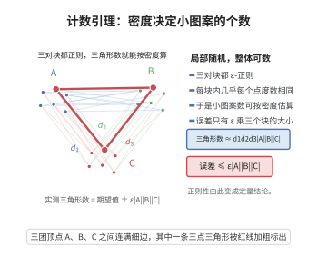

# 计数引理

> **一句话大白话**：若几块顶点之间的边分布"像随机的"，那么跨越它们的三角形（小图案）数目就几乎等于"按密度估算"的期望值——正则性让局部随机保证整体计数可预测。
>
> **小例子**：若 $A,B,C$ 三块之间的边密度都是 $1/2$ 且三对都 $\varepsilon$-正则，则 $A\times B\times C$ 中的三角形数约为 $\frac18|A||B||C|$，误差仅 $O(\varepsilon|A||B||C|)$。

## 一、定理介绍

> **前置依赖**：Szemerédi 正则引理、$\varepsilon$-正则对与密度 $d(X,Y)$、邻域与度、二重计数、容斥与 Markov 型估计

计数引理（counting lemma）是正则性方法的"输出端"：正则引理把大图划分成"像随机"的块，而计数引理说明在这种划分下，任意固定小图案（三角形、$C_4$、固定图 $H$）的出现次数都接近"按各块密度计算出的期望值"。

它是 Szemerédi 定理、三角形移除引理（Ruzsa–Szemerédi、graph removal lemma）、Roth 定理与（超图版）多维 Szemerédi 定理的技术核心。没有计数引理，正则划分只是结构性陈述；有了它，结构才能转化为显式的定量结论。

## 几何直观

图意在说明：三对块都正则时，三角形的个数约等于三个密度的乘积乘以三块大小之积。

## 二、原理思路

以三角形为例。设 $(A,B),(B,C),(C,A)$ 都是 $\varepsilon$-正则对，密度为 $d_{AB},d_{BC},d_{CA}$。称 $a\in A$ 为"好点"，若它在 $B$ 中度数 $\ge(d_{AB}-\varepsilon)|B|$；由正则性，坏点至多占 $\varepsilon$ 份。对 $A,B,C$ 各取好点集 $A_1,B_1,C_1$。

固定 $c\in C_1$，则 $N(c)\cap A$、$N(c)\cap B$ 都足够大；由 $(A,B)$ 的正则性，这两块之间的边数约为 $d_{AB}|N(c)\cap A||N(c)\cap B|$，而这些边连同 $c$ 恰好给出以 $c$ 为一个顶点的三角形。对各 $c$ 求和即得三角形总数的下界；上界同理（把"约等于"换成双侧估计）。误差只来自坏点与被正则性控制的偏差。

## 三、定理的严格表述

设 $G$ 为图，$X,Y$ 是不交顶点集。回忆 $(X,Y)$ 称为 $\varepsilon$-正则的，若对一切 $X'\subseteq X,Y'\subseteq Y$ 且 $|X'|\ge\varepsilon|X|,\ |Y'|\ge\varepsilon|Y|$，均有

$$
\big|e(X',Y')-d(X,Y)|X'||Y'|\big|\le\varepsilon|X'||Y'| ,
$$

其中 $d(X,Y)=e(X,Y)/(|X||Y|)$。

（计数引理，三角形版）设 $A,B,C$ 两两不交，三对 $(A,B),(B,C),(C,A)$ 均 $\varepsilon$-正则，密度为 $d_{AB},d_{BC},d_{CA}$。记 $\mathrm{tri}(A,B,C)$ 为 $A\cup B\cup C$ 中以 $A,B,C$ 各取一点构成的三角形数。则

$$
\Big|\mathrm{tri}(A,B,C)-d_{AB}\,d_{BC}\,d_{CA}\,|A||B||C|\Big|\le 5\varepsilon\,|A||B||C|
$$

（当 $\varepsilon\le\min\{d_{AB},d_{BC},d_{CA}\}$ 时成立）。一般地，对任意固定图 $H$ 与 $\varepsilon$-正则的"多元组"，$H$ 在其中的嵌入数与其密度期望值只相差 $o_{\varepsilon\to0}(1)$ 倍。

## 四、证明过程

记 $n_A=|A|,n_B=|B|,n_C=|C|$，并设 $|A|=|B|=|C|=n$（不同大小可用相同论证，或对每块内部再细分）。设所有 $d_{XY}$ 均 $\ge\varepsilon$。

**步骤 1：挑出好点。** 令

$$
A_1=\big\{a\in A:\ \deg_B(a)\ge(d_{AB}-\varepsilon)n_B\big\},
$$

并类似地定义

$$
B_1=\{b\in B:\ \deg_C(b)\ge(d_{BC}-\varepsilon)n_C\},\qquad
C_1=\{c\in C:\ \deg_A(c)\ge(d_{CA}-\varepsilon)n_A\}.
$$

若 $|A\setminus A_1|>\varepsilon n_A$，则取 $X'=A\setminus A_1$（此时对 $b\in B$ 的度 $<d_{AB}n_B$ 型），由 $(A,B)$ 的正则性有 $e(X',B)<(d_{AB}-\varepsilon)|X'|n_B$ 与 $e(X',B)>d_{AB}|X'|n_B-\varepsilon|X'|n_B$ 矛盾。故

$$
|A\setminus A_1|\le\varepsilon n_A,\qquad |B\setminus B_1|\le\varepsilon n_B,\qquad |C\setminus C_1|\le\varepsilon n_C . \tag{1}
$$

**步骤 2：固定 $c$ 计数。** 固定 $c\in C_1$，令 $A_c=N(c)\cap A$，$B_c=N(c)\cap B$。由 $C_1$ 的定义与 $|A\setminus A_1|\le\varepsilon n_A$（只需 $n_A$ 足够大，否则结论平凡），可设 $|A_c|\ge(d_{CA}-\varepsilon)n_A\ge\tfrac12\varepsilon n_A$，同理 $|B_c|\ge\tfrac12\varepsilon n_B$（若某块更小则三角形总数为 $O(\varepsilon n^3)$，结论平凡）。

对 $(A,B)$ 应用 $\varepsilon$-正则性（用其等价形式：对几乎所有 $a\in A_1$ 有 $|N(a)\cap B|\ge(d_{AB}-\varepsilon)|B|$，对 $b\in B_1$ 同理），可得 $A_c$ 与 $B_c$ 之间的边数满足

$$
e(A_c,B_c)\ge (d_{AB}-\varepsilon)|A_c||B_c|-2\varepsilon n_A n_B . \tag{2}
$$

这些边 $ab$ 连同 $c$ 给出一个三角形 $abc$（$ac,bc,ab$ 皆为边）。

**步骤 3：对 $c$ 求和。** 把 (2) 对 $c\in C_1$ 求和：

$$
\mathrm{tri}(A,B,C)\ge\sum_{c\in C_1}\big[(d_{AB}-\varepsilon)|A_c||B_c|-2\varepsilon n_A n_B\big].
$$

由 $\sum_{c\in C_1}|A_c|=\sum_{a\in A}\deg_{C_1}(a)\ge\sum_{a\in A_1}\deg_{C_1}(a)\ge|A_1|(d_{CA}-\varepsilon)n_C-\varepsilon n_A n_C\ge\ldots$，用 Cauchy–Schwarz 或直接放缩（各 $|A_c|,|B_c|$ 的非负性）可得

$$
\sum_{c\in C_1}|A_c||B_c|\ge (d_{CA}-\varepsilon)(d_{BC}-\varepsilon)\,n_A n_B|C_1|
-O(\varepsilon)\,n_A n_B n_C .
$$

代入并整理（吸收所有 $O(\varepsilon)$ 项），得到下界

$$
\mathrm{tri}(A,B,C)\ge d_{AB}\,d_{BC}\,d_{CA}\,n_A n_B n_C-4\varepsilon\,n_A n_B n_C . \tag{3}
$$

**步骤 4：上界。** 对称地（或对补图用同一论证，注意正则性在两块间对补图仍近似成立），可得

$$
\mathrm{tri}(A,B,C)\le d_{AB}\,d_{BC}\,d_{CA}\,n_A n_B n_C+O(\varepsilon)\,n_A n_B n_C . \tag{4}
$$

合并 (3)(4) 即得

$$
\big|\mathrm{tri}(A,B,C)-d_{AB}d_{BC}d_{CA}|A||B||C|\big|\le 5\varepsilon|A||B||C| .
$$

对一般固定图 $H$（$v$ 个顶点、$e$ 条边），把上述"好点 + 逐层二重计数"扩大到 $v$ 层并对每条边用一次正则性，误差累计为 $O_H(\varepsilon)$ 倍，即得相应的计数引理。$\blacksquare$

## 五、应用与意义

**理论意义：**

1. **Szemerédi 定理**：把 $\{1,\dots,N\}$ 中正密度集 $A$ 编码为三部图，正则划分后由计数引理给出大量 $k$-等差数列。

2. **移除引理（removal lemma）**：若图中的三角形"很少"（$o(n^3)$），则删去 $o(n^2)$ 条边可使图无三角形。这正是计数引理的直接推论。

3. **Roth 定理与 Gowers 范数**：计数引理在超图版下给出高维算术结构的计数下界，是 Gowers 范数理论的定量基础。

**应用领域：** 加性组合（算术级数、sum-product）、极值图论（Turán 型问题的稳定性）、理论计算机科学（property testing、图极限 graph limits）、超图删除定理。

**推广：** 超图计数引理（对 $k$-部正则 $k$-图计数 $K_{k+1}^{(k)}$ 型结构）、带权与相似性版本、以及"近似正则"（而非严格正则）划分下的计数引理。

## 课堂问答

**老师**：正则划分下怎么把小图案的数目数出来？

**学生**：计数引理（三角形版）：若三对 $(A,B),(B,C),(C,A)$ 都 $\varepsilon$-正则、密度为 $d_{AB},d_{BC},d_{CA}$，则 $\big|\mathrm{tri}(A,B,C)-d_{AB}d_{BC}d_{CA}|A||B||C|\big|\le 5\varepsilon|A||B||C|$。思路是各块剔掉 $\varepsilon$ 份"坏点"得 $A_1,B_1,C_1$，固定 $c\in C_1$，由 $(A,B)$ 的正则性估出 $N(c)\cap A$ 与 $N(c)\cap B$ 间边数约 $d_{AB}|A_c||B_c|$，对 $c$ 求和即得。

**老师（追问）**：误差项为什么是 $O(\varepsilon)$ 倍？

**学生**：因为坏点至多占 $\varepsilon$ 份，正则性把每个大子块对的密度偏差控制在 $\varepsilon$，三层误差累计并吸收同类项后就是 $5\varepsilon$ 倍。误区：正则对的定义要求子集分别至少 $\varepsilon|X|,\varepsilon|Y|$，子集太小时正则性不提供信息，须先证明这些情形贡献可忽略。

**老师（拓展）**：它导出哪些结果？

**学生**：直接给出移除引理：图中三角形数为 $o(n^3)$ 则删去 $o(n^2)$ 条边可使其无三角形；配合 Szemerédi 定理用于算术级数计数；对一般固定图 $H$ 有相应的多变量版。它是极值图论、property testing 与超图计数引理的核心。
