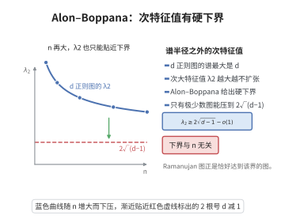

# Alon–Boppana 定理

> **一句话大白话**：$d$-正则图再怎么设计，第二大特征值都不可能小于 $2\sqrt{d-1}$（允许无穷小误差）——这是所有扩张图能谱间隙的理论天花板。

> **小例子**：$d=3$ 时下界为 $2\sqrt2\approx2.828$。随机 3-正则图的第二大特征值确实收敛到 $2\sqrt2$ 附近，说明"最优扩张图"是真实存在的极限对象，而不是空洞的下界。

## 一、定理介绍

> **前置依赖**：图的谱定理、Perron-Frobenius定理、迹方法与闭途径计数、d-正则树上的返回途径计数、图的 girth 与局部树性。

Alon–Boppana 定理源于 Noga Alon 与 Ravi Boppana 对 $d$-正则图谱隙的观察（1986，Boppana 的工作未正式发表，Alon 在文献中记录），其结论是：

> 顶点数趋于无穷的 $d$-正则图族，其第二特征值（按绝对值）满足 $\ge2\sqrt{d-1}-o(1)$。

它的意义在于给出**扩张图的谱下界**：$d$-正则图的平凡最大特征值为 $d$，若希望"除 $\lambda_1$ 外所有特征值都小"，那么小不到 $2\sqrt{d-1}$ 以下。这与上界方向的构造（Lubotzky–Phillips–Sarnak 与 Margulis 的 Ramanujan 图、以及 Friedman 的随机图定理）正好吻合，因此 $2\sqrt{d-1}$ 被称为 **Alon–Boppana 界**，达到它的图称为 **Ramanujan 图**。

证明的思想十分干净：**用闭途径计数把谱与图的局部结构联系起来**。图的 girth 越大，其局部就越像 $d$-正则树；而 $d$-正则树上长度 $2k$ 的返回途径数目渐近为 $(2\sqrt{d-1})^{2k}$。把这一计数与 $\mathrm{tr}A^{2k}=\sum_i\lambda_i^{2k}$ 比较，即得谱下界。这一"迹方法（trace method）"后来成为谱图论与随机图理论的标准工具。

## 几何直观

图意在说明：正则图的次大特征值不可能被压到 2√(d−1) 以下，n 越大只能越贴近这条线。

## 二、原理思路

1. **谱与迹**：$A$ 为邻接矩阵，$\mathrm{tr}A^{2k}=\sum_i\lambda_i^{2k}$ 等于长度为 $2k$ 的闭途径总数。
2. **上界方向**：$\mathrm{tr}A^{2k}\le d^{2k}+(n-1)\lambda^{2k}$，其中 $\lambda=\max_{i\ge2}|\lambda_i|$，于是 $\lambda^{2k}\ge\frac{\mathrm{tr}A^{2k}-d^{2k}}{n-1}$。
3. **下界方向（局部树性）**：若图的 girth 大于 $2k$，则每个顶点处长度为 $2k$ 的闭途径与 $d$-正则树上从根出发的返回途径一一对应，故 $\mathrm{tr}A^{2k}\ge n\,W_k$，其中 $W_k$ 是 $d$-正则树上长度 $2k$ 的返回途径数。
4. **算出 $W_k$ 的增长率**：$W_k$ 的生成函数由 Catalan 型的二次方程给出，其奇点在 $z=\frac{1}{2\sqrt{d-1}}$，故 $W_k^{1/(2k)}\to2\sqrt{d-1}$。
5. **取极限**：固定 $k$ 先让 $n\to\infty$，再令 $k\to\infty$，得到 $\lambda\ge2\sqrt{d-1}-o(1)$。

## 三、定理的严格表述

设 $G$ 是 $d\ge3$ 的正则简单连通图，邻接矩阵 $A$ 的特征值（计重数）为
$$
d=\lambda_1\ \ge\ \lambda_2\ \ge\ \cdots\ \ge\ \lambda_n\ \ge\ -d .
$$
记
$$
\lambda(G)=\max_{2\le i\le n}|\lambda_i|
$$
（除平凡特征值外按绝对值最大的特征值）。

**定理（Alon–Boppana）**：对任意 $\varepsilon>0$ 与任意 $k\ge1$，存在 $n_0=n_0(d,k,\varepsilon)$，使得任何 $n\ge n_0$ 个顶点的 $d$-正则图都满足
$$
\lambda(G)\ \ge\ W_k^{1/(2k)}-\varepsilon ,
$$
其中 $W_k$ 是 $d$-正则树上长度 $2k$ 的返回途径数。令 $k\to\infty$，由于 $W_k^{1/(2k)}\to2\sqrt{d-1}$，得
$$
\lambda(G)\ \ge\ 2\sqrt{d-1}-o(1)\qquad(n\to\infty).
$$

**推论（最优扩张图的下界）**：若 $d$-正则图族满足 $|\lambda_i|\le2\sqrt{d-1}$（$i\ge2$），则该族是渐近最优的；这样的图称为 Ramanujan 图，其存在性由 [Ramanujan图的构造](./Ramanujan图的构造.md) 给出。

**命题（$W_k$ 的生成函数）**：设 $B(z)$ 为 $d$-正则树中"从某顶点出发、始终留在其子树内并返回自身"的途径生成函数，则
$$
B(z)=\frac{1-\sqrt{1-4(d-1)z^2}}{2(d-1)z^2},\qquad \sum_{k\ge0}W_kz^{2k}=\frac{1}{1-d\,z^2B(z)} ,
$$
由此 $W_k^{1/(2k)}\to 2\sqrt{d-1}$，且 $W_k\sim C\,(2\sqrt{d-1})^{2k}\,k^{-3/2}$。

## 四、证明过程

**证明（定理）。**

**步骤 1（迹的谱展开）。** 由 $A$ 的对称性与谱定理，$\mathrm{tr}A^{2k}=\sum_{i=1}^n\lambda_i^{2k}$；另一方面 $\mathrm{tr}A^{2k}$ 等于长度为 $2k$ 的闭途径的条数（$A^{2k}$ 的对角元 $(A^{2k})_{vv}$ 即为从 $v$ 出发回到 $v$ 的途径数）。

**步骤 2（谱上界）。** 由 $\lambda_1=d$ 且 $|\lambda_i|\le\lambda(G)$（$i\ge2$），
$$
\mathrm{tr}A^{2k}=d^{2k}+\sum_{i=2}^n\lambda_i^{2k}\ \le\ d^{2k}+(n-1)\,\lambda(G)^{2k},
$$
故
$$
\lambda(G)^{2k}\ \ge\ \frac{\mathrm{tr}A^{2k}-d^{2k}}{n-1}.
$$

**步骤 3（局部树性下界）。** 设 $G$ 的 girth 大于 $2k$。此时任一顶点 $v$ 的 $k$-邻域中不存在回路，故从 $v$ 出发长度 $2k$ 的闭途径与 $d$-正则树上从根出发的返回途径一一对应，因此每个顶点的返回途径数都是 $W_k$，
$$
\mathrm{tr}A^{2k}=\sum_{v}\#\{\text{从 }v\text{ 出发长 }2k\text{ 的闭途径}\}\ \ge\ n\,W_k .
$$
（若图的 girth 不大于 $2k$，可用 Nilli 的技巧：只在一个半径 $k$ 的球内计数，球内仍具有树性，于是把 $n$ 换成球内顶点数并按比例处理。）

**步骤 4（合并两个方向）。** 由步骤 2、3，
$$
(n-1)\lambda(G)^{2k}\ \ge\ nW_k-d^{2k}\quad\Longrightarrow\quad \lambda(G)\ \ge\ \Bigl(\frac{nW_k-d^{2k}}{n-1}\Bigr)^{1/(2k)} .
$$
固定 $k$，令 $n\to\infty$：右端趋于 $W_k^{1/(2k)}$。故对充分大的 $n$，
$$
\lambda(G)\ \ge\ W_k^{1/(2k)}-\varepsilon .
$$

**步骤 5（计算 $W_k$ 的增长率）。** 在 $d$-正则树中，令 $B(z)$ 为从顶点到其自身、且途径始终留在该顶点的子树内的生成函数（$z$ 记录步数）。一条这样的途径是若干次"出游"的串联，每次出游选定一个孩子（$d-1$ 种选择），走到孩子处作一次子树内的往返，再回到顶点，故
$$
B=\frac{1}{1-(d-1)z^2B}\quad\Longrightarrow\quad (d-1)z^2B^2-B+1=0\quad\Longrightarrow\quad B=\frac{1-\sqrt{1-4(d-1)z^2}}{2(d-1)z^2}.
$$
从根出发的返回途径同样是各次出游的串联，每次出游有 $d$ 种邻居选择，故
$$
\sum_{k\ge0}W_kz^{2k}=\frac{1}{1-d\,z^2B(z)} .
$$
$B$ 的奇点出现在 $4(d-1)z^2=1$，即 $z_c=\frac{1}{2\sqrt{d-1}}$，故 $W_k$ 按 $(2\sqrt{d-1})^{2k}k^{-3/2}$ 增长，从而 $W_k^{1/(2k)}\to2\sqrt{d-1}$。

**步骤 6（取 $k\to\infty$）。** 在步骤 4 中先令 $n\to\infty$（对固定 $k$ 得到 $\lambda\ge W_k^{1/(2k)}-\varepsilon$），再令 $k\to\infty$，得
$$
\lambda(G)\ \ge\ 2\sqrt{d-1}-o(1).\qquad\square
$$

## 五、应用与意义

- **Ramanujan 图的定义与构造基准**：$2\sqrt{d-1}$ 是"最优谱间隙"的临界值，Lubotzky–Phillips–Sarnak、Margulis 用数论方法构造出达到该界的图族，见 [Ramanujan图的构造](./Ramanujan图的构造.md)。
- **随机图谱**：Friedman 证明随机 $d$-正则图的 $\lambda$ 几乎必然收敛到 $2\sqrt{d-1}$，说明 Alon–Boppana 界是紧的。
- **扩张与混合**：与 [Cheeger不等式](./Cheeger不等式.md) 联立，把特征值下界翻译为等周常数与随机游走混合时间的上界，是构造扩张图、纠错码与伪随机生成器的核心工具。
- **综述与推广**：本定理是"迹方法"的经典范例，同一技术用于估计群 Cayley 图的谱、随机正则图的谱分布（Kesten–McKay 律）与高维单纯复形的高阶谱。

## 课堂问答

**老师**：$d$-正则图的第二大特征值为什么压不到 $2\sqrt{d-1}$ 以下？

**学生**：因为 $2\sqrt{d-1}$ 是 $d$-正则树上长 $2k$ 返回途径数 $W_k$ 的增长率：$W_k^{1/(2k)}\to2\sqrt{d-1}$。用迹方法：$\operatorname{tr}A^{2k}=\sum_i\lambda_i^{2k}\le d^{2k}+(n-1)\lambda(G)^{2k}$；若图局部像树（girth $>2k$），则 $\operatorname{tr}A^{2k}\ge nW_k$。两式合并、固定 $k$ 让 $n\to\infty$ 给出 $\lambda(G)\ge W_k^{1/(2k)}-\varepsilon$，再令 $k\to\infty$ 即得 $\lambda(G)\ge2\sqrt{d-1}-o(1)$。

**老师（追问）**：$W_k$ 的增长率是怎么算出来的？

**学生**：用生成函数。设 $B(z)$ 记"从顶点出发、始终留在其子树内并返回"的途径生成函数，一条这样的途径是若干次出游的串联，每次出游有 $d-1$ 种孩子选择，于是 $B=\frac{1}{1-(d-1)z^2B}$，解得 $B=\frac{1-\sqrt{1-4(d-1)z^2}}{2(d-1)z^2}$。从根出发的返回途径每次有 $d$ 种选择，故 $\sum_kW_kz^{2k}=\frac{1}{1-dz^2B(z)}$。$B$ 的奇点在 $z_c=\frac{1}{2\sqrt{d-1}}$，所以 $W_k\sim C(2\sqrt{d-1})^{2k}k^{-3/2}$，开 $2k$ 次方即得极限。

**老师（拓展）**：这个下界紧吗？谁达到它？

**学生**：紧。Friedman 证明随机 $d$-正则图的 $\lambda$ 几乎必然收敛到 $2\sqrt{d-1}$，说明 Alon–Boppana 界不能改进；达到它的图族是 Ramanujan 图，由 Lubotzky–Phillips–Sarnak 与 Margulis 用数论方法显式构造。与 Cheeger 不等式联立，还能把特征值下界翻译成随机游走混合时间的上界。

## 相关条目

- [图的谱定理](./图的谱定理.md)：邻接矩阵谱与闭途径计数的理论背景。
- [Ramanujan图的构造](./Ramanujan图的构造.md)：达到 Alon–Boppana 界的图族构造。
- [Cheeger不等式](./Cheeger不等式.md)：特征值下界与等周常数、混合时间的关系。
- [Perron-Frobenius定理](./Perron-Frobenius定理.md)：最大特征值 $d$ 的唯一性与正特征向量。
- [强正则图的谱分类](./强正则图的谱分类.md)：$d$-正则图中特征值取值受强正则性限制的对照。
