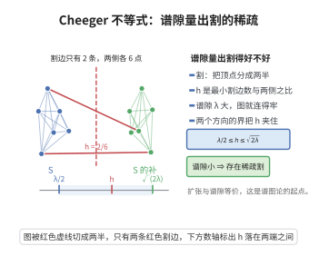

# Cheeger不等式

> **一句话大白话**：图的"代数连通度"（Laplacian 第二小特征值 $\mu_2$）和"组合连通度"（最小切割等周常数 $h(G)$）相互夹逼：$\frac{\mu_2}{2}\le h(G)\le\sqrt{2d\mu_2}$。特征值大 $\Leftrightarrow$ 网络难被切断。
>
> **小例子**：环图 $C_n$ 的等周常数约 $2/n$，其 $\mu_2\approx(2\pi/n)^2$，两者满足 $\mu_2/2\le 2/n\le\sqrt{2d\mu_2}$，直观体现了"谱越大，图越结实"。

## 一、定理介绍

> **前置依赖**：Laplacian 矩阵、Courant–Fischer 定理、Rayleigh 商、Cauchy–Schwarz 不等式、Fiedler 向量。

Cheeger 不等式是谱图理论与组合图论之间的桥梁。它把 Laplacian 的第二小特征值 $\mu_2$（代数量）与图的等周常数 $h(G)$（组合量，描述"至少切多少比例的边才能分离一部分顶点"）双向夹逼，因而既提供了计算 $h(G)$ 的有效途径，也给出了 $\mu_2$ 的组合意义。

## 几何直观

图意在说明：最小割与谱隙互相控制，λ/2 与 √(2λ) 从两侧把传导率 h 夹住。

## 二、原理思路

下界方向运用 Rayleigh 商：取达到 $h(G)$ 的最佳子集 $S$，构造一个垂直于 $\mathbf{1}$ 的"跳变"向量 $\mathbf{x}$（$S$ 上取常数、$\bar S$ 上取另一常数），其 Rayleigh 商量化了 $|E(S,\bar S)|$，从而 $\mu_2\le$ 该商 $\le 2dh(G)$。上界方向用 $\mu_2$ 的 Fiedler 特征向量做阈值切割：排序其分量、逐个阈值切成 $S_t$，再经由稠密求和与 Cauchy–Schwarz 不等式证明平均切割比被 $\sqrt{2\mu_2/d}$ 控制，故存在一个达到 $h(G)\le\sqrt{2d\mu_2}$ 的切割。

## 三、定理的严格表述

设 $G$ 是 $d$-正则连通图，$L=D-A$ 是 Laplacian 矩阵，$0=\mu_1<\mu_2\le\cdots\le\mu_n$ 是其特征值。$G$ 的 Cheeger（等周）常数为
$$
h(G)=\min_{\substack{S\subseteq V\\0<|S|\le n/2}}\frac{|E(S,\bar S)|}{d|S|}.
$$
则
$$
\frac{\mu_2}{2}\le h(G)\le\sqrt{2d\mu_2}.
$$

## 四、证明过程

**证（下界 $\frac{\mu_2}{2}\le h(G)$）：**

1. **Courant–Fischer。** $\mu_2=\min_{\mathbf{x}\perp\mathbf{1},\mathbf{x}\ne0}\frac{\mathbf{x}^TL\mathbf{x}}{\|\mathbf{x}\|^2}$。

2. **Rayleigh 商展开。** 对任意 $\mathbf{x}$，$\mathbf{x}^TL\mathbf{x}=\sum_{\{i,j\}\in E}(x_i-x_j)^2$。

3. **测试向量。** 设 $S$ 达到 $h(G)$。令 $x_i=1/|S|(i\in S)$、$x_i=-1/|\bar S|(i\notin S)$，则 $\sum_ix_i=0$。

4. **估计。** $\mathbf{x}^TL\mathbf{x}=|E(S,\bar S)|\frac{n^2}{|S|^2|\bar S|^2}$，$\|\mathbf{x}\|^2=\frac{n}{|S||\bar S|}$，故
   $$
   \mu_2\le\frac{|E(S,\bar S)|\,n}{|S||\bar S|}\le\frac{2|E(S,\bar S)|}{|S|}=2d\,h(G),
   $$
   得 $\frac{\mu_2}{2d}\le h(G)$；用归一化 Laplacian 的 $\tilde\mu_2$（满足 $\mu_2=d\tilde\mu_2$）即得 $\frac{\mu_2}{2}\le h(G)$。

**证（上界 $h(G)\le\sqrt{2d\mu_2}$）：**

5. **阈值切割。** 设 $\mathbf{f}$ 为 $\mu_2$ 的特征向量，排序分量 $f_1\le\cdots\le f_n$，令 $S_t=\{i:f_i\le t\}$。

6. **积分估计。** 对 $t$ 求和切割比并与 $\mathbf{f}$ 的 Rayleigh 商比较，得到
   $$
   \sum_{t}\frac{|E(S_t,\bar S_t)|}{d|S_t|}\le\sqrt{\frac{2\mu_2}{d}},
   $$
   其中用到 Cauchy–Schwarz 不等式与 $\sum$ 的稠密遍历。

7. **取最优阈值。** 存在某 $t$ 使 $\frac{|E(S_t,\bar S_t)|}{d|S_t|}\le\sqrt{2\mu_2/d}$，故 $h(G)\le\sqrt{2d\mu_2}$。$\square$

## 五、应用与意义

Cheeger 不等式使 $\mu_2$ 与 $h(G)$ 可以高效互相逼近，是展开图理论的核心工具，应用于网络设计与容错性分析、随机游走混合时间的估计、谱聚类（用 $\mu_2$ 的特征向量做图分割）、以及图谱正则化方法。它也是高阶 Cheeger 不等式（聚簇分解）与图信号处理的出发点。

## 课堂问答

**老师**：$\mu_2$ 是代数量、$h(G)$ 是组合量，凭什么能互相夹逼？两个方向分别怎么走？

**学生**：结论是 $\frac{\mu_2}{2}\le h(G)\le\sqrt{2d\mu_2}$。下界走 Rayleigh 商：取达到 $h(G)$ 的集合 $S$，造 $\mathbf{x}$ 在 $S$ 上取 $1/|S|$、在 $\bar S$ 上取 $-1/|\bar S|$，则 $\sum_ix_i=0$，故 $\mu_2\le\frac{\mathbf{x}^TL\mathbf{x}}{\|\mathbf{x}\|^2}=\frac{|E(S,\bar S)|\,n}{|S||\bar S|}\le2dh(G)$。上界走 Fiedler 向量的阈值切割：排序分量 $f_1\le\cdots\le f_n$，令 $S_t=\{i:f_i\le t\}$，平均切割比被 $\sqrt{2\mu_2/d}$ 控制，故存在某 $t$ 使 $h(G)\le\sqrt{2d\mu_2}$。

**老师（追问）**：$\mu_2$ 的定义里为什么非加"正交于 $\mathbf{1}$"这个约束不可？

**学生**：因为 Laplacian $L=D-A$ 的最小特征值恒为 $0$，对应特征向量就是 $\mathbf{1}$，它不携带任何切割信息。$\mu_2=\min_{\mathbf{x}\perp\mathbf{1}}\frac{\mathbf{x}^TL\mathbf{x}}{\|\mathbf{x}\|^2}$ 由 Courant–Fischer 给出；去掉约束就永远只能得到 $0$。这是初学时最容易漏掉的细节。

**老师（拓展）**：上下界一头是 $\mu_2/2$、一头是 $\sqrt{2d\mu_2}$，差着 $O(\sqrt{\mu_2})$，这说明什么？

**学生**：量级一致但常数不同，因此 $\mu_2$ 与 $h(G)$ 可高效互相逼近。它是展开图理论的核心工具：网络容错分析、随机游走混合时间估计、谱聚类（用 Fiedler 向量做分割）都依赖它，也是高阶 Cheeger 不等式与聚簇分解的出发点。
