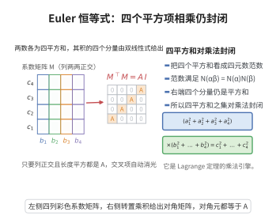

# Euler 四平方和恒等式

> **一句话大白话**：两个"四个平方之和"相乘，结果仍是"四个平方之和"，而且新的四个平方项可以由原来的 $a_i,b_j$ 用固定的加减乘组合显式写出来。

> **小例子**：取 $a=(1,1,0,0)$、$b=(1,1,0,0)$，则两边都是 $(1^2+1^2)(1^2+1^2)=4$，恒等式右端给出 $0^2+2^2+0^2+0^2=4$，完全吻合；这正说明 $Q=\{a_1^2+a_2^2+a_3^2+a_4^2\}$ 对乘法封闭。

## 一、定理介绍

> **前置依赖**：含幺交换环、分配律

Euler 四平方和恒等式断言：两个各自能写成四个整数平方之和的整数，其乘积也能写成四个整数平方之和。若把"四平方和"之集记为 $Q=\{a_1^2+a_2^2+a_3^2+a_4^2: a_1,\dots,a_4\in\mathbb Z\}$，恒等式说的正是 $Q\cdot Q\subseteq Q$。它由 Euler 在 1748 年前后发现，是 Lagrange 四平方和定理的关键乘法工具：正因为有这条封闭性，证明才能先只处理素数、再用算术基本定理把一般整数"拼"起来。

在代数上，右端四个组合项恰是**四元数** $\alpha=a_1+a_2 i+a_3 j+a_4 k$ 与 $\beta=b_1+b_2 i+b_3 j+b_4 k$ 之积 $\alpha\beta$ 的四个分量，于是恒等式等价于四元数范数的可乘性 $N(\alpha\beta)=N(\alpha)N(\beta)$。由于右端每一项对 $\{a_i\}$ 与 $\{b_j\}$ 都是双线性的，恒等式实际是含幺交换环中的形式恒等式，与具体数域无关；下面给出一个只依赖交换律、结合律与分配律的纯代数验证。

## 几何直观

图意在说明：恒等式成立的关键是系数矩阵列两两正交且长度平方相同，交叉项因此全部抵消。

## 二、原理思路

把左边看成 $\big(\sum_i a_i^2\big)\big(\sum_j b_j^2\big)$，右边看成 $\sum_{k=1}^4 c_k^2$，其中每个 $c_k$ 都是 $a_i,b_j$ 的双线性型。于是两边展开后都是 $\{a_ib_j\}$ 的二次型。

难点只在右端：$c_k^2$ 展开后会产生大量交叉项 $b_jb_l$（$j\ne l$），它们必须全部抵消。把 $c_k$ 中 $b_j$ 的系数排成一个 $4\times4$ 矩阵 $M=(M_{kj})$，则

$$
C=\sum_{k=1}^4c_k^2=\sum_{k=1}^4\Bigl(\sum_{j=1}^4 M_{kj}b_j\Bigr)^2=b^{\top}M^{\top}M\,b .
$$

于是只要证明 $M^{\top}M=A\,I_4$（$A=a_1^2+a_2^2+a_3^2+a_4^2$，$I_4$ 为单位阵），即 $M$ 的各列两两正交且每列长度的平方都是 $A$，就立刻得到

$$
C=A\,(b_1^2+b_2^2+b_3^2+b_4^2)=A\,B .
$$

这正是"交叉项全消、平方项各自配对"的定量表达。

## 三、定理的严格表述

（Euler 四平方和恒等式）对任意 $a_1,a_2,a_3,a_4,b_1,b_2,b_3,b_4$，令

$$
\begin{aligned}
c_1&=a_1b_1-a_2b_2-a_3b_3-a_4b_4,\\
c_2&=a_1b_2+a_2b_1+a_3b_4-a_4b_3,\\
c_3&=a_1b_3-a_2b_4+a_3b_1+a_4b_2,\\
c_4&=a_1b_4+a_2b_3-a_3b_2+a_4b_1 .
\end{aligned}
$$

则

$$
(a_1^2+a_2^2+a_3^2+a_4^2)(b_1^2+b_2^2+b_3^2+b_4^2)=c_1^2+c_2^2+c_3^2+c_4^2 .
$$

特别地，若 $n=a_1^2+\cdots+a_4^2$、$m=b_1^2+\cdots+b_4^2$，则 $nm=c_1^2+\cdots+c_4^2$ 也是四平方和。

## 四、证明过程

**证明。** 记 $A=a_1^2+a_2^2+a_3^2+a_4^2$，$B=b_1^2+b_2^2+b_3^2+b_4^2$，$C=c_1^2+c_2^2+c_3^2+c_4^2$。取系数矩阵

$$
M=\begin{pmatrix}
a_1&-a_2&-a_3&-a_4\\
a_2&a_1&-a_4&a_3\\
a_3&a_4&a_1&-a_2\\
a_4&-a_3&a_2&a_1
\end{pmatrix},
$$

其第 $k$ 行正是 $c_k$ 中 $b_1,b_2,b_3,b_4$ 的系数，故 $C=b^{\top}M^{\top}M\,b$。

**步骤 1（列的正交性）。** 逐列计算 $M$ 的各列内积。第 $1$ 列为 $(a_1,a_2,a_3,a_4)^{\top}$，第 $j$ 列（$j=2,3,4$）分别为
$$
(-a_2,a_1,a_4,-a_3)^{\top},\quad (-a_3,-a_4,a_1,a_2)^{\top},\quad (-a_4,a_3,-a_2,a_1)^{\top}.
$$
任意两列的内积均为 $0$，例如第 $1$、$2$ 列给出 $-a_1a_2+a_2a_1+a_3a_4-a_4a_3=0$；其余五个内积同理（每个都是形如 $\pm a_ia_j\mp a_ja_i$ 的成对抵消）。故 $M$ 的各列两两正交。

**步骤 2（各列长度）。** 第 $j$ 列各分量的平方和恰为 $a_1^2+a_2^2+a_3^2+a_4^2=A$，对 $j=1,2,3,4$ 逐一直接可见。结合步骤 1 得

$$
M^{\top}M=A\,I_4 .
$$

**步骤 3（代入求值）。** 于是

$$
C=b^{\top}M^{\top}M\,b=b^{\top}(A\,I_4)\,b=A\sum_{j=1}^4 b_j^2=A\,B .
$$

即 $c_1^2+c_2^2+c_3^2+c_4^2=(a_1^2+\cdots+a_4^2)(b_1^2+\cdots+b_4^2)$，恒等式得证。$\square$

**注。** 步骤 1、2 中只用到交换律、结合律与分配律，故恒等式对任意含幺交换环成立；在 $\mathbb Z$ 上取整系数时，$c_1,\dots,c_4$ 均为整数，这正是后续 Lagrange 定理"乘法封闭"所需的整性。

## 五、应用与意义

- **Lagrange 四平方和定理的引擎**：恒等式把"任意整数都是四平方和"化归为"素数都是四平方和"，是整个证明中最关键的一步（见同目录 Lagrange 四平方和定理）。
- **四元数代数的接口**：恒等式正是四元数范数可乘性 $N(\alpha\beta)=N(\alpha)N(\beta)$ 的分量展开，是四元数进入数论最早的通道；同样的构造在八元数（Degen 八平方恒等式）中推广，并因 Frobenius 定理在四元数处"停下"。
- **Ramanujan 图**：Lubotzky–Phillips–Sarnak 用 $a_0^2+a_1^2+a_2^2+a_3^2=p$ 的解作四元数代数生成元来构造最优扩张图族，四平方解集的计数直接决定 Cayley 图的度。

## 课堂问答

**老师**：两个四平方和相乘还是四平方和，这在代数上到底对应什么？

**学生**：对应四元数范数的可乘性。令 $\alpha=a_1+a_2i+a_3j+a_4k$、$\beta=b_1+b_2i+b_3j+b_4k$，则 $\alpha\beta$ 的四个分量恰好是恒等式右端的 $c_1,c_2,c_3,c_4$，于是恒等式等价于 $N(\alpha\beta)=N(\alpha)N(\beta)$，即"四平方和之集"$Q=\{a_1^2+\cdots+a_4^2\}$ 满足 $Q\cdot Q\subseteq Q$。

**老师（追问）**：右端展开会冒出大量交叉项 $b_jb_l$（$j\ne l$），它们凭什么全部抵消？

**学生**：把 $c_k$ 里 $b_j$ 的系数排成系数阵 $M$，则右端 $C=b^TM^TMb$。逐列算内积可见 $M$ 各列两两正交、每列长度平方都是 $A=a_1^2+\cdots+a_4^2$，即 $M^TM=AI_4$，于是 $C=Ab^Tb=A(b_1^2+\cdots+b_4^2)$。交叉项全消正是"列两两正交"这句话的定量表达。常被忽略的是：整个验证只用交换律、结合律、分配律，因此恒等式对任意含幺交换环都成立，与具体数域无关。

**老师（拓展）**：这条恒等式为什么是 Lagrange 定理证明的"引擎"？

**学生**：因为它让"四平方和"之集对乘法封闭，于是"所有整数是四平方和"只需对素数验证，再用算术基本定理把一般整数拼起来。同一构造推广到八元数给出 Degen 八平方恒等式，但受 Frobenius 定理限制，可作为范数相乘的文明在四元数处就"停下"。

## 相关条目

- [Lagrange四平方和定理](./Lagrange四平方和定理.md)：以本恒等式为乘法工具证明每个自然数都是四平方和。
- [含幺交换环](../../公理体系/11-域公理/含幺交换环.md)：恒等式成立所需的代数结构。
- [分配律](../../公理体系/10-环公理/分配律.md)：展开与合并同类项所依赖的基本定律。
