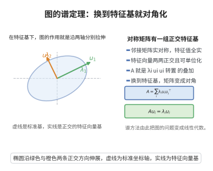

# 图的谱定理

> **一句话大白话**：无向图的邻接矩阵是对称的，所以它能"转正"——存在一组标准正交的特征向量，把矩阵对角化成特征值排成的表 $\Lambda$。图的许多性质就藏在这张表里。
>
> **小例子**：完全图 $K_n$ 邻接矩阵 $A=J-I$ 可对角化为 $\{n-1,-1^{(n-1)}\}$：全 1 向量是特征向量对应特征值 $n-1$，与 $\mathbf{1}$ 正交的空间整块压成 $-1$。

## 一、定理介绍

> **前置依赖**：邻接矩阵的对称性、谱定理、正交矩阵与正交对角化、数学归纳法原理。

图的谱定理是代数图论的基石，它表明无向简单图的邻接矩阵作为实对称矩阵，一定可正交对角化。这使我们可以用特征值（即"谱"）来编码和分析图的结构，将图论问题转化为线性代数问题。

## 几何直观

图意在说明：实对称的邻接矩阵有正交特征基，在这组基下图的作用只是沿各轴按特征值伸缩。

## 二、原理思路

核心依据是**实对称矩阵谱定理**：实对称矩阵的所有特征值为实数、不同特征值的特征向量相互正交、且存在一组标准正交特征向量基。证明通常对阶数 $n$ 归纳：取一个特征向量 $\mathbf{v}_1$ 并扩充为 $G$ 的一组标准正交基，通过正交矩阵 $Q_1$ 把 $A$ 化为分块对角形式，再对 $(n-1)\times(n-1)$ 的主子阵递归处理。

## 三、定理的严格表述

设 $G$ 是一个 $n$ 阶无向简单图，$A=A(G)$ 是其邻接矩阵。则 $A$ 可正交对角化，即存在正交矩阵 $Q$ 和对角矩阵 $\Lambda=\operatorname{diag}(\lambda_1,\dots,\lambda_n)$，使得
$$
A=Q\Lambda Q^T,
$$
其中 $\lambda_1\ge\lambda_2\ge\cdots\ge\lambda_n$ 是 $A$ 的特征值，$Q$ 的列是相应的标准正交特征向量。

## 四、证明过程

**证：**

1. **对称性。** 因 $G$ 无向，$a_{ij}=a_{ji}$，故 $A$ 实对称。

2. **归纳基础。** $n=1$ 时显然成立。

3. **选取特征向量。** 特征多项式 $\det(xI-A)$ 在复数域内有根，设 $\lambda_1$ 为 $A$ 的特征值，$\mathbf{v}_1$ 为范数为 $1$ 的特征向量。

4. **构造正交补。** 把 $\mathbf{v}_1$ 扩充为 $\mathbb{R}^n$ 的标准正交基 $\mathbf{v}_1,\mathbf{u}_2,\dots,\mathbf{u}_n$，令 $U=[\mathbf{u}_2,\dots,\mathbf{u}_n]$，$Q_1=[\mathbf{v}_1,U]$。由于 $A\mathbf{v}_1=\lambda_1\mathbf{v}_1$，有
   $$
   Q_1^TAQ_1=\begin{bmatrix}\mathbf{v}_1^TA\mathbf{v}_1 & \mathbf{v}_1^TAU\\ U^TA\mathbf{v}_1 & U^TAU\end{bmatrix}=\begin{bmatrix}\lambda_1 & \mathbf{0}^T\\ \mathbf{0} & A_1\end{bmatrix},
   $$
   其中 $A_1=U^TAU$ 是 $(n-1)\times(n-1)$ 实对称矩阵。

5. **递归对角化。** 由归纳假设存在正交矩阵 $Q_2$ 使 $Q_2^TA_1Q_2=\operatorname{diag}(\lambda_2,\dots,\lambda_n)$。令 $Q=Q_1\begin{bmatrix}1&\mathbf{0}^T\\\mathbf{0}&Q_2\end{bmatrix}$，则 $Q$ 正交且 $Q^TAQ=\Lambda$。

6. **实特征值。** 设 $\lambda$ 为 $A$ 的特征值、$\mathbf{v}$ 为相应（可能复）特征向量。由对称性
   $$
   \overline{\mathbf{v}}^TA\mathbf{v}=\overline{\lambda}\|\mathbf{v}\|^2,\qquad \overline{\mathbf{v}}^TA\mathbf{v}=\lambda\|\mathbf{v}\|^2,
   $$
   故 $\lambda=\overline{\lambda}$，即特征值为实数。$\square$

## 五、应用与意义

图谱定理确立了用线性代数研究图论问题的合法性：Laplacian 谱、代数连通度、Cheeger 不等式、强正则图与 Ramanujan 图的分类全部建立在"邻接矩阵可正交对角化"这一事实上。它也是谱聚类、网页排名、图信号处理等现代算法与理论的根本出发点。

## 课堂问答

**老师**：无向图的邻接矩阵，凭什么一定能对角化？关键用到哪条性质？

**学生**：因为无向图有 $a_{ij}=a_{ji}$，邻接矩阵 $A$ 实对称，而实对称矩阵必可正交对角化：存在正交阵 $Q$ 与对角阵 $\Lambda$ 使 $A=Q\Lambda Q^T$。证明对阶数归纳：取单位特征向量 $\mathbf{v}_1$，扩充成标准正交基并放进 $Q_1$ 的第一列，由 $A\mathbf{v}_1=\lambda_1\mathbf{v}_1$ 得 $Q_1^TAQ_1=\operatorname{diag}(\lambda_1,A_1)$，其中 $A_1=U^TAU$ 仍是实对称的，递归即可。

**老师（追问）**：为什么 $Q_1^TAQ_1$ 的非对角块会整块变零？还有，凭什么特征值都是实数？

**学生**：因为 $Q_1=[\mathbf{v}_1,U]$ 中 $U$ 的列都与 $\mathbf{v}_1$ 正交，于是 $U^TA\mathbf{v}_1=\lambda_1U^T\mathbf{v}_1=\mathbf{0}$，右上块同理为零。实特征值用 $\overline{\mathbf{v}}^TA\mathbf{v}$ 的两种算法：它既等于 $\overline{\lambda}\|\mathbf{v}\|^2$（把 $A\mathbf{v}=\lambda\mathbf{v}$ 代入）又等于 $\lambda\|\mathbf{v}\|^2$（因 $A$ 实对称可移），故 $\lambda=\overline{\lambda}\in\mathbb{R}$。常见误区是以为"可对角化"就够了——一般可对角化矩阵未必能正交对角化，正交性才是无向图给的红利。

**老师（拓展）**：这条定理在代数图论里到底解放了什么？

**学生**：它把图论问题合法地翻译成线性代数。完全图 $K_n$ 的 $A=J-I$ 谱为 $\{n-1,-1^{(n-1)}\}$：全 1 向量对应 $n-1$，与 $\mathbf{1}$ 正交的空间整块压成 $-1$。有了正交对角化，Laplacian 谱、代数连通度、Cheeger 不等式、强正则图与 Ramanujan 图的分类才有立足点，谱聚类与 PageRank 也都是它的下游。
