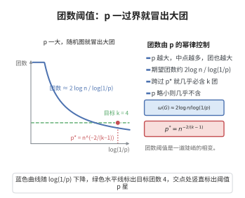

# 团数阈值

> **一句话大白话**：$G(n,p)$ 里最大的完全子图（团）有多大？固定 $p$ 时，几乎必然在 $2\log_{1/p}n$ 附近：期望团数 $\binom{n}{k}p^{\binom{k}{2}}$ 在此处从 $\infty$ 跌到 $0$。
>
> **小例子**：$p=\tfrac12$ 时 $\omega(G)\approx2\log_2 n$；对 $n=2^{20}$，大约有 $40$ 个顶点的完全子图，偏差不超过 $1$。

## 一、定理介绍

> **前置依赖**：$G(n,p)$ 随机图模型、期望的线性性、Markov 不等式、第二矩方法、Stirling 公式。

团数阈值刻画 $G(n,p)$ 中最大团的大小。因为完全子图极难出现，其个数 $\binom{n}{k}p^{\binom{k}{2}}$ 随 $k$ 变化剧烈，故团数高度集中在临界值附近，体现了"极值有序"现象。

## 几何直观

图意在说明：期望团数约为 2log n/log(1/p)，跨过临界 p* 后随机图几乎必然含 k 团。

## 二、原理思路

用矩方法做二阶分析。$X_k$ 为 $k$-团个数，$\mathbb{E}[X_k]=\binom{n}{k}p^{\binom{k}{2}}$。在临界尺度 $k\approx2\log_{1/p}n$ 处对数期望由正转负：$k>k_0$ 用 Markov 不等式排除（$\mathbb{E}[X_k]\to0$），$k<k_0$ 用第二矩方法（$\operatorname{Var}(X_k)=o((\mathbb{E}X_k)^2)$）保证几乎必然存在。

## 三、定理的严格表述

（团数阈值）设 $k=k(n)$ 正整数序列，$p=p(n)\in(0,1)$，$X_k$ 为 $G(n,p)$ 中 $k$-团的个数。则
$$
\mathbb{E}[X_k]=\binom{n}{k}p^{\binom{k}{2}}.
$$
固定 $p\in(0,1)$，令 $k_0=\lfloor2\log_{1/p}n\rfloor$，则
$$
\omega(G(n,p))\in\{k_0-1,k_0,k_0+1\}\qquad\text{几乎必然}。
$$

## 四、证明过程

**证：**

1. **期望。** 对每个 $k$-子集，它为团当且仅当 $\binom{k}{2}$ 条边全出现（概率 $p^{\binom{k}{2}}$），故 $\mathbb{E}[X_k]=\binom{n}{k}p^{\binom{k}{2}}$。

2. **临界尺度。** 由 Stirling $\binom{n}{k}\sim\left(\frac{en}{k}\right)^k$，$\log\mathbb{E}[X_k]\approx k(\log\frac{en}{k}+\frac{k-1}{2}\log p)$。令 $k=2\log_{1/p}n+x$ 得 $\mathbb{E}[X_k]\approx\left(\frac{e}{k}p^{(x-1)/2}\right)^k$：$x\to-\infty$ 时趋于 $\infty$，$x\to+\infty$ 时趋于 $0$。

3. **上界。** $k>k_0$ 时 $\mathbb{E}[X_k]\to0$，Markov 不等式给出 $\mathbb{P}(X_k\ge1)\le\mathbb{E}[X_k]\to0$，故 $\omega(G)\le k_0$。

4. **下界（第二矩）。** $k<k_0$ 时 $\mathbb{E}[X_k]\to\infty$。对 $|S\cap T|=i$ 的两子集，$S\cup T$ 为团需 $p^{\binom{k}{2}+\binom{k}{2}-\binom{i}{2}}$，据此可证 $\operatorname{Var}(X_k)=o((\mathbb{E}X_k)^2)$；Chebyshev 不等式给出 $\mathbb{P}(X_k=0)\to0$，故 $\omega(G)\ge k_0-1$。$\square$

## 五、应用与意义

团数阈值是随机图极值理论的经典结果，给出了"几乎所有图的最大团大小"的精确量级。它是 Ramsey 理论、图着色问题、以及社交网络（finding cliques）、聚类与组合搜索算法的随机输入分析的基础，也是"典型极值"思想的代表。

## 课堂问答

**老师**：$G(n,p)$ 里最大团有多大？

**学生**：固定 $p$ 时几乎必然在 $k_0\approx2\log_{1/p}n$ 附近，精确到 $\omega(G)\in\{k_0-1,k_0,k_0+1\}$。$p=\frac12$ 时约为 $2\log_2n$，$n=2^{20}$ 大约对应 $40$ 个顶点的团。直觉是 $k$-团个数期望 $\mathbb{E}[X_k]=\binom{n}{k}p^{\binom{k}{2}}$ 随 $k$ 变化极快，在 $k_0$ 处从 $\infty$ 跌到 $0$。

**老师（追问）**：两个方向分别用第几矩？临界尺度为什么选 $2\log_{1/p}n$？

**学生**：上界用第一矩：由 Stirling $\binom{n}{k}\sim(\frac{en}{k})^k$，$\log\mathbb{E}[X_k]\approx k(\log\frac{en}{k}+\frac{k-1}{2}\log p)$；令 $k=2\log_{1/p}n+x$ 得 $\mathbb{E}[X_k]\approx(\frac{e}{k}p^{(x-1)/2})^k$，$k>k_0$ 时 $\mathbb{E}[X_k]\to0$，Markov 不等式排除。下界用第二矩：对 $|S\cap T|=i$ 的两子集算得 $\operatorname{Var}(X_k)=o((\mathbb{E}X_k)^2)$，Chebyshev 给出 $\mathbb{P}(X_k=0)\to0$。临界尺度正是让对数期望由正转负的那一点。

**老师（拓展）**：这条结果的地位？

**学生**：它是随机图极值理论的经典结果，也是"典型极值"思想的代表——几乎所有图的最大团尺寸高度集中在同一量级。它是 Ramsey 理论、图着色、社交网络 find-cliques 与聚类算法的随机输入分析的共同基础。
