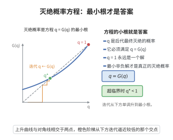

# 灭绝概率方程

> **一句话大白话**：一个家族（或病毒、谣言）最终"断子绝孙"的概率 $\rho$，恰好是后代分布的概率母函数的最小非负不动点：解出 $\rho=\varphi(\rho)$ 中最小的那个非负根即可。

> **小例子**：后代数服从 $\operatorname{Poi}(c)$ 时（随机图分支过程的标准情形），方程为 $\rho=e^{c(\rho-1)}$。当 $c=1.5$ 时最小非负解 $\rho\approx0.417$，即约 $1-\rho\approx58\%$ 的起点会繁衍出 $\Theta(n)$ 量级的巨族群。

## 一、定理介绍

> **前置依赖**：生成函数基本定理、Knaster-Tarski不动点定理、单调收敛定理、常见分布的期望与方差

灭绝概率方程是 Galton–Watson 分支过程的核心结论。设每代每个个体独立繁殖出 $k$ 个后代的概率为 $p_k$（$k\ge0$），记概率母函数 $\varphi(s)=\sum_{k\ge0}p_k s^k$，则"从单个个体出发的家族最终灭绝"的概率 $\rho$ 是方程 $\rho=\varphi(\rho)$ 的**最小非负解**。它把"随机繁衍是否会永久持续"这一动态问题，化归为一个函数方程求根问题；在随机图里，它正是巨分支比例 $1-\rho$ 的来源（见同目录巨分支阈值）。

## 几何直观

图意在说明：灭绝概率是 q = G(q) 的最小非负解，从下方迭代会单调收敛到它。

## 二、原理思路

设 $Z_n$ 为第 $n$ 代的个体数，$Z_0=1$，则 $Z_{n+1}$ 是 $Z_n$ 个独立个体的后代数之和。记"到第 $n$ 代已经灭绝"的概率为 $q_n=\mathbb P(Z_n=0)$。由分支过程的全期望（母函数复合）性质可得递推

$$
q_{n+1}=\varphi(q_n),\qquad q_0=\mathbb P(Z_0=0)=0 .
$$

关键观察有三点：

1. $q_n$ 单调不减且有上界 $1$，故极限 $\rho=\lim_n q_n$ 存在；
2. $\varphi$ 在 $[0,1]$ 上连续（幂级数在收敛半径内连续），故 $\rho=\varphi(\rho)$，即 $\rho$ 是不动点；
3. $\varphi$ 在 $[0,1]$ 上单调不减，用归纳证明 $q_n\le x$ 对任意不动点 $x\ge0$ 成立，从而 $\rho$ 是**最小**非负不动点。

这条"从 $0$ 出发迭代、取极限得最小不动点"的论证，正是 Knaster–Tarski 不动点定理在完全格 $[0,1]$ 上的具体形态。

## 三、定理的严格表述

（灭绝概率方程）设 $(p_k)_{k\ge0}$ 为概率分布（$\sum_k p_k=1$，$p_0<1$），$\varphi(s)=\sum_{k\ge0}p_k s^k$ 为其概率母函数。设 $Z_n$ 为对应的 Galton–Watson 分支过程，$Z_0=1$，定义灭绝概率

$$
\rho=\mathbb P\Bigl(\bigcup_{n\ge0}\{Z_n=0\}\Bigr)=\lim_{n\to\infty}\mathbb P(Z_n=0).
$$

则 $\rho$ 是方程 $\rho=\varphi(\rho)$ 的最小非负解。特别地：

- 当平均后代数 $\mu=\varphi'(1)\le1$ 时，$\rho=1$（几乎必然灭绝）；
- 当 $\mu>1$ 时，$\rho<1$（有正概率永不灭绝）。

对后代分布 $\operatorname{Poi}(c)$（$\varphi(s)=e^{c(s-1)}$），方程化为

$$
\rho=e^{c(\rho-1)},
$$

在 $c>1$ 时于 $[0,1)$ 内有唯一根，在 $c\le1$ 时 $\rho=1$。

## 四、证明过程

**证明。**

**步骤 1（递推关系）。** 设第 $0$ 代有 $1$ 个个体。由分支过程的独立性，$Z_n=0$ 当且仅当全部 $1$ 代后代各自的子孙在 $n-1$ 代内灭绝。设单株后代数为 $k$ 的概率为 $p_k$，则

$$
q_{n+1}=\mathbb P(Z_{n+1}=0)=\sum_{k\ge0}p_k\,\mathbb P(Z_{n+1}=0\mid Z_1=k)
=\sum_{k\ge0}p_k\,q_n^{\,k}=\varphi(q_n).
$$

这里用到母函数复合（生成函数基本定理）与各支相互独立。$q_0=0$。

**步骤 2（单调有界，极限存在）。** 因 $\varphi$ 在 $[0,1]$ 上非负且单调不减，由 $q_0=0\le q_1=\varphi(0)=p_0$ 与归纳法 $q_n\le q_{n+1}\Rightarrow\varphi(q_n)\le\varphi(q_{n+1})$，得 $q_n$ 单调不减；又 $q_n\le1$ 有界。故由单调收敛定理，$\rho=\lim_n q_n$ 存在且 $0\le\rho\le1$。

**步骤 3（极限满足方程）。** $\varphi$ 作为幂级数在 $[0,1]$ 上连续，于是

$$
\varphi(\rho)=\varphi\bigl(\lim_n q_n\bigr)=\lim_n\varphi(q_n)=\lim_n q_{n+1}=\rho,
$$

即 $\rho$ 是 $\varphi$ 的非负不动点。

**步骤 4（最小性）。** 设 $x\ge0$ 是任一不动点，$\varphi(x)=x$。我们用归纳证明 $q_n\le x$：$q_0=0\le x$；若 $q_n\le x$，由 $\varphi$ 单调不减得 $q_{n+1}=\varphi(q_n)\le\varphi(x)=x$。故一切 $q_n\le x$，取极限得 $\rho\le x$。因此 $\rho$ 是最小非负不动点，由 Knaster–Tarski 不动点定理（$[0,1]$ 为完全格、$\varphi$ 单调）其存在性早已被保证。

**步骤 5（临界性与 $\operatorname{Poi}(c)$ 情形）。** 对 $\varphi$，注意 $\varphi(1)=1$ 恒成立。若 $\mu=\varphi'(1)\le1$，则 $\varphi$ 在 $[0,1]$ 上凸（$\varphi''\ge0$）且切线斜率在 $1$ 处 $\le1$，由凸性 $\varphi(s)\ge s$ 对 $s\in[0,1]$ 成立，结合步骤 4 与 $x=1$ 为不动点知 $\rho=1$。若 $\mu>1$，则存在 $s_0\in(0,1)$ 使 $\varphi(s_0)<s_0$，而 $\varphi(0)=p_0\ge0$，由连续性存在小于 $1$ 的不动点，最小者 $\rho<1$。

后代分布 $\operatorname{Poi}(c)$ 的母函数为 $\varphi(s)=e^{c(s-1)}$（由常见分布的期望与方差，其均值 $\mu=c$），于是 $\rho=e^{c(\rho-1)}$；由上面的判别法，$c\le1$ 时 $\rho=1$，$c>1$ 时 $\rho$ 为 $[0,1)$ 中唯一根。$\square$

## 五、应用与意义

灭绝概率方程是"繁衍/传播是否存活"的统一判据：在 $G(n,p)$ 随机图中，$c>1$ 时从给定顶点出发的广度优先探索以概率 $1-\rho$ 永不终止，这直接给出巨分支大小为 $(1-\rho)n$（见巨分支阈值）。同一方程还用于流行病学的基本再生数 $R_0$（$\mu=R_0$）与群体免疫阈值、谣言传播、渗流与分支程序的存活概率估计，是相变理论中最常被引用的定量工具之一。

## 课堂问答

**老师**：Galton–Watson 过程最终灭绝的概率怎么求？

**学生**：它是概率母函数的最小非负不动点。设 $\varphi(s)=\sum_kp_ks^k$、灭绝概率 $\rho$，则 $\rho$ 是方程 $\rho=\varphi(\rho)$ 的最小非负解。令 $q_n=\mathbb{P}(Z_n=0)$，由母函数复合得递推 $q_{n+1}=\varphi(q_n)$、$q_0=0$，取极限即得 $\rho$。

**老师（追问）**：怎么保证取极限后仍是不动点，而且是最小的那个？

**学生**：$q_n$ 单调不减（因 $\varphi$ 单调）且有上界 $1$，故极限存在；$\varphi$ 作为幂级数在 $[0,1]$ 上连续，于是 $\varphi(\rho)=\lim\varphi(q_n)=\lim q_{n+1}=\rho$。最小性用归纳：对任意非负不动点 $x$，$q_0=0\le x$ 且 $q_n\le x\Rightarrow q_{n+1}=\varphi(q_n)\le\varphi(x)=x$，故 $\rho\le x$。这实际是 Knaster–Tarski 不动点定理在完全格 $[0,1]$ 上的形态。对后代 $\operatorname{Poi}(c)$ 有 $\varphi(s)=e^{c(s-1)}$，方程即 $\rho=e^{c(\rho-1)}$：$c\le1$ 时 $\rho=1$，$c>1$ 时 $\rho$ 为 $[0,1)$ 内唯一根。

**老师（拓展）**：这个 $\rho$ 和随机图的巨分支有什么关系？

**学生**：直接对应。$c>1$ 时从给定顶点出发的广度优先探索以概率 $1-\rho$ 永不终止，故巨分支大小为 $(1-\rho)n$。同一方程还给出流行病学基本再生数 $R_0=\mu$、群体免疫阈值与渗流存活概率，是相变理论里最常引用的定量工具。误区是以为 $\rho=1$ 恒成立——只有 $\mu\le1$ 才几乎必然灭绝。

## 相关条目

- [巨分支阈值](./巨分支阈值.md)：用本方程的根 $\rho$ 给出巨分支比例 $1-\rho$ 与临界点 $c=1$。
- [Knaster-Tarski不动点定理](../第85级-序理论/Knaster-Tarski不动点定理.md)：保证最小非负不动点的存在。
- [生成函数基本定理](../第28级-组合数学/生成函数基本定理.md)：母函数复合等运算的依据。
