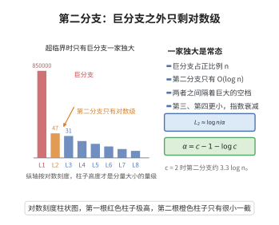

# 第二分支大小

> **一句话大白话**：$c>1$ 时巨分支独吞全场，第二大的分支小得可怜——只有 $O(\log n)$，约 $\frac{1}{\alpha}\log n$ 大（$\alpha=c-1-\log c$）。"一家独大"是随机超图的结构常态。
>
> **小例子**：$c=2$ 时 $\alpha=2-1-\log2\approx0.307$，故 $L_2\approx3.26\log n$；$n=10^6$ 时第二分支大约只有 $45$ 个顶点。

## 一、定理介绍

> **前置依赖**：巨分支阈值、Poisson 分支过程、Borel 分布、Stirling 公式、期望与矩方法。

第二分支大小定理刻画了 $G(n,p)$（$p=c/n$，$c>1$）在巨分支之外的"残余小分支"的规模：最大值约 $\frac{1}{\alpha}\log n$。它揭示了巨分支的"垄断性"，是巨分支理论的重要组成部分。

## 几何直观

图意在说明：超临界随机图中最大分量占正比例，第二大连通分量却只有 log n 量级。

## 二、原理思路

巨分支外的每个小分支对应一个最终灭绝的分支过程。对一个 $\operatorname{Poi}(c)$ 分支过程，其总个体数 $T$ 服从 Borel 分布
$$
\mathbb{P}(T=k)=\frac{e^{-ck}(ck)^{k-1}}{k!},
$$
代入 $c>1$ 并求和估计刻画出最大小分支的量级，$\alpha=c-1-\log c$ 是其指数衰减率。

## 三、定理的严格表述

（第二分支大小）设 $p=c/n$，$c>1$ 常数，$L_1,L_2$ 分别为最大与次大连通分量大小。则几乎必然
$$
L_2=O(\log n),
$$
更精确地，$L_2\sim\frac{1}{\alpha}\log n$，其中 $\alpha=c-1-\log c>0$。

## 四、证明过程

**证：**

1. **分支视角。** 巨分支外的顶点属小分支，每个小分支是从某顶点出发、条件为最终灭绝的 $\operatorname{Poi}(c)$ 分支过程。

2. **Borel 分布。** 对 Poisson 后代 $\operatorname{Poi}(c)$，分支总大小 $T$ 满足
   $$
   \mathbb{P}(T=k)=\frac{e^{-ck}(ck)^{k-1}}{k!}.
   $$

3. **极大值估计。** 对所有可能起点求并，利用 Stirling 与求和估计：小分支大小超过 $\frac{1}{\alpha}\log n$ 的期望数趋于 $0$，从而几乎必然 $L_2\le\frac{1}{\alpha}\log n$；反向构造下界匹配，得 $L_2\sim\frac{1}{\alpha}\log n$。$\square$

## 五、应用与意义

第二分支大小定理说明超临界随机图的连通结构由唯一巨分支"主宰"，这对传染病建模（判断疫情规模）、网络的鲁棒性分析（大分支之外的孤立小团体）以及图算法中"先找巨分支再处理残余"的加速策略具有直接指导意义。

## 课堂问答

**老师**：$c>1$ 时巨分支之外的第二大分支有多大？

**学生**：只有 $O(\log n)$，更精确是 $L_2\sim\frac{1}{\alpha}\log n$，其中 $\alpha=c-1-\log c>0$。直觉是巨分支之外剩下的都是"最终灭绝"的分支过程，尺寸受指数衰减率 $\alpha$ 压制。$c=2$ 时 $\alpha=2-1-\log2\approx0.307$，故 $L_2\approx3.26\log n$。

**老师（追问）**：小分支大小的分布是怎么得到的？

**学生**：对 $\operatorname{Poi}(c)$ 后代的分支过程，其总个体数 $T$ 服从 Borel 分布 $\mathbb{P}(T=k)=\frac{e^{-ck}(ck)^{k-1}}{k!}$。因为小分支就是"条件为最终灭绝"的过程，把所有可能起点的分支用并集界加 Stirling 估计：大小超过 $\frac{1}{\alpha}\log n$ 的期望数趋于 $0$，故几乎必然 $L_2\le\frac{1}{\alpha}\log n$；反向构造匹配下界即得渐近式。要留意这里只适用于超临界 $c>1$，$c\le1$ 时根本没有巨分支。

**老师（拓展）**：这个结论有什么用？

**学生**：它说明超临界随机图的连通结构由唯一巨分支"垄断"，对传染病规模判断、网络鲁棒性（大分支之外只剩孤立小团体）以及"先找巨分支再处理残余"的图算法加速都有直接指导。
