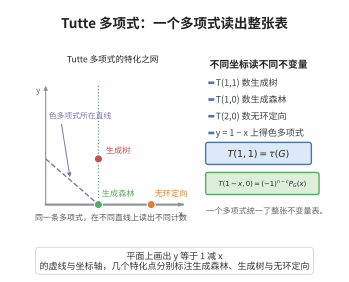

# Tutte多项式的性质

> **一句话大白话**：Tutte 多项式有一套"化简口诀"：空基值 $1$，遇环提 $y$，遇余环提 $x$，直接和相乘。把复杂拟阵一步步拆成它这些基本块。
>
> **小例子**：一个含环 $e_1$、余环 $e_2$、然后分解成两个不相交块 $M_1,M_2$ 的拟阵，其 $T_M=x\,y\,T_{M_1}T_{M_2}$，逐步"提因数"归约。

## 一、定理介绍

> **前置依赖**：Tutte 多项式的定义、拟阵的秩函数、环与余环、直和与秩的可加性、收缩-删除递推。

Tutte 多项式满足一组递推性质：空阵值为 $1$，环贡献因子 $y$，余环贡献因子 $x$，直和对应乘积。它们与收缩-删除递推一起构成完整算法，是所有 Tutte 多项式计算的基础工具。

## 几何直观

图意在说明：Tutte 多项式在不同直线与整点上取特化，就得到生成树、森林、无环定向与色多项式。

## 二、原理思路

直接从定义式 $T_M(x,y)=\sum_{A}(x-1)^{r(E)-r(A)}(y-1)^{|A|-r(A)}$ 出发。空阵仅一项。环 $e$ 满足 $r(A\cup\{e\})=r(A)$ 且 $r(E)=r(E\setminus\{e\})$，把含 $e$ 项与不含 $e$ 项合并提公因子得 $y$。余环 $e$ 属于每个基，故 $r(A\cup\{e\})=r(A)+1$、$r(E)=r(E\setminus\{e\})+1$，提公因子得 $x$。直和的秩函数可加，代入定义即得乘积性。

## 三、定理的严格表述

（Tutte 多项式的性质）设 $T_M(x,y)$ 为拟阵 $M$ 的 Tutte 多项式，则：

1. 若 $E=\varnothing$，则 $T_M(x,y)=1$。
2. 若 $e$ 是环（$\{e\}$ 是圈），则 $T_M(x,y)=y\cdot T_{M\setminus e}(x,y)$。
3. 若 $e$ 是余环（$\{e\}$ 是 $M^*$ 的圈，即 $e$ 属于每个基），则 $T_M(x,y)=x\cdot T_{M/e}(x,y)$。
4. 若 $M=M_1\oplus M_2$，则 $T_M(x,y)=T_{M_1}(x,y)\cdot T_{M_2}(x,y)$。

## 四、证明过程

**证：**

1. $E=\varnothing$ 时仅子集 $A=\varnothing$，$r(\varnothing)=0$、$|A|=0$，故 $T=(x-1)^0(y-1)^0=1$。

2. **环。** $r(A\cup\{e\})=r(A)$，$r(E)=r(E\setminus\{e\})$。按 $e$ 拆分，含 $e$ 项与不含 $e$ 项除因子 $(y-1)$ 外相同，合并后每项乘 $(1+(y-1))=y$，得 $y\cdot T_{M\setminus e}$。

3. **余环。** $e$ 属于每个基，故 $r(A\cup\{e\})=r(A)+1$、$r(E)=r(E\setminus\{e\})+1$。类似拆分合并后每项乘 $(x-1)+1=x$，得 $x\cdot T_{M/e}$。

4. **直和。** $r_{M_1\oplus M_2}(A_1\cup A_2)=r_{M_1}(A_1)+r_{M_2}(A_2)$，代入定义式即得乘积。$\square$

## 五、应用与意义

这些性质使 Tutte 多项式成为可高效迭代求值的双变量图/拟阵不变量：它统一推广了图的色多项式、流多项式、可靠性多项式与生成树计数（在 $(1,1)$ 处取值），在统计物理（Ising、Potts 模型配分函数）、网络可靠性与 DNA 折叠等学科有广泛联系。

## 课堂问答

**老师**：Tutte 多项式的几条基本性质是什么？

**学生**：空阵 $T=1$；环 $e$ 给 $T_M(x,y)=y\cdot T_{M\setminus e}(x,y)$；余环 $e$ 给 $T_M(x,y)=x\cdot T_{M/e}(x,y)$；直和给 $T_{M_1\oplus M_2}(x,y)=T_{M_1}(x,y)\cdot T_{M_2}(x,y)$。它们与收缩-删除递推一起构成完整的递推算法。

**老师（追问）**：环和余环为什么分别提出 $y$ 和 $x$？

**学生**：环满足 $r(A\cup\{e\})=r(A)$ 且 $r(E)=r(E\setminus\{e\})$，把含 $e$ 与不含 $e$ 的项并起来，每项多出因子 $1+(y-1)=y$；余环属于每个基，$r(A\cup\{e\})=r(A)+1$、$r(E)=r(E\setminus\{e\})+1$，类似合并多出 $(x-1)+1=x$。直和则因秩函数可加 $r_{M_1\oplus M_2}(A_1\cup A_2)=r_{M_1}(A_1)+r_{M_2}(A_2)$，代入定义式即得乘积。

**老师（拓展）**：这些性质把 Tutte 多项式变成了什么？

**学生**：它成为一个可高效迭代求值的双变量不变量，统一推广了色多项式、流多项式、可靠性多项式与生成树计数（在 $(1,1)$ 处取值）。因为"提因数"与"直和相乘"让复杂拟阵能拆成基本块逐步归约，它在统计物理（Ising、Potts 配分函数）与网络可靠性分析里都是核心工具。要留神 $x$ 与 $y$ 的角色不能调换：环提 $y$、余环提 $x$。
