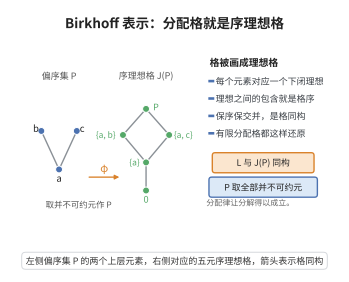

# Birkhoff表示定理

> **一句话大白话**：每一个有限分配格，都能看作某个偏序集 $P$ 的"向下一层层关闭的下拉集合"（序理想）组成的格。于是"分配格"和"序理想的集合"是同一件事。
>
> **小例子**：有限布尔代数 $2^{[n]}$ 是分配格，它同构于以不可约元 $1,2,\dots,n$（视为链的两端的原子）的序理想格 $J(P)$，其中 $P=[n]$ 是反链，其序理想恰是 $[n]$ 的所有子集。

## 一、定理介绍

> **前置依赖**：有限分配格、并不可约元、序理想与序理想格、格同构。

Birkhoff 表示定理（表示定理）给出有限分配格的完整分类：每个有限分配格都同构于某个有限偏序集的序理想格 $J(P)$。它是序理论与其在数学结构分类中"以格研究偏序"的方法核心。

## 几何直观

图意在说明：有限分配格里的每个元素都对应偏序集的一个下闭理想，格的交并正是理想的交并。

## 二、原理思路

关键概念是**并不可约元**（$p\ne0$ 且 $p=a\vee b$ 蕴含 $p=a$ 或 $p=b$）。取 $P$ 为 $L$ 的并不可约元集 $\operatorname{JIrr}(L)$（按诱导序），定义 $\varphi(a)=\{p\in P:p\le a\}$。证明 $\varphi$：单射靠"每元素都是不可约元的并"这一分配格标准分解；满射靠并不可约元的"$\le$ 结合可提元"性质；保持 $\wedge,\vee$ 则用序理想的交/并封性与并不可约元的分配性。

## 三、定理的严格表述

（Birkhoff 表示定理）每个有限分配格 $L$ 同构于某个有限偏序集 $P$ 的序理想格 $J(P)$。具体地，取 $P=\operatorname{JIrr}(L)$（$L$ 的并不可约元集），则映射
$$
\varphi:L\to J(P),\qquad \varphi(a)=\{p\in P:p\le a\}
$$
是格同构。

## 四、证明过程

**证：**

1. **$\varphi(a)$ 是序理想。** 若 $p\in\varphi(a)$、$q\le p$，则 $q\le a$，故 $q\in\varphi(a)$，向下封闭。

2. **单射。** 若 $a\ne b$，不妨 $a\not\le b$。由标准分解存在并不可约元 $p\le a$、$p\not\le b$，于是 $p\in\varphi(a)\setminus\varphi(b)$。

3. **满射。** 对序理想 $I\in J(P)$，令 $a=\bigvee I$。$I\subseteq\varphi(a)$ 显然；反之 $p\in\varphi(a)$ 即 $p\le a=\bigvee I$，因 $p$ 并不可约且 $L$ 分配，存在 $q\in I$ 使 $p\le q$，而 $I$ 是序理想故 $p\in I$，得 $\varphi(a)\subseteq I$。故 $\varphi(a)=I$。

4. **保运算。** $\varphi(a\wedge b)=\varphi(a)\cap\varphi(b)$ 显然。对并，$\subseteq$ 显然；若 $p\in\varphi(a\vee b)$，则 $p=p\wedge(a\vee b)=(p\wedge a)\vee(p\wedge b)$，由 $p$ 并不可约得 $p=p\wedge a$ 或 $p\wedge b$，即 $p\le a$ 或 $p\le b$，故 $\subseteq\varphi(a)\cup\varphi(b)$。$\square$

**推论：** 有限布尔代数同构于某个有限集合的幂集格（$n$ 元布尔代数 $\cong 2^{[n]}$）；反之每个有限偏序集的序理想格都是有限分配格。

## 五、应用与意义

Birkhoff 表示定理把序理论嵌入格论并可逆回偏序，奠定了基础：布尔代数的"幂集模型"、分配格的"序理想模型"、以及用它编码（正规表格、约化简单有向图的理想）的数据结构（如有向图可合并链与真子集格）都导源于此。它是有限格分类与计算机科学中"理想双方格的表示"的重要理论支撑。

## 课堂问答

**老师**：有限分配格 $L$ 一定同构于某个偏序集的序理想格，取哪个偏序集最自然？

**学生**：取 $P=\operatorname{JIrr}(L)$，即所有并不可约元 $p\ne0$ 且 $p=a\vee b\Rightarrow p=a$ 或 $p=b$ 组成的集合，映射 $\varphi(a)=\{p\in P:p\le a\}$ 就是格同构。关键在两处：分配格里每个元素都能写成并不可约元的并，保证单射；$P$ 中元素"可提"，保证满射。

**老师（追问）**：满射那一步，若 $I$ 是序理想，凭什么原像恰好是 $I$，而不是更大？

**学生**：令 $a=\bigvee I$。先有 $I\subseteq\varphi(a)$。反向：若并不可约元 $p\le a=\bigvee I$，因 $L$ 分配且 $p$ 并不可约，存在 $q\in I$ 使 $p\le q$，$I$ 向下封闭故 $p\in I$。若丢掉分配性，这一步就断了，同构也不成立。

**老师（拓展）**：反过来，每个偏序集的序理想格都是分配格吗？

**学生**：是。$J(P)$ 的并是集合并、交是集合交，满足分配律 $(I\cap K)\cup(I\cap L)=I\cap(K\cup L)$，故 $J(P)$ 恒为分配格。于是"有限分配格"与"有限序理想格"彻底同一，推论便是有限布尔代数同构于幂集格 $2^{[n]}$。
