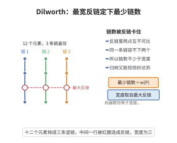

# Dilworth定理

> **一句话大白话**：把有限偏序集拆成"互相不可比的元素（反链）"，最宽的一层有多少个元素，最少就要用多少条"链"把整个集合盖起来。宽度 = 所需链数的最小值。
>
> **小例子**：任务调度中把所有可同时开工、互无先后的任务看作一层，Dilworth 定理说：任一时刻最多同时进行 $w(P)$ 项工作，那么排满所有任务最少需要 $w(P)$ 台机器（每条链排一台）。若 $P=2^{[3]}$ 的中间层有 $3$ 个元素，则最少 $3$ 条链即可覆盖。

## 一、定理介绍

> **前置依赖**：有限偏序集、链与反链、偏序集的宽度、数学归纳法原理。

Dilworth 定理是组合序理论的核心结果：有限偏序集最少可用多少条链覆盖，恰好等于最大反链（"宽度"）的大小。它与 Hall 婚姻定理关于二分图匹配等价，是众多极值组合问题的源头。

## 几何直观

图意在说明：反链中任意两点不能同链，故链数不少于宽度；归纳构造又能恰好达到这个下界。

## 二、原理思路

下界是显然的：反链中元素两两不可比，必须分属不同链。上界通过对集合大小归纳证明：取最大反链 $A$，分两类处理——若 $A$ 既非全部极大元的集合也非全部极小元的集合，则用 $A$ 把 $P$ 切成 $P^+,P^-$ 两部分（都在 $A$ 处相接），分别由归纳盖成 $w(P)$ 条链后沿 $A$ 拼接；若所有最大反链都是极大元或极小元的全体，则抽掉一对可比元 $(x,y)$ 归约。

## 三、定理的严格表述

（Dilworth 定理）设 $(P,\le)$ 是有限偏序集。则把 $P$ 分解为不相交的链所需的最少链数等于 $P$ 中最大反链的大小（宽度 $w(P)$）。

## 四、证明过程

**证：**

1. **下界。** 任一最大反链的 $w(P)$ 个元素两两不可比，必须落在不同链中，故至少 $w(P)$ 条链。

2. **归纳结构。** 对 $|P|$ 归纳。设 $A$ 为最大反链，$|A|=w(P)$。

3. **情形 1（$A$ 非全极大亦非全极小）。** 令
   $$
   P^+=\{x:\exists a\in A,\,a\le x\},\qquad P^-=\{x:\exists a\in A,\,x\le a\}.
   $$
   则 $P^+\cup P^-=P$、$P^+\cap P^-=A$ 且 $P^\pm\ne P$。由归纳，$P^+$ 盖成 $w(P)$ 条链 $C_i^+$（每条以 $A$ 某元为最小元），$P^-$ 盖成 $w(P)$ 条链 $C_i^-$（每条以 $A$ 某元为最大元），沿共同元素拼接得 $w(P)$ 条链覆盖 $P$。

4. **情形 2（每个最大反链为全极大或全极小集）。** 取极小元 $x$ 与极大元 $y$ 使 $x\le y$，令 $P'=P\setminus\{x,y\}$，则 $w(P')\ge w(P)-1$。由归纳 $P'$ 用 $\le w(P)-1$ 条链覆盖，加上链 $\{x,y\}$ 得 $w(P)$ 条链的分解。$\square$

## 五、应用与意义

Dilworth 定理统一了无数"分解问题"：任务并行度与机器数、匹配与覆盖在偏序上的对偶、以及 (其特例) Mirsky 定理、链分解与加密设计中"最宽反链"的估计。它与 König/Hall 定理的等价性是组合优化中 "min–max 对偶" 的样板，也被用于统计（项链拆分）与理论计算机科学（调度与偏序宽度计算）。

## 课堂问答

**老师**：有限偏序集里覆盖全体最少需要几条链？为什么不能少于最大反链？

**学生**：最少链数恰等于宽度 $w(P)$（最大反链大小）。下界显而易见——反链元素两两不可比，必属不同链。上界对 $|P|$ 归纳，用最大反链 $A$ 把 $P$ 切成 $P^+=\{x:\exists a\in A,\,a\le x\}$ 与 $P^-=\{x:\exists a\in A,\,x\le a\}$。

**老师（追问）**：情形 1 里为什么 $P^+\cap P^-=A$，拼接时又为什么恰好不增链数？

**学生**：若 $x$ 同时有 $a\le x$ 与 $x\le a'$，则 $a\le a'$；又 $A$ 是反链，故 $a=a'$，于是 $x\in A$ 且 $P^+\cap P^-=A$。归纳把 $P^\pm$ 各盖成 $w(P)$ 条链，每条以 $A$ 中某元为端点，沿 $A$ 一一对接，链数不变。

**老师（拓展）**：它与二分图匹配有什么联系？

**学生**：把偏序当二分图（$x<y$ 连边）后，König 定理给出最大匹配 $=$ 最小点覆盖，配合 Hall 定理即可证 Dilworth；等价地"最少链覆盖 $=$ $|P|-$最大匹配"，是 min–max 对偶的样板，而 Mirsky 定理正是它的对偶镜像。
