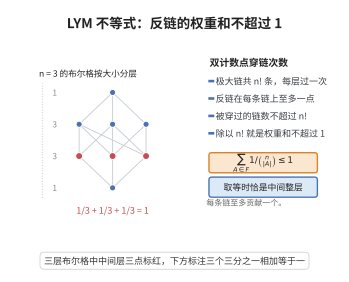

# LYM 不等式

> **一句话大白话**：在 $[n]$ 的所有子集里挑一族互不包含的集合（反链），那么它们"占据"最大链的比例之和不会超过 $100\%$——把每个集合 $A$ 按 $\binom{n}{|A|}^{-1}$ 记一次权重，总权重至多 $1$。
>
> **小例子**：$n=3$ 时取反链 $\mathcal F=\{\{1,2\},\{1,3\},\{2,3\}\}$（都在最中间一层），每项权重 $1/\binom32=1/3$，和恰为 $1$，取等。若再加一个 $\varnothing$，反链被破坏（$\varnothing\subseteq\{1,2\}$），不等式的前提也随之失效。

## 一、定理介绍

> **前置依赖**：布尔格 $2^{[n]}$ 与包含偏序、反链、链与极大链、二项式系数、双计数法。

LYM 不等式（Lubell, 1966；Yamamoto, 1954；Meshalkin, 1963，故简称 LYM）是极值集合论的"母不等式"：它把反链的计数问题化归为一次漂亮的**双计数**，只需数清"每个集合被多少条极大链穿过"。Sperner 定理是它最直接的推论，而加权版本的 LYM 还统辖了 Erdős–Moser、Engel、Bollobás 等一系列推广。

## 几何直观

图意在说明：每条极大链至多穿过一个反链元素，双计数后除以链总数，就得到权重和的上界。

## 二、原理思路

布尔格 $2^{[n]}$ 中的**极大链**是从 $\varnothing$ 走到 $[n]$、每次添一个元素的链，共有 $n!$ 条（对应 $n$ 个元素的排列）。

双计数 $(A,C)$ 的对数，其中 $A\in\mathcal F$、$C$ 是穿过 $A$ 的极大链：

- **按 $A$ 数**：固定 $A$，链在下半段（$\varnothing\to A$）按 $|A|$ 个元素的顺序自由选择，有 $|A|!$ 种；上半段（$A\to[n]$）有 $(n-|A|)!$ 种。故共 $|A|!\,(n-|A|)!$ 条。
- **按 $C$ 数**：因 $\mathcal F$ 是反链，一条链上不可能同时穿过两个不同成员（链是全序的，链上的两个集合必互相包含），故每条链至多贡献 $1$。

于是立即得

$$
\sum_{A\in\mathcal F}|A|!\,(n-|A|)!\ \le\ n!,
$$

两边除以 $n!$ 便是 LYM 形式。

## 三、定理的严格表述

**定理（LYM 不等式）**：设 $\mathcal F\subseteq 2^{[n]}$ 是反链（即对任意 $A\ne B\in\mathcal F$ 有 $A\not\subseteq B$ 且 $B\not\subseteq A$）。则

$$
\sum_{A\in\mathcal F}\frac{|A|!\,(n-|A|)!}{n!}=\sum_{A\in\mathcal F}\frac{1}{\binom{n}{|A|}}\ \le 1 .
$$

**等价形式（Lubell 计数形式）**：

$$
\sum_{A\in\mathcal F}|A|!\,(n-|A|)!\ \le\ n! .
$$

**推论（Sperner 定理）**：$|\mathcal F|\le\binom{n}{\lfloor n/2\rfloor}$。

## 四、证明过程

**证明。** 记 $\mathcal C$ 为 $2^{[n]}$ 中全部极大链的集合，$|\mathcal C|=n!$（极大链与 $[n]$ 的排列一一对应：排列给出逐次添加元素的次序）。

**步骤 1（计数极大链）。** 一条极大链形如
$$
\varnothing=A_0\subset A_1\subset\cdots\subset A_n=[n],\qquad |A_i|=i .
$$
给定排列 $\pi=(\pi_1,\dots,\pi_n)$，取 $A_i=\{\pi_1,\dots,\pi_i\}$ 便得一条极大链；反之每条极大链唯一决定 $\pi$。故 $|\mathcal C|=n!$。

**步骤 2（固定 $A$ 的链数）。** 给定 $A\in 2^{[n]}$，$|A|=a$。穿过 $A$ 的极大链由两段独立决定：

- 从 $\varnothing$ 到 $A$：$A$ 的 $a$ 个元素可按任意顺序逐个添入，共 $a!$ 种；
- 从 $A$ 到 $[n]$：余下 $n-a$ 个元素可按任意顺序逐个添入，共 $(n-a)!$ 种。

故穿过 $A$ 的极大链恰有 $a!\,(n-a)!$ 条。

**步骤 3（双计数）。** 计数集合
$$
\Phi=\{(A,C):\ A\in\mathcal F,\ C\in\mathcal C,\ A\in C\}.
$$
一方面按 $A$ 分类：
$$
|\Phi|=\sum_{A\in\mathcal F}\#\{C\in\mathcal C:A\in C\}=\sum_{A\in\mathcal F}|A|!\,(n-|A|)! .
$$
另一方面按 $C$ 分类：固定 $C\in\mathcal C$，$C$ 中的集合按包含关系构成全序，而 $\mathcal F$ 是反链，故 $C$ 至多与 $\mathcal F$ 交于一个集合（若 $A,B\in\mathcal F\cap C$ 则 $A\subseteq B$ 或 $B\subseteq A$，除非 $A=B$）。因此
$$
|\Phi|=\sum_{C\in\mathcal C}\#\{A\in\mathcal F:A\in C\}\ \le\ \sum_{C\in\mathcal C}1=n! .
$$
合并两式即得
$$
\sum_{A\in\mathcal F}|A|!\,(n-|A|)!\le n! .
$$
两边同除以 $n!$，并用 $\binom{n}{a}=\dfrac{n!}{a!\,(n-a)!}$ 得 LYM 形式。$\square$

**推论（Sperner 定理）的证明。** 设 $m=\lfloor n/2\rfloor$。对任意 $A$ 有 $\binom{n}{|A|}\le\binom{n}{m}$（二项式系数在中间层取最大），故
$$
\frac{|\mathcal F|}{\binom{n}{m}}\le\sum_{A\in\mathcal F}\frac1{\binom{n}{|A|}}\le1
\quad\Longrightarrow\quad
|\mathcal F|\le\binom{n}{\lfloor n/2\rfloor}.
$$
取 $\mathcal F=\{A:|A|=m\}$ 时上式取等（同层集合互不包含，是大小为 $\binom{n}{m}$ 的反链）。$\square$

## 五、应用与意义

- **Sperner 定理与极值集合论**：LYM 是 Sperner 定理的"定量加强"，也是几乎所有反链/链分解极值问题的模板。同类结果包括 Erdős–Ko–Rado（相交族）、Ahlswede–Zhang（多重集反链、以 Engel 不等式为工具）、Bollobás 二族定理、Frankl–Wilson（受限相交族）、以及 Katona 的循环排列方法。
- **概率论中的"LYM 方法"（Lubell–Yamamoto–Meshalkin）**：随机取一个均匀排列，则每个集合 $A$ 成为该排列某前缀的概率恰为 $1/\binom{n}{|A|}$，而反链中至多一个集合能成为前缀，于是概率之和 $\le1$——这正是上面的双计数，说明 LYM 本质上是"随机排列下的事件互斥"。
- **链分解与 Mirsky 定理的对偶**：Dilworth/Mirsky 定理说 $2^{[n]}$ 可分解为 $\binom{n}{\lfloor n/2\rfloor}$ 条链；LYM 与此互为定量对偶，在对称链分解（de Bruijn–Tengbergen–Kruyswijk, BTK）中，每个反链恰与每条对称链相交一次，立即给出"反链大小不超过链条数"这一 Sperner 的另一证明。
- **排序与算法**：LYM 型双计数是分析比较排序算法下界（决策树叶子数）、拓扑排序与偏序线性扩展计数（更一般的"加权 LYM"可用于估计线性扩展个数的上界）的基本工具；在随机图与网络可靠性中，它给出"极小割/极小路径族"的规模估计。
- **后续发展**：由 LYM 出发的"正则化 LYM"（Pikhurko, 2001）解决了 $[n]$ 的 $k$ 部推广；"LYM 与射影几何的 Erdős–Moser 问题"则把同一套双计数搬到射影平面上，得到向量空间上的 Sperner 型结论（q-LYM 不等式）。

## 课堂问答

**老师**：为什么反链 $\mathcal F\subseteq 2^{[n]}$ 的权重和 $\sum_{A\in\mathcal F}\binom{n}{|A|}^{-1}$ 一定不超过 $1$？

**学生**：双计数极大链。$2^{[n]}$ 的极大链与 $n!$ 个排列一一对应。集合 $A$ 被 $|A|!(n-|A|)!$ 条极大链穿过，而反链里每条链至多穿过一个成员，故 $\sum_{A\in\mathcal F}|A|!(n-|A|)!\le n!$，两边除以 $n!$ 即 $\sum_{A\in\mathcal F}\binom{n}{|A|}^{-1}\le1$。

**老师（追问）**：怎么一步推出 Sperner 定理，等号何时取到？

**学生**：中间层二项式系数最大，故 $\binom{n}{|A|}\le\binom{n}{\lfloor n/2\rfloor}$，于是 $|\mathcal F|/\binom{n}{\lfloor n/2\rfloor}\le\sum_A\binom{n}{|A|}^{-1}\le1$，即 $|\mathcal F|\le\binom{n}{\lfloor n/2\rfloor}$。取 $\mathcal F$ 为全体 $m=\lfloor n/2\rfloor$ 元子集时每项权重相等，和为 $1$，取等。

**老师（拓展）**：换成一族两两相交的集合，还能照搬吗？

**学生**：不能直接套用——相交族要用 Erdős–Ko–Rado 定理，结论是 $n\ge2k$ 时最多 $\binom{n-1}{k-1}$。但同一套双计数可改写成"随机排列下事件互斥"的概率论证，并推广到射影空间上的 q-LYM（Erdős–Moser 问题）。

## 相关条目

- [Sperner定理](./Sperner定理.md)
- [Dilworth定理](./Dilworth定理.md)
- [Mirsky定理](./Mirsky定理.md)
- [Birkhoff表示定理](./Birkhoff表示定理.md)
- [Knaster-Tarski不动点定理](./Knaster-Tarski不动点定理.md)
