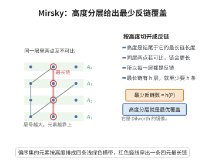

# Mirsky定理

> **一句话大白话**：把有限偏序集拆成若干"链"（互相可比的层），最高的楼梯有几级，最少就用几条"反链"把它盖住——刚好是 Dilworth 定理的"镜像"。
>
> **小例子**：某课程表按"先修"关系偏序，最长的先修链条 $h(P)$ 有 $h$ 门课；Mirsky 定理说：排课矛盾（两门互为先修冲突）至少需要的"时段层"正好是 $h$，按高度函数分 $h$ 个反链即可。

## 一、定理介绍

> **前置依赖**：有限偏序集、链与反链、偏序集的高度、高度函数。

Mirsky 定理是 Dilworth 定理的对偶：反链覆盖的最少数目等于最大链（"高度" $h(P)$）。它以显式的高度函数构造给出，是序理论中"分反链润滑"的经典工具。

## 几何直观

图意在说明：按高度函数分层后，同一层内两点若可比就会拉长最长链，故每层自动是反链，层数恰为高度。

## 二、原理思路

下界：一条链上的元素两两可比，必须分属不同反链，故至少 $h(P)$ 条。上界：定义高度函数
$$
\operatorname{ht}(x)=\max\{|C|:C\text{ 为以 }x\text{ 为最大元的链}\},
$$
按 $\operatorname{ht}$ 值 $k$ 分层 $A_k=\{x:\operatorname{ht}(x)=k\}$。若同一层 $x<y$，则把 $y$ 拼到以 $x$ 为最大元的最长链末尾得到更长链，矛盾，故 $A_k$ 是反链。

## 三、定理的严格表述

（Mirsky 定理）设 $(P,\le)$ 是有限偏序集。则把 $P$ 分解为不相交反链所需的最少反链数等于 $P$ 中最大链的大小（高度 $h(P)$）。

## 四、证明过程

**证：**

1. **下界。** 一条最大链的 $h(P)$ 个元素两两可比，必须分属不同反链，故至少 $h(P)$ 条。

2. **高度函数。** 记 $A_k=\{x:\operatorname{ht}(x)=k\}$，$k=1,\dots,h(P)$，其中 $\operatorname{ht}(x)$ 为以 $x$ 为最大元的链的最大长度。

3. **$A_k$ 是反链。** 若 $x,y\in A_k$ 且 $x<y$，则把 $y$ 接到以 $x$ 为最大元、长为 $k$ 的链末尾，得到以 $y$ 为最大元、长为 $k+1$ 的链，与 $\operatorname{ht}(y)=k$ 矛盾。

4. **覆盖。** $\{A_1,\dots,A_{h(P)}\}$ 是 $P$ 的 $h(P)$ 条互不相交反链的分解。$\square$

## 五、应用与意义

Mirsky 定理是 Dilworth 定理的优雅对偶，应用于任务分层着色、拓扑排序的分层、以及"最宽带"问题的对偶命题。在偏序集维数、以及传递闭包的层数估计中，它提供了一种直接、构造性的反链分解方案。

## 课堂问答

**老师**：Mirsky 定理说反链覆盖的最少数目等于什么？证据为什么这么短？

**学生**：等于最大链的大小（高度 $h(P)$）。下界：一条最长链的元素两两可比，必分属不同反链。上界用显式构造：按高度函数 $\operatorname{ht}(x)=\max\{|C|:C$ 以 $x$ 为最大元$\}$ 分层 $A_k=\{x:\operatorname{ht}(x)=k\}$，每层都是反链。

**老师（追问）**：$A_k$ 为什么一定是反链？

**学生**：若 $x<y$ 且同层，把 $y$ 接到以 $x$ 为最大元的长 $k$ 链末尾，得到以 $y$ 结尾的长 $k+1$ 链，与 $\operatorname{ht}(y)=k$ 矛盾。故同层元素互不可比。

**老师（拓展）**：它和 Dilworth 是同一结论还是对偶？

**学生**：是精确对偶：Dilworth 用链覆盖、由最大反链控制；Mirsky 用反链覆盖、由最大链控制。把偏序反向，Dilworth 就变成 Mirsky。高度函数分层还直接给出拓扑排序的最少层数（关键路径长度）。
