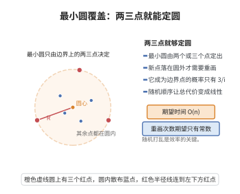

# 最小圆覆盖的随机增量算法

> **一句话大白话**：把点随机打乱后逐个"收入"当前圆，若新点在圆外就把它钉在边界上重画，只要 $O(n)$ 期望时间就能圈住所有点——随机顺序让"重画"很少发生。
>
> **小例子**：一个点刚好落在最终最小圆边界上的概率至多 $3/i$（最小圆由至多三个点决定）；于是第 $i$ 步需要"重画"的期望次数很小，总期望时间仅为 $O(n)$。

## 一、定理介绍

> **前置依赖**：三点决定一个圆、数学归纳法原理、概率期望与线性期望、距离度量与最小包围圆概念

最小圆覆盖随机增量算法以期望 $O(n)$ 的时间求覆盖给定 $n$ 个点的最小圆。它证明了"随机化成增量式几何算法高效"这一范式的威力，是最小包围圆问题的经典最优解法。

## 几何直观

图意在说明：最小包围圆由边界上的两点或三点唯一确定，新点落在圆内时无需改动，故重画极少发生。

## 二、原理思路

随机打乱点为 $p_1,\dots,p_n$，维护覆盖前 $i$ 点的最小圆 $C_i$。若 $p_i\in C_{i-1}$ 则 $C_i=C_{i-1}$；否则 $C_i$ 是以 $p_i$ 为边界点的覆盖 $\{p_1,\dots,p_i\}$ 的最小圆，递归到"两/三点定圆"的基情形。正确性用归纳；期望时间用"$p_i$ 落最终最小圆边界概率 $\le3/i$"控制触发重构的次数。

## 三、定理的严格表述

（最小圆覆盖的随机增量算法）给定平面上 $n$ 个点，存在（随机）算法以期望 $O(n)$ 时间求出覆盖所有点的最小圆。

## 四、证明过程

**证：**

1. **打乱与增量。** 随机排列 $p_1,\dots,p_n$，初始化 $C_2$ 为覆盖 $p_1,p_2$ 的最小圆；对 $i=3,\dots,n$：若 $p_i\in C_{i-1}$，置 $C_i=C_{i-1}$；否则置 $C_i$ 为包含 $\{p_1,\dots,p_i\}$ 且以 $p_i$ 为边界点的最小圆。

2. **正确性（归纳）。** 假设 $C_{i-1}$ 覆盖 $\{p_1,\dots,p_{i-1}\}$ 且最小。若 $p_i\in C_{i-1}$，则 $C_i=C_{i-1}$ 显然仍最小。若 $p_i\notin C_{i-1}$，则原全局最小圆若存在必以 $p_i$ 为边界点（否则 $C_{i-1}$ 可微调扩至含 $p_i$ 而更小），于是递归构造以 $p_i$ 为边界点的最小圆，得到 $C_i$，归纳保持。

3. **期望时间。** 第 $i$ 步触发重构当且仅当 $p_i$ 是最终最小圆的一个确定点。由于最小圆由至多三个点唯一确定，$\mathbb{P}[p_i\text{ 在边界上}]\le3/i$。故第 $i$ 步期望重构代价 $=O(\frac3i\cdot i)=O(1)$ 量级，两步基情形与内层求圆 $O(i)$ 合并，总期望
   $$
   \mathbb{E}[T]=O\Bigl(\sum_{i=3}^n\tfrac3i\cdot O(i)\Bigr)=O(n)。
   $$
   $\square$

## 五、应用与意义

最小圆覆盖用于最小包围球、几何装配公差检验、以及算法中的"最小包络"子程序；随机增量是几何算法中"重算皆因边界点"分析的代表，其概率摊销思想被推广到凸包、点定位与最近点对等多种增量问题。

## 课堂问答

**老师**：随机化的最小圆覆盖为什么能到期望 $O(n)$？

**学生**：随机打乱后逐个加入。若 $p_i$ 在当前最小圆 $C_{i-1}$ 内则不变；否则全局最小圆必以 $p_i$ 为边界点，重画为"过 $p_i$ 的覆盖前 $i$ 点最小圆"。关键概率事实是：最小圆由至多 $3$ 个点唯一确定，故 $p_i$ 落在最终最小圆边界上的概率 $\le3/i$，触发重构的期望代价为 $O(1)$ 量级。

**老师（追问）**：重画时为什么可以假设 $p_i$ 一定在边界上？

**学生**：若 $p_i\notin C_{i-1}$，而全局最小圆 $C^*$ 不以 $p_i$ 为边界点，则 $C^*$ 既包含 $C_{i-1}$ 已覆盖的旧点又不含 $p_i$，与 $C_{i-1}$ 的最小性矛盾。更严格地 $C_{i-1}\subseteq C^*$ 迫使 $p_i$ 落在 $C^*$ 边界上，故可递归到"以 $p_i$ 为边界点"的基情形。

**老师（拓展）**：这个概率 $O(1/i)$ 的摊销思想还用在哪些地方？

**学生**：同型分析用于随机增量凸包（期望 $O(n\log n)$）、线性规划、点定位等。一般原则是"只有当新点属于最终解的组合（顶点或边界）时才重算"，而边界点数 $\le d+1$ 保证期望代价为常数，这就是向后分析（backward analysis）。
