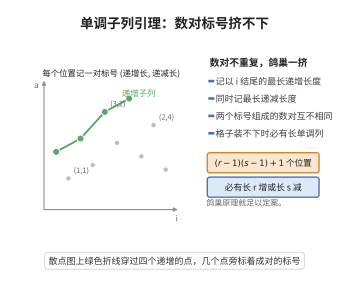

# Erdős–Szekeres 单调子序列引理

> **一句话大白话**：一串足够长且互不相同的数字里，一定能挑出一段"一直往上"或"一直往下"的子序列——想完全躲开单调是躲不掉的。
>
> **小例子**：长度 $(r-1)(s-1)+1$ 的序列必有长 $r$ 递增或长 $s$ 递减子序列；取 $r=s=4$，长为 $10$ 的序列必有 $4$ 项递增或 $4$ 项递减。

## 一、定理介绍

> **前置依赖**：序列与子序列、递增与递减序列、鸽巢原理、数学归纳法原理。

该引理由 Paul Erdős 与 George Szekeres 于 1935 年在研究"幸福结局问题"时提出。当时他们试图证明平面上足够多的点必含凸多边形，为处理点的坐标次序，把几何问题化归为实数序列的单调子序列存在性，从而得到本引理。它是 Ramsey 型组合学与极值理论的模板：假设极少（只要求序列有限），结论却是必然的序结构，且证明只用到鸽巢原理。引理给出的临界常数 $(r-1)(s-1)+1$ 是最优的，下界由分块递减构造给出，说明无法改进。它同时是 Erdős–Szekeres 定理、Dilworth 定理与最长递增子序列算法的共同源头，在排列统计、偏序集与随机排列的极限形状理论中被反复使用。

## 几何直观

图意在说明：每个位置的两个标号互不相同，位置数超过格子数时，必然挤出一条足够长的单调子列。

## 二、原理思路

1. 对每个位置 $i$ 记录两个量：$f(i)$ 为以 $a_i$ 结尾的最长递增子序列长度，$g(i)$ 为以 $a_i$ 结尾的最长递减子序列长度。
2. 证明映射 $i\mapsto(f(i),g(i))$ 是单射：若 $i<j$ 且 $a_i<a_j$，则 $f(j)\ge f(i)+1$；若 $a_i>a_j$，则 $g(j)\ge g(i)+1$；两种情形都使数对互异。
3. 用鸽巢原理收尾：若既无长 $r$ 递增子序列也无长 $s$ 递减子序列，则所有 $f(i)\le r-1$、$g(i)\le s-1$，数对至多 $(r-1)(s-1)$ 种，与序列长度 $(r-1)(s-1)+1$ 及单射性矛盾。

## 三、定理的严格表述

设 $a_1,\dots,a_N$ 为两两互不相同的实数序列，$r,s\ge2$ 为整数。若

$$
N \ge (r-1)(s-1)+1 ,
$$

则存在下标 $i_1<\cdots<i_r$ 使 $a_{i_1}<\cdots<a_{i_r}$（长 $r$ 递增子序列），或存在下标 $j_1<\cdots<j_s$ 使 $a_{j_1}>\cdots>a_{j_s}$（长 $s$ 严格递减子序列）。

当序列允许相等时，结论相应改为"长 $r$ 非减子序列或长 $s$ 严格递减子序列"。常数 $(r-1)(s-1)+1$ 是最优的。

## 四、证明过程

**步骤 1（定义长度函数）。** 对每个 $1\le i\le N$，令

$$
f(i)=\max\{k:\ \exists\, i_1<\cdots<i_k=i,\ a_{i_1}<\cdots<a_{i_k}\},
$$

即以下标 $i$ 结尾的最长严格递增子序列长度；令 $g(i)$ 为以下标 $i$ 结尾的最长严格递减子序列长度。由单项 $a_i$ 本身可知 $f(i),g(i)\ge 1$。

**步骤 2（数对的单射性）。** 设 $1\le i<j\le N$。因元素互异，只有两种可能。若 $a_i<a_j$，则把"以 $i$ 结尾的最长递增子序列"接上 $a_j$ 得长度 $f(i)+1$ 的递增子序列，故 $f(j)\ge f(i)+1>f(i)$。若 $a_i>a_j$，同理 $g(j)\ge g(i)+1>g(i)$。两种情形均有 $(f(i),g(i))\ne(f(j),g(j))$，故 $i\mapsto(f(i),g(i))$ 是单射。

**步骤 3（反设与计数）。** 反设不存在长 $r$ 递增子序列，则一切 $f(i)\le r-1$；反设不存在长 $s$ 递减子序列，则一切 $g(i)\le s-1$。于是每个数对 $(f(i),g(i))$ 都落在集合

$$
\{1,\dots,r-1\}\times\{1,\dots,s-1\}
$$

中，该集合恰有 $(r-1)(s-1)$ 个元素。

**步骤 4（鸽巢矛盾）。** 由步骤 2，$i\mapsto(f(i),g(i))$ 是单射，故 $N\le(r-1)(s-1)$。但题设 $N\ge(r-1)(s-1)+1$，矛盾。因此必存在 $i$ 使 $f(i)\ge r$（给出长 $r$ 递增子序列）或存在 $j$ 使 $g(j)\ge s$（给出长 $s$ 递减子序列）。

**步骤 5（常数最优）。** 构造序列由 $(r-1)$ 个长度各为 $(s-1)$ 的递减块拼成，块间整体递增：第 $k$ 块为 $k(s-1),\ k(s-1)-1,\ \dots,\ k(s-1)-(s-2)$。该序列长度为 $(r-1)(s-1)$，无长 $r$ 递增子序列（递增子序列至多每块取一项）、亦无长 $s$ 严格递减子序列（每块只有 $s-1$ 项）。故临界常数确为 $(r-1)(s-1)+1$。$\square$

## 五、应用与意义

- 是 Erdős–Szekeres（幸福结局）定理的关键引理，直接推出 $N(m)=2^{m-2}+1$。
- 给出最长递增子序列（LIS）的 $O(n\log n)$ 算法原理与 Dilworth 定理的组合证明。
- 体现"有限数据必现有序结构"的 Ramsey 型思想，用于排列统计、偏序集与随机排列的极限形状（Baik–Deift–Johansson）。

## 课堂问答

**老师**：为什么长度 $(r-1)(s-1)+1$ 的互异实数列必含长 $r$ 递增或长 $s$ 递减子序列？

**学生**：给每个位置记数对 $(f(i),g(i))$——以 $a_i$ 结尾的最长递增、递减子序列长度。若 $i<j$，则 $a_i<a_j$ 时 $f(j)\ge f(i)+1$，$a_i>a_j$ 时 $g(j)\ge g(i)+1$，两种情形数对都不同，故 $i\mapsto(f(i),g(i))$ 是单射。若既无长 $r$ 递增又无长 $s$ 递减，则所有数对落在 $\{1,\dots,r-1\}\times\{1,\dots,s-1\}$ 内，只有 $(r-1)(s-1)$ 个，与 $N$ 个互异数对矛盾。

**老师（追问）**：为什么这个常数不能再小？

**学生**：构造 $(r-1)$ 个长度各 $(s-1)$ 的递减块、块间整体递增，共 $(r-1)(s-1)$ 项：递增子序列至多每块取一项（$\le r-1$），递减子序列至多落在一块内（$\le s-1$），故既无长 $r$ 递增也无长 $s$ 递减。可见临界值恰是 $(r-1)(s-1)+1$。

**老师（拓展）**：它接出哪些结果？

**学生**：直接推出 Erdős–Szekeres 幸福结局定理 $N(m)=2^{m-2}+1$；取 $r=s$ 给出最长递增子序列的 $O(n\log n)$ 算法原理；还把序列转成偏序而与 Dilworth 定理互为表里，是"有限数据必现有序结构"的 Ramsey 型原型。

## 相关条目

- [Erdős-Szekeres定理](./Erdős-Szekeres定理.md)：以上界证明直接使用本引理。
- [Carathéodory定理](./Carathéodory定理.md)：同属"有限数据必有结构"的离散几何定理。
- [Helly定理](./Helly定理.md)：另一类由有限配置强制结论的定理。
- [Erdős-Szekeres定理（第70级）](../第70级-离散几何与凸几何/Erdős-Szekeres定理.md)：同一定理的另一次收录，可交叉参考。
