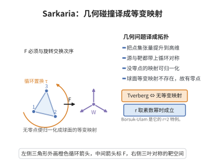

# Sarkaria 定理

> **一句话大白话**：Tverberg 定理（足够多的点总能分成 $r$ 组、各组凸包相交）等价于一个"$r$-循环对称"的 Borsuk–Ulam 型无从映射定理——几何的碰撞问题被翻译成拓扑的等变映射问题。
>
> **小例子**：$r=2$ 时它退化为经典 Borsuk–Ulam：$S^{d+1}\to S^{d}$ 的 $\mathbb{Z}_2$-等变映射不存在，对应 Radon 定理（$d+2$ 点可二分使两凸包相交）。

## 一、定理介绍

> **前置依赖**：凸包与凸组合、Tverberg 定理、Radon 定理、Borsuk–Ulam 定理、单形与 join、同调与等变映射。

Sarkaria 定理由 Karanbir Sarkaria 于 1991–1992 年在研究 Tverberg 型问题与 van Kampen–Flores 定理时提出。其核心是所谓的"张量技巧"（Sarkaria's tensor trick）：把一张仿射映射提升为一个定义在 $r$ 份单形 join 上的 $\mathbb{Z}_r$-等变映射，于是 Tverberg 的"存在共享点"被等价地改写为"不存在某个等变球面映射"。这把离散几何的计数问题完全转化为群作用的同伦/同调问题，使 Borsuk–Ulam 与 Dold 定理可以直接用于 Tverberg、彩色 Carathéodory、van Kampen–Flores 等一大批结果。它是拓扑组合学的枢纽定理，也是"素数幂 $r$ 情形可证、非素数幂情形失效"这一现象的统一解释框架。

## 几何直观

图意在说明：把点集张量提升后，Tverberg 问题等价于某个循环对称的球面映射不存在。

## 二、原理思路

1. 张量提升：取 $\mathbb{Z}_r$ 的约化正则表示 $W$（维数 $r-1$，由循环置换 $\tau$ 作用）。把映射与齐次化 $\mathbb{R}^{d+1}\to\mathbb{R}^d$ 结合，构造等变映射 $F:(\Delta_N)^{*r}\to\mathbb{R}^{d+1}\otimes W$。
2. 若 $F$ 处处非零，则归一化得等变映射 $F:(\Delta_N)^{*r}\to S^{N-1}$，与等变拓扑的非存在性定理矛盾，故 $F$ 必有零点。
3. $F$ 的零点对应 $r$ 份单形中取值相同的 $r$ 个点，其支撑恰为不交的面，即给出 Tverberg 划分；反之若无 Tverberg 划分则 $F$ 恒不为零，可构造等变映射，两个方向合起来给出等价性。

## 三、定理的严格表述

设 $r\ge2$、$d\ge1$，记 $N=(d+1)(r-1)$。令 $W$ 为循环群 $\mathbb{Z}_r=\langle\tau\rangle$ 的约化正则表示，则 $W$ 为 $r-1$ 维实向量空间。考虑 $r$ 份 $N$ 维单形 $\Delta_N$ 的 join

$$
K=(\Delta_N)^{*r},
$$

$\mathbb{Z}_r$ 通过 $\tau$ 循环置换这 $r$ 份单形。则下列两条等价：

1. （Tverberg 定理）任意 $N+1=(d+1)(r-1)+1$ 个 $\mathbb{R}^d$ 中的点，总可划分为 $r$ 组，使各组凸包有公共点；等价地，对任意仿射映射 $f:\Delta_N\to\mathbb{R}^d$，存在两两不交的面 $\sigma_1,\dots,\sigma_r\subset\Delta_N$ 使 $f(\sigma_1)\cap\cdots\cap f(\sigma_r)\ne\emptyset$。
2. （Sarkaria 的线性 Borsuk–Ulam 型陈述）不存在 $\mathbb{Z}_r$-等变的连续映射

$$
F:\ (\Delta_N)^{*r}\ \longrightarrow\ S^{N-1}\subset \mathbb{R}^{d+1}\otimes W .
$$

当 $r$ 为素数幂时，陈述 2 的非存在性成立，故 Tverberg 定理对一切 $r$ 成立；陈述 2 在 $r$ 非素数幂时可能失效，这正对应拓扑 Tverberg 猜想的反例。

## 四、证明过程

**步骤 1（构造等变提升）。** 把 $f:\Delta_N\to\mathbb{R}^d$ 的顶点值 $a_0,\dots,a_N\in\mathbb{R}^d$ 齐次化为 $\hat a_i=(a_i,1)\in\mathbb{R}^{d+1}$，并令 $\hat f:\Delta_N\to\mathbb{R}^{d+1}$ 为对应仿射映射，$\hat f(x)=\sum_i x_i\hat a_i$。取 $K=(\Delta_N)^{*r}$ 中一点 $x=(x^{(1)},\dots,x^{(r)})$，其中 $x^{(j)}=\sum_i x^{(j)}_i e_i$ 是第 $j$ 份单形上的凸坐标。定义

$$
F(x)=\sum_{j=1}^{r}\hat f(x^{(j)})\otimes \tau^{\,j}v_0\ \in\ \mathbb{R}^{d+1}\otimes W ,
$$

其中 $v_0\in W$ 为生成元。由 $W$ 的循环结构，$F$ 是 $\mathbb{Z}_r$-等变的：$F(\tau\cdot x)=\tau\cdot F(x)$。

**步骤 2（非零提升给出等变映射）。** 假设对所有 $x$ 有 $F(x)\ne0$。由 $W$ 中 $\tau$ 的循环对称性，$\sum_{j=1}^{r}\tau^{\,j}v_0=0$，故 $F$ 落在"约化"子空间内；对它归一化即得等变映射 $\hat F:K\to S^{N-1}$，其中 $S^{N-1}$ 是 $\mathbb{R}^{d+1}\otimes W\cong\mathbb{R}^{N}$ 中的单位球面。

**步骤 3（等变拓扑的非存在性）。** 由 $\mathbb{Z}_r$-等变的 Borsuk–Ulam（Dold 型）定理，由于 $K$ 的维数足够高且 $\mathbb{Z}_r$ 沿 $K$ 的相应骨架自由作用，这样的等变映射 $\hat F$ 不存在。故 $F$ 必有零点。

**步骤 4（零点导出 Tverberg 划分）。** 设 $F(x)=0$。把 $F(x)$ 按 $W$ 的基展开，$F(x)=0$ 的每个分量方程等价于

$$
\sum_{j=1}^{r} \tau^{\,\ell}\big(\hat f(x^{(j)})\big)=0\quad(\ell=0,\dots,r-1),
$$

由此得 $\hat f(x^{(1)})=\cdots=\hat f(x^{(r)})$。把 $x^{(j)}$ 的支撑面记作 $\sigma_j$；按下标作规则分配（把同时属于多个支撑的点归入其余支撑），可得两两不交的面 $\sigma_1,\dots,\sigma_r$，其像共享同一公共点（即 $\hat f(x^{(j)})$ 在前 $d$ 个坐标上的投影）。于是得到 Tverberg 划分。

**步骤 5（反向等价）。** 反之，若存在无 Tverberg 划分的仿射 $f$，则上述构造的 $F$ 恒不为零，可归一化得等变映射 $\hat F$，从而给出陈述 2 的反例。两个方向合起来即为等价性。$\square$

## 五、应用与意义

- 提供 Tverberg 定理的拓扑证明框架，把几何碰撞问题化为等变映射的非存在性。
- 统一处理彩色 Carathéodory、van Kampen–Flores 与拓扑 Tverberg 猜想，并解释素数幂条件的来源。
- 是拓扑组合学中张量技巧与 Dold 定理应用的范式，广泛用于代数拓扑方法与离散几何的交叉。

## 课堂问答

**老师**：Sarkaria 定理的核心思想是什么？

**学生**：把 Tverberg 的"存在共享点"翻译成拓扑的"不存在某个 $\mathbb Z_r$-等变球面映射"。用张量技巧把仿射映射 $f:\Delta_N\to\mathbb R^d$ 提升为定义在 $r$ 份单形 join $K=(\Delta_N)^{*r}$ 上的等变映射，其中 $N=(d+1)(r-1)$，取 $F(x)=\sum_{j=1}^{r}\hat f(x^{(j)})\otimes\tau^{\,j}v_0$。$F$ 有零点等价于存在 Tverberg 划分。

**老师（追问）**：为什么 $F$ 有零点就给出 Tverberg 划分？

**学生**：$F(x)=0$ 按 $W$ 的基展开成 $r$ 个分量方程，等价于 $\hat f(x^{(1)})=\cdots=\hat f(x^{(r)})$，即 $r$ 份单形上各取一点、其像（投影到前 $d$ 维）重合。把每份单形的支撑面记作 $\sigma_j$（按规则处理重叠下标），即得两两不交的面，其像共享公共点，正是 Tverberg 划分。

**老师（拓展）**：素数幂假设从哪来？

**学生**：来自 $\mathbb Z_r$-等变的 Borsuk–Ulam（Dold 型非存在性）定理——$r$ 为素数幂时该等变映射确实不存在，故 Tverberg 成立；$r$ 非素数幂时这一非存在性可能失效，正好对应拓扑 Tverberg 猜想的反例，也是该猜想至今只在素数幂情形被解决的原因。

## 相关条目

- [Tverberg定理](./Tverberg定理.md)：本定理的核心等价对象。
- [Radon定理](./Radon定理.md)：$r=2$ 时的特例，对应对经典 Borsuk–Ulam。
- [Carathéodory定理](./Carathéodory定理.md)：彩色 Carathéodory 与 Tverberg 通过本框架相联系。
- [Helly定理](./Helly定理.md)：同为离散几何中凸集相交的经典刻画。
