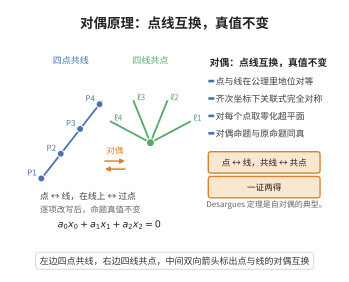

# 射影平面的对偶原理

> **一句话大白话**：在射影平面里，"点"与"直线"地位完全对等——把命题中的点和线互换、把"在……上"与"经过"互换，得到的仍是成立的命题。
>
> **小例子**："两条直线必交于一点"的对偶是"两点必连成一条直线"；Desargues 定理是自对偶的，其对偶命题仍是它自己。

## 一、定理介绍

> **前置依赖**：射影平面的公理与齐次坐标、点与直线的关联关系、向量空间与对偶空间、Desargues定理。

射影平面源于 Desargues 在 17 世纪透视画法中的研究，Poncelet 与 Gergonne 在 19 世纪初明确提出"对偶原理"。其核心观察是：射影平面中"点位于直线上"这一关联关系是对称的——用齐次坐标表示时，点 $(x_0:x_1:x_2)$ 位于直线 $(a_0:a_1:a_2)$ 上的条件是内积 $a_0x_0+a_1x_1+a_2x_2=0$，而该式对点坐标与直线坐标完全对称。于是任何只涉及关联关系的命题，交换"点 $\leftrightarrow$ 线""在 $\leftrightarrow$ 经过""共线 $\leftrightarrow$ 共点"后仍成立，对偶命题与原命题同真。这使一条定理自动给出另一条定理，是射影几何最有力的方法论工具，也为有限射影平面、对偶码与线性规划对偶提供统一视角。

## 几何直观

图意在说明：把命题中的点与线、在线上与过点逐项互换，得到的对偶命题与原命题同真。

## 二、原理思路

1. 用齐次坐标把点与直线统一为三维向量空间 $V$ 中的一维子空间与二维子空间，关联关系由对称双线性内积为零刻画。
2. 定义对偶映射 $\pi$：把每个点（一维子空间 $[x]$）映到其零化超平面 $x^{\perp}$（二维子空间，即一条直线）；在点集与直线集之间给出双射，且保持关联。
3. 因此任何由关联关系所构成的命题经 $\pi$ 作用后变为对偶命题，真值不变；对可坐标化（Desarguesian）射影平面，对偶平面与原平面同构，故对偶原理成立。

## 三、定理的严格表述

设 $\Pi=\mathrm{PG}(2,\mathbb{F})$ 为域 $\mathbb{F}$ 上的射影平面，$V=\mathbb{F}^3$。点集为 $V$ 的一维子空间，直线集为 $V$ 的二维子空间，点 $p=[x]$ 在直线 $\ell=[a]$ 上当且仅当

$$
a_0x_0+a_1x_1+a_2x_2=0 .
$$

（对偶原理）设 $\mathcal{P}$ 是仅用"点、直线、关联、共线、共点"表述的命题。把其中每个"点"与"直线"互换、每个"在……上"与"经过"互换，得到对偶命题 $\mathcal{P}^{*}$。则

$$
\mathcal{P}\ \text{在}\ \Pi\ \text{中成立} \iff \mathcal{P}^{*}\ \text{在}\ \Pi\ \text{中成立}.
$$

## 四、证明过程

**步骤 1（对偶映射的定义）。** 对点 $p=[x]$（$x\ne0$）定义 $\pi(p)$ 为线性方程 $\sum_i a_ix_i=0$ 的解空间 $x^{\perp}\subset V$。因 $x\ne0$，$\dim x^{\perp}=3-1=2$，故 $\pi(p)$ 是一条直线。对称地，对直线 $\ell=[a]$ 定义 $\pi(\ell)=a^{\perp}$ 为一个点。显然 $\pi$ 在点集与直线集之间给出双射。

**步骤 2（保持关联）。** 由对称双线性式 $\langle a,x\rangle=\sum_i a_ix_i$ 直接得

$$
p\ \text{在}\ \ell\ \text{上} \iff \langle a,x\rangle=0 \iff \langle x,a\rangle=0 \iff \pi(\ell)\ \text{在}\ \pi(p)\ \text{上}.
$$

即 $\pi$ 把点-线关联变为线-点关联，把共线点集变为共点直线束，把共点直线束变为共线点集。

**步骤 3（命题的翻译）。** 设 $\mathcal{P}$ 用只含"点""直线""在……上"谓词的一阶语句描述。按步骤 2 的对应逐项改写量词与谓词即得 $\mathcal{P}^{*}$。因为 $\pi$ 是双射且保持关联，任一实现 $\mathcal{P}$ 的配置 $C$ 经 $\pi$ 变为实现 $\mathcal{P}^{*}$ 的配置 $\pi(C)$，反之亦然。故 $\mathcal{P}$ 有模型当且仅当 $\mathcal{P}^{*}$ 有模型。

**步骤 4（对偶平面自同构）。** 所有 $\pi(p)$ 构成对偶平面 $\Pi^{*}$。由于 $\Pi$ 与 $\Pi^{*}$ 都用同一个坐标域 $\mathbb{F}$ 坐标化，可选取非退化双线性型把 $\Pi^{*}$ 与 $\Pi$ 等同，得 $\Pi\cong\Pi^{*}$。这解释了为何对可坐标化射影平面，对偶命题总与原命题同真；对非 Desarguesian 射影平面，对偶平面可能不与原平面同构，但"对偶命题在该对偶平面中成立"依然成立。$\square$

## 五、应用与意义

- 射影几何中实现"一证两得"：Brianchon 定理对偶于 Pascal 定理，Desargues 定理自对偶。
- 有限射影平面的点-线计数 $q^2+q+1$ 与对偶码、对称区组设计理论直接相关。
- 与线性规划对偶、向量空间对偶、Poincaré 对偶共享"对偶"这一统一方法论。

## 课堂问答

**老师**：在射影平面里把命题中的"点"和"线"对调，得到的命题还成立吗？

**学生**：对只用"点、线、关联、共线、共点"表述的命题，成立——这就是对偶原理。根源在齐次坐标：点 $[x]$ 在直线 $[a]$ 上等价于 $\langle a,x\rangle=a_0x_0+a_1x_1+a_2x_2=0$，而它对 $a$ 和 $x$ 完全对称。于是"对每个点取零化超平面 $x^{\perp}$"给出点集与直线集之间的双射 $\pi$，并且保持关联。

**老师（追问）**：凭什么说 $\pi$ 把命题的真值也保存下来？

**学生**：因为 $p$ 在 $\ell$ 上等价于 $\langle a,x\rangle=0$，又等价于 $\langle x,a\rangle=0$，即 $\pi(\ell)$ 在 $\pi(p)$ 上。$\pi$ 是双射且保持关联，所以任何实现原命题的构形 $C$ 经 $\pi$ 变成实现对偶命题的构形 $\pi(C)$，反之亦然，两命题同真。

**老师（拓展）**：这种对偶在任何射影平面都成立吗？会不会有反例？

**学生**：要分清两层。凡是可用关联关系表述的命题，"对偶命题在该对偶平面中成立"都成立；但"对偶平面与原平面同构"只对可坐标化的 Desarguesian 平面成立，非 Desarguesian 平面的对偶平面可能不同构。常见误区就是把这层混为一谈。经典收获如 Pascal 定理与 Brianchon 定理互为对偶、Desargues 定理自对偶。

## 相关条目

- [有限射影平面的基本性质](./有限射影平面的基本性质.md)：对偶原理在有限域射影平面上的具体体现。
- [Desargues定理](./Desargues定理.md)：自对偶的经典射影定理。
- [仿射平面与射影平面的扩展](./仿射平面与射影平面的扩展.md)：引入无穷远线使对偶关系封闭成立。
- [Bruck-Ryser定理](./Bruck-Ryser定理.md)：用计数与数论排除某些射影平面的存在性。
