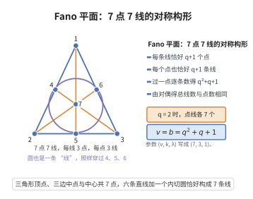

# 有限射影平面的基本性质

> **一句话大白话**：有限射影平面非常"排布均匀"：每条线有 $q+1$ 个点，则每个点也在 $q+1$ 条线上，总点数与总线数都是 $q^2+q+1$。
>
> **小例子**：Fano 平面（阶 $q=2$）有 $2^2+2+1=7$ 个点、$7$ 条线，每条线上 $3$ 个点、每点过 $3$ 条线——"点点对称、线线等价"的构形。

## 一、定理介绍

> **前置依赖**：有限射影平面的公理定义、射影平面的对偶原理、计数方法与双计数、关联矩阵及其特征值

有限射影平面的基本性质给出其完备的参数计数：由共线的点数 $q+1$ 可推出每点的线数、总点数与总线数。它依赖射影平面的对偶性，并可用关联矩阵 $AA^T=qI+J$ 严格证实。

## 几何直观

图意在说明：由每线 q+1 个点出发，对偶与双计数同时定出每点线数、总点数与总线数。

## 二、原理思路

射影平面公理在对偶（点↔线互换）下不变，故点的结论与线的结论对偶。计数：取不通过 $p$ 的线 $l$（有 $q+1$ 个点），$p$ 与 $l$ 上每点确定一条互异且遍历所有过 $p$ 线的线，故过 $p$ 的线数为 $q+1$。再固定 $p$，过 $p$ 的 $q+1$ 条线除 $p$ 外各有 $q$ 个互异点，总点数 $v=1+(q+1)q=q^2+q+1$。

## 三、定理的严格表述

（有限射影平面的基本性质）设 $\Pi$ 为有限射影平面，每条线上 $q+1$ 个点，则：

1. 每个点恰好在 $q+1$ 条线上；
2. 总点数 $v=q^2+q+1$；
3. 总线数 $b=q^2+q+1$。

## 四、证明过程

**证：**

1. **对偶性。** 射影平面公理点线互换不变，故点的对偶陈述成立。

2. **每点线数。** 取不通过 $p$ 的线 $l$（含 $q+1$ 个点），$p$ 与 $l$ 上每点确定互异的线（否则两线有两个交点），且过 $p$ 的任一线与 $l$ 交于唯一一点。故过 $p$ 的线数等于 $l$ 上点数 $q+1$。

3. **总点数。** 固定 $p$，过 $p$ 的 $q+1$ 条线除 $p$ 外各含 $q$ 个互异点，故 $v=1+(q+1)\cdot q=q^2+q+1$。

4. **总线数。** 由对偶性 $b=v=q^2+q+1$。可并行验证关联矩阵：$AA^T=qI+J$，各行列和为 $q+1$，特征值与矩阵方程给出 $v$。$\square$

## 五、应用与意义

有限射影平面参数 $(q^2+q+1, q+1, 1)$ 构成对称 $(v,k,\lambda)$-设计，是组合设计理论的基本对象。它们用于构造正交拉丁方、纠错码（如 $PG(2,q)$ 上的码）、BIBD 与拟阵，并在把"均匀、对称"的几何结构工程化（如网络拓扑、无误通信）中扮演核心角色。

## 课堂问答

**老师**：一个有限射影平面里，如果每条直线上都恰好有 $q+1$ 个点，你能立刻告诉我每个点上有几条线、整个平面有多少点、多少线吗？

**学生**：结论是：每个点恰好在 $q+1$ 条线上，总点数与总线数都等于 $q^2+q+1$。理由分两层——先对偶、再双计数。对偶说点的命题与线的命题一一对应，所以点的结论可以直接从线的结论翻过来。

**老师（追问）**：那"每个点 $q+1$ 条线"具体怎么数出来？射影公理里哪一条被用到了？

**学生**：取一条不通过 $p$ 的线 $l$，它上面有 $q+1$ 个点；$p$ 与 $l$ 上每个点确定一条线，这些线互不相同（否则两线会有两个交点），而过 $p$ 的任一条线又必与 $l$ 交于唯一一点，于是"过 $p$ 的线"与"$l$ 上的点"构成双射，数目就是 $q+1$。这一步用到"任两点确定唯一直线"。再固定 $p$：过它的 $q+1$ 条线除 $p$ 外各含 $q$ 个互异点，故 $v=1+(q+1)q=q^2+q+1$，总线数由对偶得 $b=v$。用关联矩阵写即 $AA^T=qI+J$。

**老师（拓展）**：把参数写成 $(v,k,\lambda)=(q^2+q+1,q+1,1)$，它正好是一个对称区组设计。那反过来，随便给一个这样的对称设计，就一定是射影平面吗？

**学生**：不一定。常见误区就是把对称设计与射影平面画等号——对称设计没有"任两点唯一连线、任两线交于一点"的公理约束，$(q^2+q+1,q+1,1)$ 只是必要参数。比如 $q=2$ 给出 Fano 平面（$7$ 点 $7$ 线），而 $q=10$ 对应的设计是否真能成为射影平面，至今仍未解决。
