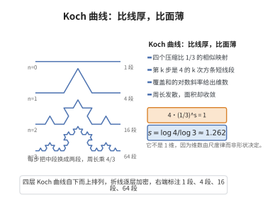

# Koch曲线的Hausdorff维数

> **一句话大白话**：Koch 曲线由四个压缩比 $1/3$ 的相似映射生成，于是维数 $s$ 满足 $4\cdot(1/3)^s=1$，即 $s=\log4/\log3\approx1.26$。
>
> **小例子**：Koch 雪花"周长无穷而面积有限"：每次迭代周长乘 $4/3$ 趋于无穷，面积却收敛到有限值——这正是 $1.26$ 维"比线厚、比面薄"的体现。

## 一、定理介绍

> **前置依赖**：IFS吸引子的维数、相似映射与压缩比、开集条件、质量分布原理、Hausdorff测度与维数

Koch 曲线 $K$ 由单元线段每步三等分、以等边三角形替换中段构造。本定理证明 $\dim_H K=\log4/\log3$，是"有限面积、无限周长"之奇观背后的分形维数根据。

## 几何直观

图意在说明：每步段数乘 4、长度除 3，尺度律解出维数 1.26，于是周长发散而面积有限。

## 二、原理思路

与 Cantor 集完全平行：上界用第 $k$ 步的 $4^k$ 条长 $3^{-k}$ 线段作覆盖；下界把 $K$ 视为 IFS 吸引子（四个压缩比 $1/3$ 的相似映射），验证开集条件并在其上安放使得每个第 $k$ 级子区间测度为 $4^{-k}$ 的测度，用质量分布原理证 $\mathcal{H}^s(K)>0$。

## 三、定理的严格表述

（Koch 曲线的 Hausdorff 维数）Koch 曲线 $K$ 的 Hausdorff 维数为
$$
\dim_H K=\frac{\log4}{\log3}
$$

## 四、证明过程

**第一步（上界）：** 第 $k$ 步构造中 $K$ 近似由 $4^k$ 条长 $3^{-k}$ 的线段组成，构成 $\delta_k=3^{-k}$ 覆盖，故
$$
\mathcal{H}^s_{\delta_k}(K)\le4^k\cdot(3^{-k})^s=(4\cdot3^{-s})^k
$$
若 $s>\log4/\log3$，则 $4\cdot3^{-s}<1$，令 $k\to\infty$ 得 $\mathcal{H}^s(K)=0$，故 $\dim_H K\le\log4/\log3$。

**第二步（下界）：** 视 $K$ 为四个压缩比 $1/3$ 的相似映射 $f_1,\dots,f_4$ 的 IFS 吸引子，它们分别沿 $x$ 轴压缩平移、压缩并旋转 $60^\circ$、$-60^\circ$、再平移 $2/3$。取 $V$ 为端点 $(0,0),(1,0)$ 的等边三角形内部，则开集条件成立。由 IFS 维数定理，$s$ 满足 $4\cdot(1/3)^s=1$，即 $s=\log4/\log3$。

直接证明下界：在 $K$ 上构造自然概率测度 $\mu$，使每个第 $k$ 级子区间测度为 $4^{-k}$，可证存在 $c>0$ 使 $\mu(B(x,r))\le c\,r^s$。由质量分布原理 $\mathcal{H}^s(K)>0$，故 $\dim_H K\ge s$。

**第三步（综合）：** 由上下界得 $\dim_H K=\log4/\log3$。$\square$

## 五、应用与意义

Koch 曲线是"无限长度维数却不等于 $1$"的经典展示，它的雪花版本直观呈现 $1.26$ 维的填充能力。该曲线还启发人们思考自然形态（海岸线、雪花、树冠）的分形建模，并与长度测量的尺度依赖现象（海岸线悖论）直接相关。

## 课堂问答

**老师**：Koch 曲线的维数为什么不是 $1$？

**学生**：$\dim_H K=\log4/\log3\approx1.262$。它由四个压缩比 $1/3$ 的相似映射生成，套 IFS 维数定理：$4\cdot(1/3)^s=1$ 得 $s=\log4/\log3$。

**老师（追问）**：它明明是一条"曲线"，怎么会大于 $1$ 维？

**学生**：因为自我相似带来"周长无穷、面积有限"。第 $k$ 步用 $4^k$ 条长 $3^{-k}$ 的线段作覆盖，$\mathcal{H}^s_{\delta_k}(K)\le4^k\cdot(3^{-k})^s=(4\cdot3^{-s})^k$，当 $s>\log4/\log3$ 时趋于 $0$，得上界；下界在 $K$ 上放每个第 $k$ 级子区间测度为 $4^{-k}$ 的测度，配合质量分布原理得 $\mathcal{H}^s(K)>0$。上下界相夹即得结论。

**老师（拓展）**：那"周长无穷、面积有限"的机理是什么？

**学生**：每步周长乘以 $4/3$，迭代 $k$ 次后是 $(4/3)^k\to\infty$；而面积每步乘约 $4/9$，等比收敛到有限值。正是 $1<s<2$ 的"比线厚、比面薄"造成这一奇观。常见误区是凭直观说它是 $1$ 维——维数由覆盖的尺度律决定，而非它长得像曲线。Koch 雪花导出的海岸线悖论也由此而来：用不同尺子量同一曲线会得到不同长度。
