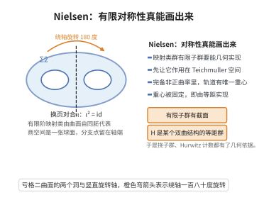

# Nielsen 实现定理

> **一句话大白话**：曲面映射类群里的任意有限子群，都能被"真正几何地实现"——存在同构的有限群通过曲面的自同胚起作用；映射类群中的有限阶对称性不是纯形式代数关系，而是真能画出来的对称。

> **小例子**：亏格 $2$ 曲面 $\Sigma_2$ 的超椭圆对合 $\iota$（把 $\Sigma_2$ 表为 $S^2$ 的二重分枝覆盖时的换叶自同胚）满足 $\iota^2=\mathrm{id}$，它在 $\mathrm{Mod}(\Sigma_2)$ 中给出一个阶 2 类——这正是 Nielsen 实现定理所保证的"有限阶映射类可由自同胚代表"。

## 一、定理介绍

> **前置依赖**：曲面映射类群、映射类群的Dehn扭转生成定理、曲面的双曲结构与测地线、双曲群的Cartan-Hadamard定理、Svarc-Milnor引理、Teichmüller 空间与标记曲面。

Jakob Nielsen 在 1920 年代研究曲面自同胚的代数刻画时提出并证明了本定理的雏形：他把 $\mathrm{Mod}(S)$ 与 $\mathrm{Out}(\pi_1(S))$ 联系起来，并断言有限阶的映射类总能由有限阶自同胚代表。完整的"任意有限子群可同时实现"由 Kerckhoff 于 1983 年用 Teichmüller 空间的凸性与重心论证给出干净证明（此前 Wolpert、Macbeath、Fenchel 等已有部分结果）。

定理是曲面拓扑与几何群论的基本工具：它说明映射类群中的有限对称性可以"几何化"为等距群，从而 $\mathrm{Mod}(S)$ 的挠子群、Hurwitz 型计数（$|\mathrm{Isom}|\le84(g-1)$）、商轨形 $\Sigma_g/H$ 与覆盖空间理论得以建立；它也是 $\mathrm{Out}(F_n)$ 有限子群实现问题、虚拟上同调与算术群刚性的原型。定理由此把"代数上的有限阶"与"几何上的对称"完全对齐。

## 几何直观

图意在说明：映射类群里的有限子群可用曲面的自同胚实现，因为轨道在 Teichmuller 空间有唯一重心。

## 二、原理思路

1. **提升为 Teichmüller 空间上的作用**：$\mathrm{Mod}(S)$ 通过拉回双曲结构作用在 Teichmüller 空间 $\mathcal T(S)$ 上，且是等距的、正常不连续的离散群作用。

2. **有限群有不动点**：$\mathcal T(S)$ 上配有 Teichmüller 度量，它是完备、非正曲率、Busemann 凸的；有限群 $H$ 的轨道取"重心"（唯一最小直径点），该点被 $H$ 固定。

3. **不动点即实现**：若 $[\sigma_0]\in\mathcal T(S)$ 被 $H$ 固定，则 $H$ 提升为某个双曲结构 $\sigma_0$ 的等距群子群，而 $\mathrm{Isom}^+(\sigma_0)\to\mathrm{Mod}(S)$ 的像恰为 $\mathrm{Stab}_{\mathrm{Mod}(S)}([\sigma_0])$，故 $H$ 由同胚（等距）实现。

4. **与 Dehn 扭转生成配合**：由 Dehn 扭转生成定理，$H$ 的生成元都是有限个扭转的复合，它们作为 $\mathcal T(S)$ 上的等距适用同一重心论证，故有限生成集可同时实现。

## 三、定理的严格表述

设 $S$ 是紧致、可定向、连通曲面（可带边界分支或 puncture），$\mathrm{Mod}(S)=\pi_0(\mathrm{Homeo}^+(S))$ 为其保定向映射类群，$S$ 的内部带完备双曲结构，$\mathcal T(S)$ 为 Teichmüller 空间，$\pi:\mathrm{Homeo}^+(S)\to\mathrm{Mod}(S)$ 为自然投影。

**（Nielsen 实现定理）**

（a）**提升性**：设 $H\le\mathrm{Mod}(S)$ 是有限子群。则存在单射同态（"截面"）
$$
\rho:H\longrightarrow\mathrm{Homeo}^+(S),\qquad \pi\circ\rho=\mathrm{id}_H ,
$$
即 $H$ 由曲面的自同胚实现，且可实现为有限阶自同胚。

（b）**几何实现**：存在标记双曲结构 $[\sigma_0]\in\mathcal T(S)$，使
$$
\rho(H)\subseteq\mathrm{Isom}^+(\sigma_0)\subseteq\mathrm{Homeo}^+(S),
$$
即 $H$ 同时实现为同一个双曲度量 $\sigma_0$ 的保定向等距群子群；等价地，$\mathcal T(S)$ 上的 $H$-作用有不动点 $[\sigma_0]$。

（c）**代数形式**：若 $S$ 的 $\pi_1(S)$ 有非平凡中心（$\pi_1$ 平凡、$\mathbb Z$、$\mathbb Z^2$ 等低复杂度情形）需单独处理，则本结论用 $\mathrm{Out}(\pi_1(S))$ 的有限子群提升为 $\mathrm{Aut}(\pi_1(S))$ 的有限子群表述；在 $g\ge2$ 时 $\mathrm{Mod}(S)\cong\mathrm{Out}^+(\pi_1(S))$，$H$ 的有限提升即为实现。

## 四、证明过程

**步骤 1（Teichmüller 空间上的等距作用）。** Teichmüller 空间 $\mathcal T(S)$ 是所有标记双曲结构 $[\sigma]$ 的集合，其上有 Teichmüller 度量 $d_{\mathcal T}$，$\mathcal T(S)$ 是完备、单连通、非正曲率（Busemann 凸）的度量空间，可记为有限维的 $\mathbb R^{6g-6}$ 型凸区域。映射类群通过
$$
\varphi\cdot[\sigma]:=[\varphi_*\sigma],\qquad (\varphi\in\mathrm{Mod}(S))
$$
作用在 $\mathcal T(S)$ 上，且该作用是等距的：
$$
d_{\mathcal T}(\varphi\cdot[\sigma],\varphi\cdot[\sigma'])=d_{\mathcal T}([\sigma],[\sigma']).
$$
$\mathrm{Mod}(S)$ 在这个作用下的像是离散（正常不连续）等距群，这一点可由 Thurston 的紧化与 Wolpert 的凸性结果得到。

**步骤 2（有限群作用的不动点）。** 设 $H\le\mathrm{Mod}(S)$ 有限。任取 $[\sigma]\in\mathcal T(S)$，考虑轨道 $\{h\cdot[\sigma]:h\in H\}$。定义其直径
$$
D([\sigma])=\max_{h,h'\in H}d_{\mathcal T}\big(h\cdot[\sigma],h'\cdot[\sigma]\big).
$$
在 $\mathcal T(S)$ 的 Busemann 凸性与严格凸性下，最小化 $D$ 的点存在且唯一（有限维非正曲率空间上的凸函数有唯一极小点），记为 $[\sigma_0]$。由 $d_{\mathcal T}$ 的 $H$-不变性与极小点唯一性，对任意 $h\in H$ 有 $h\cdot[\sigma_0]=[\sigma_0]$，即 $[\sigma_0]$ 被 $H$ 固定。

**步骤 3（不动点给出等距实现）。** 断言：$\mathrm{Stab}_{\mathrm{Mod}(S)}([\sigma_0])$ 恰是 $\mathrm{Isom}^+(\sigma_0)$ 在 $\mathrm{Homeo}^+(S)$ 中的像。一方面，若同胚 $\varphi$ 满足 $\varphi_*\sigma_0$ 与 $\sigma_0$ 同构，则 $\varphi$ 同痕于一个等距；另一方面，等距同痕于自身的映射类是良定义的，且不同等距若同痕则给出同一映射类。故有群同构
$$
\mathrm{Isom}^+(\sigma_0)\big/\big(\text{同痕的等距}\big)\xrightarrow{\ \sim\ }\mathrm{Stab}_{\mathrm{Mod}(S)}([\sigma_0]),
$$
而 $\mathrm{Isom}^+(\sigma_0)$ 在 $\mathrm{Mod}(S)$ 中的像是有限群（因为曲面双曲等距群对 $g\ge2$ 是离散且余紧的）。由步骤 2，$H\subseteq\mathrm{Stab}_{\mathrm{Mod}(S)}([\sigma_0])$，故 $H=\pi(\Sigma_0)$ 对某个有限群 $\Sigma_0\le\mathrm{Isom}^+(\sigma_0)$ 成立；取 $\rho$ 为 $\pi|_{\Sigma_0}$ 的逆，得
$$
\rho:H\hookrightarrow\mathrm{Isom}^+(\sigma_0)\subseteq\mathrm{Homeo}^+(S),\qquad \pi\circ\rho=\mathrm{id}_H,
$$
即（a）与（b）。每个 $\rho(h)$ 是有限阶等距（等距群离散且余紧、有限子群 ⇒ 每个元素有限阶），故 $H$ 实现为有限阶自同胚。

**步骤 4（与 Dehn 扭转生成的配合）。** 由映射类群的 Dehn 扭转生成定理，$\mathrm{Mod}(S)$（或带边界情形下的 $\mathrm{PMod}(S)$）由有限个 Dehn 扭转表示；若 $H$ 由一个有限生成集给出，则每个生成元是这些扭转的复合，作为 $\mathcal T(S)$ 上的等距，它们对 $D$ 的作用与 $H$ 的任意元素一致，故步骤 2 的重心论证同样给出公共不动点，使整个有限生成集同时等距实现。这解释了为什么不必逐个元素实现后再凑合：凸性一次性给出同时不动点。

**步骤 5（低复杂度与边界情形）。** 当 $S$ 为球面少 punctures、环面、圆环等低复杂度曲面时，$\pi_1(S)$ 的中心非平凡，需在 $\mathcal T(S)$ 的相应变体（带测地边界的标记双曲面、或对低维 $\mathcal T(S)$ 直接参数化）上重复步骤 1–3；结论形式（存在同胚实现与共同双曲/平坦结构）不变。$\square$

## 五、应用与意义

- **映射类群的挠子群**：本定理说明 $\mathrm{Mod}(S)$ 的每个有限子群都是等距群子群，由此可枚举与分类曲面的有限对称群（Hurwitz 型结论 $|\mathrm{Isom}^+|\le84(g-1)$，$g\ge2$）。
- **轨形与覆盖空间**：商 $S/H$ 是紧轨形，$S\to S/H$ 是轨形覆盖，把曲面拓扑问题转化为轨形基本群与覆盖理论，用于分类算术轨形与三角群。
- **$\mathrm{Out}(F_n)$ 中的有限子群**：曲面情形是 $\mathrm{Out}(F_n)$ 有限子群提升问题（Nielsen realization conjecture）的原型与可解特例。
- **Teichmüller 几何与刚性**：重心与凸性论证说明 $\mathcal T(S)$ 的 Busemann 凸性是映射类群作用的本质几何输入，也是 Mostow 刚性与 Thurston 紧化的技术基础。
- **几何群论中的拟等距与边界**：实现后的等距群作用把曲面看成非正曲率空间（双曲群的 Cartan–Hadamard 定理给出唯一测地线与凸性），为拟测地线稳定性等结论提供模型。

## 课堂问答

**老师**：Nielsen 实现定理凭什么说映射类群的有限子群都能被几何实现？

**学生**：先给结论——任意有限子群 $H\le\mathrm{Mod}(S)$ 存在截面 $\rho:H\hookrightarrow\mathrm{Homeo}^+(S)$，且可实现为同一双曲结构 $\sigma_0$ 的等距，即 $\rho(H)\subseteq\mathrm{Isom}^+(\sigma_0)$。核心事实：Teichmüller 空间 $\mathcal{T}(S)$ 完备且 Busemann 凸，$H$ 的轨道有唯一最小直径点，即不动点。

**老师（追问）**：为什么凸性能保证有不动点？

**学生**：定义轨道直径 $D([\sigma])=\max_{h,h'\in H}d_{\mathcal{T}}(h\cdot[\sigma],h'\cdot[\sigma])$。非正曲率、严格凸的空间上凸函数有唯一极小点 $[\sigma_0]$；由 $d_{\mathcal{T}}$ 的 $H$-不变性与极小点唯一性，得 $h\cdot[\sigma_0]=[\sigma_0]$。

**老师（拓展）**：这个不动点是怎么变成"实现"的？

**学生**：在不动点处 $\mathrm{Isom}^+(\sigma_0)$ 到 $\mathrm{Mod}(S)$ 的像恰为 $\mathrm{Stab}_{\mathrm{Mod}(S)}([\sigma_0])$，故 $H$ 落在其中，取逆即得同胚（且为有限阶）实现。由此得到 Hurwitz 界 $|\mathrm{Isom}^+|\le84(g-1)$，它也是 $\mathrm{Out}(F_n)$ 有限子群实现问题的原型。

## 相关条目

- [曲面映射类群](../第62级-低维拓扑/曲面映射类群.md)：本定理的作用对象，其有限子群的可实现性正是定理内容。
- [映射类群的Dehn扭转生成定理](../第62级-低维拓扑/映射类群的Dehn扭转生成定理.md)：给出映射类群的生成元，是步骤 4 中"同时实现"论证的输入。
- [双曲群的Cartan-Hadamard定理](./双曲群的Cartan-Hadamard定理.md)：保证非正曲率空间的凸性与唯一测地线，是重心论证的几何基础。
- [Svarc-Milnor引理](./Svarc-Milnor引理.md)：把等距群作用与曲面的几何结构联系起来，是本定理与拟等距理论的接口。
