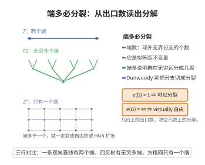

# Stallings端定理

> **一句话大白话**：群的"端"是它在 Cayley 图上"有多少个无穷大的出口"。超过一个出口的群，一定能沿有限子群裂成自由积或 HNN 扩张。
>
> **小例子**：自由群 $F_2$ 有无穷多个端（$e(F_2)=\infty$），它沿平凡子群裂成 $F_2=\mathbb{Z}*\mathbb{Z}$；而 $\mathbb{Z}$ 只有两个端（$e(\mathbb{Z})=2$）。

## 一、定理介绍

> **前置依赖**：Cayley 图与端数（拟等距不变量）、自由积与 HNN 扩张、Bass–Serre 理论、virtually 自由群、Dunwoody 割理论

Stallings 端定理（1968）刻画了有限生成群的端数：$e(G)>1$ 当且仅当 $G$ 可分解为自由积 $G=A*B$（$A\ne1\ne B$）或沿有限子群 $C$ 的 HNN 扩张 $G=A*_C$。它是几何群论中"代数结构由几何结构决定"的第一批深刻典范。

## 几何直观

图意在说明：Cayley 图在无穷远处的出口个数大于一时，群必沿有限子群裂成自由积或 HNN 扩张。

## 二、原理思路

端数是 Cayley 图"球外无界连通分支数"，属拟等距不变量。证明分两步：反向方向利用 Bass–Serre 理论（自由积与 HNN 扩张带来分解树上的作用，给出无穷多端）；正向则借助 Dunwoody 的割理论把端数与分裂对应起来，再对端数进行二分（$2$ 与 $\infty$）处理。

## 三、定理的严格表述

（Stallings 端定理）有限生成群 $G$ 满足 $e(G)>1$（有无穷多个端）当且仅当 $G$ 可分解为自由积 $G=A*B$（$A\ne1\ne B$）或作为 HNN 扩张 $G=A*_C$（其中 $C$ 是有限子群）。等价地，$e(G)=\infty$ 当且仅当 $G$ virtually 自由或者可沿有限子群非平凡融合。

## 四、证明过程

**第一步（端数 $>1$ 的几何刻画）：** $e(G)>1$ 等价于存在紧子集 $K\subset\Gamma=\Gamma(G,S)$ 使 $\Gamma\setminus K$ 至少有两个无界连通分支。

**第二步（Dunwoody 割理论）：** 利用 Dunwoody 的割理论研究将端分离的有限子集，可证存在有限子集 $F\subset G$，使 $G$ 沿 $F$ 分裂为 $G=A*B$ 或 $G=A*_C$，其中 $C$ 是有限子群。

**第三步（分类）：** 若 $e(G)=2$，则 $G\cong\mathbb{Z}$ 或 $G$ 含 $\mathbb{Z}$ 为有限指数子群；若 $e(G)=\infty$，则 $G$ 含有限指数自由子群（即 virtually 自由）。

**第四步（反向）：** 若 $G=A*B$ 且 $A\ne1\ne B$，则 $e(G)=\infty$；若 $G=A*_C$ 且 $C$ 是 $A$ 的真子群，则 $e(G)>1$。$\square$

## 五、应用与意义

Stallings 端定理是使用几何（端数）推得纯代数结论（自由积分解）的里程碑，深刻影响组合群论与 Bass–Serre 理论。它随后发展出 Stallings–Peierls-Dunwoody 的群分裂理论，成为群作用在树上的分解理论（可测树、JSJ 分解）的源头。

## 课堂问答

**老师**：Stallings 端定理的核心断言是什么？

**学生**：先给结论——有限生成群 $e(G)>1$ 当且仅当 $G$ 可分解为自由积 $G=A*B$（$A\ne1\ne B$）或沿有限子群 $C$ 的 HNN 扩张 $G=A*_C$。几何上端数是 Cayley 图"球外无界连通分支数"，是拟等距不变量。

**老师（追问）**：证明的两个方向各用什么工具？

**学生**：反向用 Bass–Serre 理论：自由积或 HNN 诱导出群在树上的作用，直接给出无穷多端。正向用 Dunwoody 割理论：把分离端的有限子集对应到群的分裂 $G=A*B$ 或 $G=A*_C$。

**老师（拓展）**：端数还能进一步分类吗？

**学生**：能。$e(G)=2$ 时 $G\cong\mathbb{Z}$ 或 virtually $\mathbb{Z}$；$e(G)=\infty$ 时 $G$ virtually 自由。注意 $e(F_2)=\infty$，因为 $F_2=\mathbb{Z}*\mathbb{Z}$；而 $\mathbb{Z}$ 只有两个端，正说明"两个端"是临界情形。
