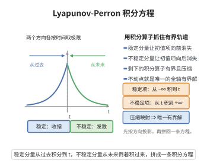

# Lyapunov-Perron 积分方程

> **一句话大白话**：想找双曲系统里"永远有界"的那条轨道，不必直接解微分方程，只要把它换成一条积分方程——稳定方向"从过去积到现在"、不稳定方向"从未来倒着积过来"，再用压缩映射找唯一解。

> **小例子**：中心流形定理中把流形写成 $v=h(u)$ 后，解 $h$ 的方程形如 $h(u)=\int_{-\infty}^{0}e^{-A_s\tau}\,\phi\,f_s(u(\tau),h(u(\tau)))\,d\tau$，这正是本条目的积分方程，其唯一解就是所求的中心流形表示。

## 一、定理介绍

> **前置依赖**：Banach不动点定理、中心流形定理、Gronwall不等式、Picard-Lindelöf定理

Lyapunov–Perron 积分方程（又称 Lyapunov–Perron 方法）是把常微分方程的**有界解存在唯一性**问题化为积分算子不动点问题的经典手段。考虑双曲线性系统 $\dot x=Ax+f(x)$（$f(0)=0$），设 $\mathbb R^n=E^s\oplus E^u$ 为 $A$ 的稳定—不稳定谱分解。对解用变分常数法并按时间方向投影，可得

$$
x(t)=\int_{-\infty}^{t}e^{A(t-s)}P_s f(x(s))\,ds-\int_{t}^{+\infty}e^{A(t-s)}P_u f(x(s))\,ds,
$$

其中 $P_s,P_u$ 为谱投影，稳定项"从过去积到现在"、不稳定项"从未来倒着积过来"。该算子在有界连续函数空间上是压缩的，于是由 Banach 不动点定理获得唯一的全轴有界解。它是中心流形定理、稳定流形定理与双曲不变集理论证明中的核心工具。

## 几何直观

图意在说明：按谱投影分方向取时间极限，把有界解问题化成积分算子的不动点问题。

## 二、原理思路

1. **变分常数法**：把方程看成线性方程，$x(t)=e^{A(t-t_0)}x(t_0)+\int_{t_0}^{t}e^{A(t-s)}f(x(s))ds$。
2. **按时间方向"选择性"取极限**：稳定分量令 $t_0\to-\infty$ 使初值项消失，得到从 $-\infty$ 到现在；不稳定分量令 $t_0\to+\infty$，得到从现在到 $+\infty$ 的反向积分。二者拼成积分方程。
3. **压缩性**：指数衰减使两个积分算子关于 $\|f\|_\infty$ 一致有界；若 Lipschitz 常数 $L$ 相对谱隙 $\alpha$ 足够小，则算子 $T$ 是压缩映射。
4. **不动点即解**：由 Banach 不动点定理得唯一有界解；再用 Gronwall 不等式验证"有界解 $\iff$ 积分方程的解"。

## 三、定理的严格表述

设 $A$ 为双曲矩阵，$\mathbb R^n=E^s\oplus E^u$ 为相应不变分解，存在 $\alpha>0$、$K\ge1$ 使

$$
\|e^{At}P_s\|\le K e^{-\alpha t}\ (t\ge0),\qquad \|e^{At}P_u\|\le K e^{-\alpha t}\ (t\le0).
$$

设 $f(0)=0$ 且 $\|f(x)-f(y)\|\le L\|x-y\|$。

（Lyapunov–Perron 积分方程）若 $L<\dfrac{\alpha}{2K}$，则

$$
x(t)=T(x)(t):=\int_{-\infty}^{t}e^{A(t-s)}P_s f(x(s))\,ds-\int_{t}^{+\infty}e^{A(t-s)}P_u f(x(s))\,ds
$$

在 Banach 空间 $C_b(\mathbb R,\mathbb R^n)$（上确界范数）上有唯一不动点 $x^*$，且 $x^*$ 恰是 $\dot x=Ax+f(x)$ 在 $\mathbb R$ 上唯一的有界解。

在中心流形定理中，令 $A_s$ 为双曲（稳定）部分、$f_s$ 为对应非线性项、$\phi$ 为截断函数，中心流形表示 $v=h(u)$ 满足

$$
h(u)=\int_{-\infty}^{0}e^{-A_s\tau}\,\phi\,f_s\bigl(u(\tau),h(u(\tau))\bigr)\,d\tau .
$$

## 四、证明过程

**证明。**

**步骤 1（有界解满足积分方程）。** 设 $x\in C_b$ 是解，变分常数法给出 $x(t)=e^{A(t-t_0)}x(t_0)+\int_{t_0}^{t}e^{A(t-s)}f(x(s))ds$。作用 $P_s$ 并令 $t_0\to-\infty$：因 $\|e^{A(t-t_0)}P_s\|\le Ke^{-\alpha(t-t_0)}\to0$ 而 $x(t_0)$ 有界，得

$$
P_sx(t)=\int_{-\infty}^{t}e^{A(t-s)}P_s f(x(s))\,ds .
$$

作用 $P_u$ 并令 $t_0\to+\infty$（此时 $t-t_0\to-\infty$，用 $\|e^{A(t-t_0)}P_u\|\le Ke^{\alpha(t-t_0)}\to0$），得

$$
P_u x(t)=-\int_{t}^{+\infty}e^{A(t-s)}P_u f(x(s))\,ds .
$$

两式相加得 $x=Tx$：有界解必是 $T$ 的不动点（广义积分收敛由指数衰减与 $\|f\|_\infty<\infty$ 保证）。

**步骤 2（$T$ 映 $C_b$ 到 $C_b$）。** 由 $\|e^{A(t-s)}P_s\|\le Ke^{-\alpha(t-s)}$，

$$
\Bigl\|\int_{-\infty}^{t}e^{A(t-s)}P_s f(x(s))\,ds\Bigr\|\le K\|f\|_\infty\int_{-\infty}^{t}e^{-\alpha(t-s)}ds=\frac{K}{\alpha}\|f\|_\infty ,
$$

反向积分同界，故 $\|T(x)\|_\infty\le\frac{2K}{\alpha}\|f\|_\infty<\infty$；连续性由积分限的连续依赖与控制收敛得到。因此 $T(x)\in C_b$。

**步骤 3（压缩性）。** 对 $x,y\in C_b$，结合 Lipschitz 性得 $\|T(x)-T(y)\|_\infty\le\frac{2K}{\alpha}L\|x-y\|_\infty$。当 $L<\alpha/(2K)$ 时 $q:=\frac{2KL}{\alpha}<1$，$T$ 是压缩映射；$C_b$ 完备，由 Banach 不动点定理得唯一不动点 $x^*$。

**步骤 4（不动点解方程）。** 对 $t$ 求导（指数衰减下可对参数求导，用 Leibniz 公式）：

$$
\frac{d}{dt}\Bigl[\int_{-\infty}^{t}e^{A(t-s)}P_s f(x^*(s))ds\Bigr]=A\!\int_{-\infty}^{t}e^{A(t-s)}P_s f(x^*(s))ds+P_s f(x^*(t)),
$$

$$
\frac{d}{dt}\Bigl[-\int_{t}^{+\infty}e^{A(t-s)}P_u f(x^*(s))ds\Bigr]=-A\!\int_{t}^{+\infty}e^{A(t-s)}P_u f(x^*(s))ds+P_u f(x^*(t)).
$$

相加并用 $P_s+P_u=I$，得 $\dot x^*(t)=A x^*(t)+f(x^*(t))$，即不动点是原方程的解。

**步骤 5（有界解唯一性）。** 由步骤 1 任一有界解都是 $T$ 的不动点，而步骤 3 保证不动点唯一，故有界解唯一。也可直接用 Gronwall 不等式：设 $x,y$ 为有界解，$w=x-y$，则 $\dot w=Aw+f(x)-f(y)$，于是

$$
\|w(t)\|\le Ke^{-\alpha(t-t_0)}\|w(t_0)\|+KL\int_{t_0}^{t}e^{-\alpha(t-s)}\|w(s)\|ds,
$$

令 $t_0\to-\infty$ 后用 Gronwall 不等式即得 $w\equiv0$。

**步骤 6（与局部存在性对照）。** Picard-Lindelöf 定理只保证初值问题局部存在唯一解；本方法借助双曲性把"局部"提升为"全轴有界的整体唯一解"。

**步骤 7（中心流形情形）。** 中心流形定理的双曲部分 $A_s$ 是收缩的：令 $\tau=t-t_0\le0$，则 $\|e^{-A_s\tau}\|\le Ke^{\alpha\tau}$ 当 $\tau\to-\infty$ 时趋于 $0$。把步骤 1—5 逐条照搬，即得 $h$ 满足的积分方程与其唯一性，从而确认中心流形表示的存在。$\square$

## 五、应用与意义

Lyapunov–Perron 积分方程把"解微分方程"变成"求积分算子不动点"，是双曲动力学构造性与定量化的标准引擎：稳定/不稳定流形定理、中心流形定理、Hartman–Grobman 线性化、双曲集的结构稳定性与不变叶层理论都依赖它。它把指数二分性直接翻译成可压缩的积分算子，使存在性、唯一性以及沿参数或初值的正则性（可微性）能一并证明，也是"按时间方向分别积分"求解边值问题与数值积分格式的原理来源。

## 课堂问答

**老师**：Lyapunov–Perron 方法为什么能构造出全轴有界的解？

**学生**：先给结论——对双曲系统 $\dot x=Ax+f(x)$，把解写成 $x(t)=\int_{-\infty}^{t}e^{A(t-s)}P_s f\,ds-\int_{t}^{+\infty}e^{A(t-s)}P_u f\,ds$（稳定分量从过去积到现在、不稳定分量从未来倒着积过来）；当 Lipschitz 常数满足 $L<\alpha/(2K)$ 时该算子在 $C_b$ 上是压缩的，故有唯一不动点，即有界解。

**老师（追问）**：为什么按时间方向"选择性"取极限？

**学生**：变分常数法给 $x(t)=e^{A(t-t_0)}x(t_0)+\int_{t_0}^{t}e^{A(t-s)}f(x(s))\,ds$。对 $P_s$ 令 $t_0\to-\infty$，初值项因 $\|e^{A(t-t_0)}P_s\|\le Ke^{-\alpha(t-t_0)}$ 消失；对 $P_u$ 令 $t_0\to+\infty$ 同理，两段拼成积分方程。

**老师（拓展）**：它与局部存在性定理的差别在哪？

**学生**：压缩常数 $q=2KL/\alpha<1$ 给出唯一不动点，再对 $t$ 求导即得 $\dot x^*=Ax^*+f(x^*)$。Picard–Lindelöf 只保证局部解，本方法借双曲性把它提升为全轴全局唯一解。中心流形定理求 $h(u)=\int_{-\infty}^{0}e^{-A_s\tau}\phi f_s\,d\tau$ 用的就是它。

## 相关条目

- [中心流形定理](./中心流形定理.md)：其证明用本积分方程确定中心流形表示 $h$。
- [Banach不动点定理](../第89级-分形几何/Banach不动点定理.md)：压缩映射原理，给出唯一不动点。
- [Gronwall不等式](../第23级-常微分方程/Gronwall不等式.md)：用于有界解的唯一性。
- [Picard-Lindelöf定理](../第23级-常微分方程/Picard-Lindelöf定理.md)：初值问题局部存在唯一性的对照。
