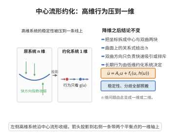

# 中心流形约化

> **一句话大白话**：想知道系统在平衡点附近稳不稳、怎么分歧，不用看全部 $n$ 个方向，只要看中心流形上那个"降了维"的约化系统就够了。
>
> **小例子**：Lorenz 系统在 $\rho=1$ 处原点失稳时，中心流形是一维，约化系统 $\dot u=\frac{\sigma}{1+\sigma}(\rho-1)u-\frac{\sigma\beta}{2(1+\sigma)}u^3+\cdots$ 已经完整决定其超临界叉形分歧行为。

## 一、定理介绍

> **前置依赖**：中心流形定理、局部流不变性、坐标分解为中心/双曲方向、投影与约化系统、双曲方向的指数吸引/排斥

中心流形约化是中心流形定理的直接应用：由于中心流形包含全部有界轨道且局部流不变，系统在平衡点附近的稳定性与分歧行为完全由中心流形上的约化系统决定。它把复杂高维问题压成一维/二维的显式计算。

## 几何直观

图意在说明：双曲方向只负责快速涨缩，稳定性与分歧行为完全由中心流形上的一维约化系统决定。

## 二、原理思路

把坐标写成 $x=x_c+h(x_c)$，其中 $h$ 由中心流形定理保证存在。由于横截（双曲）方向的运动在局部指数涨/缩，长期行为只看中心方向，即把原系统投影到中心流形上得到约化系统 $\dot u=A_cu+f_c(u,h(u))$。稳定与分歧分析全部转至该低维系统。

## 三、定理的严格表述

（中心流形约化）系统 $\dot{x}=f(x)$ 在平衡点 $0$ 附近的局部动力学行为（稳定性、分歧等）完全由中心流形上的约化系统
$$
\dot{u}=A_cu+f_c(u,h(u))
$$
决定，其中 $h$ 是中心流形 $v=h(u)$ 的表示。

## 四、证明过程

**证（约化的有效性）：**

**局部等价：** 由中心流形定理，存在局部流不变的中心流形 $x=x_c+h(x_c)$。在其上，$x$ 完全由 $u\in E^c$ 参数化。

**保留有界轨道：** 中心流形包含所有在平衡点邻域内保持有界的轨道，故对稳定性与分歧而言，关键动力学均落在 $u$ 方向。

**投影得约化系统：** 把 $\dot x=f(x)$ 沿 $x=x_c+h(x_c)$ 求导并利用 $\dot v=Dh\dot u$，得到中心方向的闭子系统
$$
\dot u=A_cu+f_c(u,h(u))
$$

**结论：** 于是稳定性（对应 $\operatorname{Re}$ 符号分析）与分歧（随参数变化的中心方向动力学）完全由此 $E^c$-维系统描述，余下双曲方向不会引入定性变化。$\square$

## 五、应用与意义

中心流形约化是把"看整体"变成"看低维"的核心省力手段：Hopf 分歧（二维中心流形）与叉形/鞍结点分歧（一维中心流形）的标准证明都先约化再做规范形。它使分支理论具备可计算性，是现代动力学分析与数值软件的常用前提。

## 课堂问答

**老师**：为什么研究平衡点附近只需看中心流形？

**学生**：先给结论——平衡点附近的稳定性与分歧完全由中心流形上的约化系统 $\dot u=A_cu+f_c(u,h(u))$ 决定，双曲方向不引入定性变化。

**老师（追问）**：理由是什么？

**学生**：中心流形包含所有局部有界轨道且局部流不变；横截（双曲）方向的运动指数式涨或缩，长期行为只看中心方向。把 $\dot x=f(x)$ 沿 $x=x_c+h(x_c)$ 求导并利用 $\dot v=Dh\dot u$，即得中心方向上的闭子系统。

**老师（拓展）**：能举个具体例子吗？

**学生**：Lorenz 系统在 $\rho=1$ 原点失稳时中心流形是一维，约化系统 $\dot u=\frac{\sigma}{1+\sigma}(\rho-1)u-\frac{\sigma\beta}{2(1+\sigma)}u^3+\cdots$ 已完整决定其超临界叉形分歧。一般地，Hopf 用二维、鞍结点与叉形用一维中心流形，这正是分支理论可计算的关键。
