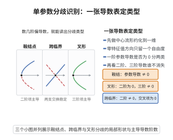

# 单参数分歧的识别

> **一句话大白话**：只要盯住零特征值方向，数几项偏导数（一阶、二阶、三阶），就能圈定这里发生的是鞍结点、叉形还是跨临界分歧。
>
> **小例子**：$\dot x=\mu x-x^2$ 在 $(\mu,x)=(0,0)$ 满足跨临界条件，是跨临界分歧；$\dot x=\mu x-x^3$ 满足叉形条件，是叉形分歧。

## 一、定理介绍

> **前置依赖**：中心流形约化、特征值与特征向量、高阶偏导数与 Taylor 展开、鞍结点/叉形/跨临界分歧的代数判据

本定理给出单参数系统在平衡点处的统一分歧识别准则。当线性化有零特征值时，沿中心方向判断关键偏导数是否为零，即可判定三类基本分歧：鞍结点（一阶参数导数与二阶空间导数非零）、叉形（三阶空间导数非零且二阶空间导数消失）、跨临界（二阶空间导数非零且交叉二阶导数非零）。

## 几何直观

图意在说明：约化到一维后，只看参数导数与二阶、三阶导数谁不消失，就能认出属于哪类分歧。

## 二、原理思路

统一框架是中心流形约化降维到一维 $\dot u=g(u,\mu)$，再按 $g$ 在 $(0,\mu_0)$ 的各阶偏导数分类。各类分歧对应不同的主导项组合：鞍结点 $a\epsilon+bu^2$、叉形 $c\epsilon u+du^3$、跨临界 $e\epsilon u+fu^2$。通过 $v,w$ 把 $g$ 的偏导数翻译回原系统偏导数，即得判据。

## 三、定理的严格表述

（单参数分歧的识别）设 $\dot x=f(x,\mu)$，$x\in\mathbb{R}^n$，$\mu\in\mathbb{R}$，$(x_0,\mu_0)$ 是平衡点，$A=Df(x_0,\mu_0)$ 有唯一零特征值（右/左特征向量 $v,w$，$w\cdot v=1$），其余实部非零。则：
1. 若 $w\cdot\partial f/\partial\mu\neq0$ 且 $w\cdot D^2f(v,v)\neq0$：鞍结点分歧；
2. 若 $w\cdot\partial f/\partial\mu=0$、$w\cdot D^2f(v,v)=0$、$w\cdot D^3f(v,v,v)\neq0$、$w\cdot\partial^2f/\partial x\partial\mu\,v\neq0$：叉形分歧；
3. 若 $w\cdot\partial f/\partial\mu=0$、$w\cdot D^2f(v,v)\neq0$、$w\cdot\partial^2f/\partial x\partial\mu\,v=0$：跨临界分歧。

## 四、证明过程

**证（统一框架）：** 中心流形约化把系统化为一维 $\dot u=g(u,\mu)$，$g(0,\mu_0)=0$、$\partial g/\partial u(0,\mu_0)=0$。这些偏导数经 $v,w$ 翻译为原系统的条件。

**情形 1（鞍结点）：** $\partial g/\partial\mu\neq0$，$\partial^2g/\partial u^2\neq0$。则 $g=a(\mu-\mu_0)+bu^2+\cdots$，解 $u\approx\pm\sqrt{-a(\mu-\mu_0)/b}$，两平衡相撞消失。

**情形 2（叉形）：** $\partial g/\partial\mu=0$，$\partial^2g/\partial u^2=0$，$\partial^2g/\partial u\partial\mu\neq0$，$\partial^3g/\partial u^3\neq0$。则 $g=c(\mu-\mu_0)u+du^3+\cdots$，解 $u=0$ 或 $u\approx\pm\sqrt{-c(\mu-\mu_0)/d}$。

**情形 3（跨临界）：** $\partial g/\partial\mu=0$，$\partial^2g/\partial u^2\neq0$，$\partial^2g/\partial u\partial\mu\neq0$。则 $g=e(\mu-\mu_0)u+fu^2+\cdots$，解 $u=0$ 或 $u\approx-e(\mu-\mu_0)/f$。

这些情形分别对应定理条件中 $w\cdot$ 形式的偏导数非零组合。$\square$

## 五、应用与意义

该识别准则是把抽象分歧理论落地为"代数签名"的实用工具：只需在平衡点处计算几个关键偏导数，无须数值积分即可划分类别。它在系统辨识、相变分析与工程控制中被广泛用作分歧类型探测的一线判据。

## 课堂问答

**老师**：怎么用几个偏导数就把单参数分歧"分类"出来？

**学生**：先给结论——设 $A=Df(x_0,\mu_0)$ 有唯一零特征值，右、左特征向量为 $v,w$ 且 $w\cdot v=1$。若 $w\cdot\partial_\mu f\ne0$ 且 $w\cdot D^2f(v,v)\ne0$，是鞍结点；若两者都不为零的条件变为 $w\cdot\partial_\mu f=0$、$w\cdot D^2f(v,v)=0$ 而 $w\cdot D^3f(v,v,v)\ne0$，是叉形；若 $w\cdot\partial_\mu f=0$、$w\cdot D^2f(v,v)\ne0$ 而 $w\cdot\partial_x\partial_\mu f\,v=0$，是跨临界。

**老师（追问）**：统一的框架是什么？

**学生**：先用中心流形约化到一维 $\dot u=g(u,\mu)$，再看 $g$ 在 $(0,\mu_0)$ 的各阶偏导组合：鞍结点 $a\epsilon+bu^2$、叉形 $c\epsilon u+du^3$、跨临界 $e\epsilon u+fu^2$。这些偏导经 $v,w$ 就翻译回原系统的 $w\cdot$ 形式条件。

**老师（拓展）**：举两个例子？

**学生**：$\dot x=\mu x-x^2$ 是跨临界，解为 $u\approx-e\epsilon/f$；$\dot x=\mu x-x^3$ 是叉形，解为 $u\approx\pm\sqrt{-c\epsilon/d}$。常见误区是在叉形判据里漏掉交叉导数条件 $w\cdot\partial_x\partial_\mu f\,v\ne0$。
