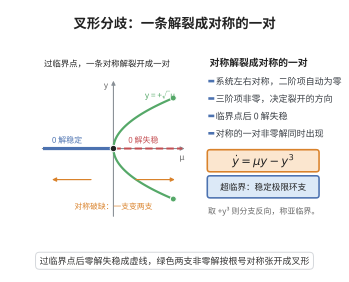

# 叉形分歧的规范形

> **一句话大白话**：只要在分歧点满足几项非退化条件（二阶项消失、三阶项不为零等），叉形分歧无论在哪个系统里都会"长得一样"：约化后就是 $\dot y=\mu y\pm y^3$。
>
> **小例子**：受迫对称系统在原点发生叉形分歧后，超临界情形 $\dot y=\mu y-y^3$：$\mu<0$ 只有平衡点 $0$（稳定），$\mu>0$ 稳定打破并出现两支非零平衡 $y=\pm\sqrt{\mu}$。

## 一、定理介绍

> **前置依赖**：奇异性理论、Taylor 展开与高阶偏导数、尺度/近恒等坐标变换、接触等价与余维数、对称性与规格化

叉形分歧规范形定理说明：满足特定对称性（$f(x,-\mu)$ 型或 $\partial^2f/\partial x^2=0$）与非退化条件（$\partial^3f/\partial x^3\neq0$、$\partial^2f/\partial x\partial\mu\neq0$）的单参数系统，经坐标变换必化为标准形 $\dot y=\mu y\pm y^3$，$+$ 为亚临界、$-$ 为超临界。

## 几何直观

图意在说明：二阶项消失、三阶项非零时，系统必化成规范形，对称的零解分裂成一对对称解。

## 二、原理思路

用奇异性理论：在 $(0,0)$ 附近 Taylor 展开得 $f(x,\mu)=a\mu x+bx^3+\cdots$，通过尺度变换 $x=\alpha y,\ \mu=\beta\nu$ 把主项归一化为 $\nu y+\operatorname{sgn}(b)y^3$；再用近恒等变换消去其余高阶项，最终得到只有共振主项的规范形。

## 三、定理的严格表述

（叉形分歧的规范形）设 $\dot x=f(x,\mu)$，$x,\mu\in\mathbb{R}$，在 $(0,0)$ 处满足 $f(0,0)=0$、$\partial f/\partial x(0,0)=0$、$\partial f/\partial\mu(0,0)=0$、$\partial^2f/\partial x^2(0,0)=0$，以及 $\partial^3f/\partial x^3(0,0)\neq0$、$\partial^2f/\partial x\partial\mu(0,0)\neq0$。则存在坐标变换将其化为规范形
$$
\dot y=\mu y\pm y^3
$$
其中 $+$ 对应亚临界、$-$ 对应超临界叉形分歧。

## 四、证明过程

**第一步（Taylor 展开）：** 在 $(0,0)$ 附近
$$
f(x,\mu)=a\mu x+bx^3+O(\mu x^2,\mu^2x,\mu^3,x^4)
$$
其中 $a=\partial^2f/\partial x\partial\mu\neq0$，$b=\frac16\partial^3f/\partial x^3\neq0$。

**第二步（尺度变换）：** 令 $x=\alpha y,\ \mu=\beta\nu$ 使
$$
a\beta\nu\cdot\alpha y+b\alpha^3y^3=\alpha(\nu y+\operatorname{sgn}(b)y^3)
$$
取 $\alpha=1/\sqrt{|b|}$、$\beta=1/a$，系统化为 $\dot y=\nu y+\operatorname{sgn}(b)y^3+O(\cdot)$。

**第三步（近恒等变换）：** 用 $y=z+\phi(z,\nu)$ 消去高阶非共振项。由奇异性理论，非退化条件使 $f(x,\mu)$ 与 $\nu y+\operatorname{sgn}(b)y^3$ 在 $(0,0)$ 接触等价，因为分歧余维数为 $1$。

**第四步（确定规范形）：** 得
$$
\dot z=\nu z+\epsilon z^3,\quad\epsilon=\operatorname{sgn}(b)=\pm1
$$
$\epsilon=-1$ 为超临界、$\epsilon=+1$ 为亚临界。$\square$

## 五、应用与意义

叉形分歧规范形是"万物皆可简化"的直接范例，广泛应用于相变、对称系统与生态模型中。它确立超临界/亚临界两类的普适判据，其通用开折 $\dot x=\mu x-x^3+\alpha_1+\alpha_2x^2$（余维 2）更构成奇异性理论方法的核心示范。

## 课堂问答

**老师**：叉形分歧的规范形为什么是"普适"的？

**学生**：先给结论——若在 $(0,0)$ 处 $f=0$、$f_x=0$、$f_\mu=0$、$f_{xx}=0$，而 $f_{xxx}\ne0$、$f_{x\mu}\ne0$，则 $\dot x=f(x,\mu)$ 经坐标变换可化为 $\dot y=\mu y\pm y^3$，其中负号对应超临界、正号对应亚临界。

**老师（追问）**：系数是怎么被归一成 $\pm1$ 的？

**学生**：Taylor 展开 $f(x,\mu)=a\mu x+bx^3+O(\mu x^2,\mu^2x,\mu^3,x^4)$，其中 $a=f_{x\mu}\ne0$、$b=\frac16 f_{xxx}\ne0$。作尺度变换 $x=\alpha y$、$\mu=\beta\nu$，取 $\alpha=1/\sqrt{|b|}$、$\beta=1/a$，把主项归为 $\nu y+\operatorname{sgn}(b)y^3$；再用近恒等变换消去高阶非共振项。

**老师（拓展）**：超临界与亚临界的动力学差别在哪？

**学生**：以 $\dot y=\nu y-y^3$ 为例，$\nu<0$ 时只有稳定的平衡点 $0$；$\nu>0$ 时 $0$ 失稳并分支出 $y=\pm\sqrt{\nu}$ 两支稳定平衡。它广泛用于相变、对称系统与生态模型；其通用开折含 $\alpha_1$ 与 $\alpha_2x^2$ 两项，是余维 2 的奇异性理论范例。
