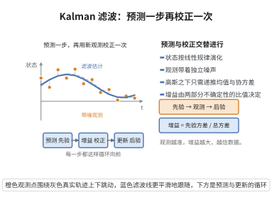

# Kalman 滤波的递推公式

> **一句话大白话**：有一个我们看不见的"系统状态"随时间演化，我们只能用带噪声的观测去猜它；Kalman 滤波给出一个不断"预测—校正"的递推规则，越猜越准。
>
> **小例子**：卫星的位置看不见，但雷达每隔一阵测到带噪 的距离；Kalman 滤波把运动规律和观测结合起来，递推给出对卫星位置的实时最优估计。

## 一、定理介绍

> **前置依赖**：状态空间模型（状态方程与观测方程）、高斯的条件分布、条件均值与条件协方差、矩阵运算与求逆、最小均方误差准则

在状态空间模型下，Kalman 滤波递推给出在给定观测下的状态条件分布（高斯情形下为条件均值与条件协方差）。它从已知的上一时刻估计出发，通过预测步与更新步循环，得到最小均方误差意义下的实时状态估计。

## 几何直观

图意在说明：高斯线性模型下只需递推均值与协方差，先预测再用新观测按增益校正，循环向前。

## 二、原理思路

考虑状态方程 $\boldsymbol{\alpha}_t = \boldsymbol{T}_t\boldsymbol{\alpha}_{t-1} + \boldsymbol{R}_t\boldsymbol{\eta}_t$ 与观测方程 $\boldsymbol{y}_t = \boldsymbol{Z}_t\boldsymbol{\alpha}_t + \boldsymbol{\xi}_t$。在高斯、线性假设下条件分布保持高斯，只需递推其均值与协方差：先由状态方程预测（先验），再用观测的新息通过 Kalman 增益进行校正（后验）。

## 三、定理的严格表述

设状态方程

$$
\boldsymbol{\alpha}_t = \boldsymbol{T}_t\boldsymbol{\alpha}_{t-1} + \boldsymbol{R}_t\boldsymbol{\eta}_t, \quad \boldsymbol{\eta}_t \sim N(\boldsymbol{0},\boldsymbol{Q}_t),
$$

观测方程

$$
\boldsymbol{y}_t = \boldsymbol{Z}_t\boldsymbol{\alpha}_t + \boldsymbol{\xi}_t, \quad \boldsymbol{\xi}_t \sim N(\boldsymbol{0},\boldsymbol{H}_t),
$$

则递推为

$$
\hat{\boldsymbol{\alpha}}_{t|t-1} = \boldsymbol{T}_t\hat{\boldsymbol{\alpha}}_{t-1|t-1}, \quad
\boldsymbol{P}_{t|t-1} = \boldsymbol{T}_t\boldsymbol{P}_{t-1|t-1}\boldsymbol{T}_t^\top + \boldsymbol{R}_t\boldsymbol{Q}_t\boldsymbol{R}_t^\top,
$$

更新步用 Kalman 增益

$$
\boldsymbol{K}_t = \boldsymbol{P}_{t|t-1}\boldsymbol{Z}_t^\top\big(\boldsymbol{Z}_t\boldsymbol{P}_{t|t-1}\boldsymbol{Z}_t^\top + \boldsymbol{H}_t\big)^{-1}
$$

修正状态估计。该递推给出潜状态的条件分布 $\boldsymbol{\alpha}_t \mid \boldsymbol{y}_{1:t}$。

## 四、证明过程

1. **预测步**：由状态方程的线性性与零均值噪声得先验均值与协方差的递推。
2. **联合高斯更新**：在给定 $\boldsymbol{y}_t$ 下应用高斯条件分布公式，重新加权先验与观测。
3. **Kalman 增益**：增益 $\boldsymbol{K}_t$ 由先验协方差、观测矩阵与观测噪声方差确定，使后验协方差最小。
4. **校正步**：$\hat{\boldsymbol{\alpha}}_{t|t} = \hat{\boldsymbol{\alpha}}_{t|t-1} + \boldsymbol{K}_t(\boldsymbol{y}_t - \boldsymbol{Z}_t\hat{\boldsymbol{\alpha}}_{t|t-1})$，$\boldsymbol{P}_{t|t} = (\boldsymbol{I} - \boldsymbol{K}_t\boldsymbol{Z}_t)\boldsymbol{P}_{t|t-1}$。

## 五、应用与意义

Kalman 滤波是动态系统最优状态估计的核心工具，广泛用于自动驾驶、目标跟踪、导航、金融波动率（状态空间/随机波动模型）等。它把统计推断与时间序列建模统一起来，是可观测序列与潜状态之间桥接的典范，并推广到非线性（扩展 Kalman 滤波、无迹 Kalman 滤波）。

## 课堂问答

**老师**：Kalman 滤波的"预测—更新"两步各自在做什么，增益从哪来？

**学生**：结论是高斯线性假设下条件分布始终是高斯的，只需递推均值与协方差。预测步 $\hat{\boldsymbol{\alpha}}_{t|t-1}=\boldsymbol{T}_t\hat{\boldsymbol{\alpha}}_{t-1|t-1}$、$\boldsymbol{P}_{t|t-1}=\boldsymbol{T}_t\boldsymbol{P}_{t-1|t-1}\boldsymbol{T}_t^\top+\boldsymbol{R}_t\boldsymbol{Q}_t\boldsymbol{R}_t^\top$；更新步用增益 $\boldsymbol{K}_t=\boldsymbol{P}_{t|t-1}\boldsymbol{Z}_t^\top(\boldsymbol{Z}_t\boldsymbol{P}_{t|t-1}\boldsymbol{Z}_t^\top+\boldsymbol{H}_t)^{-1}$，得 $\hat{\boldsymbol{\alpha}}_{t|t}=\hat{\boldsymbol{\alpha}}_{t|t-1}+\boldsymbol{K}_t(\boldsymbol{y}_t-\boldsymbol{Z}_t\hat{\boldsymbol{\alpha}}_{t|t-1})$、$\boldsymbol{P}_{t|t}=(\boldsymbol{I}-\boldsymbol{K}_t\boldsymbol{Z}_t)\boldsymbol{P}_{t|t-1}$。增益本质是先验不确定度对观测不确定度的权重。

**老师（追问）**：为什么 $\boldsymbol{P}_{t|t}=(\boldsymbol{I}-\boldsymbol{K}_t\boldsymbol{Z}_t)\boldsymbol{P}_{t|t-1}$ 就保证后验协方差最小？

**学生**：由联合高斯条件分布公式，后验协方差为 $\boldsymbol{P}_{t|t-1}-\boldsymbol{P}_{t|t-1}\boldsymbol{Z}_t^\top(\boldsymbol{Z}_t\boldsymbol{P}_{t|t-1}\boldsymbol{Z}_t^\top+\boldsymbol{H}_t)^{-1}\boldsymbol{Z}_t\boldsymbol{P}_{t|t-1}$，恰是 $(\boldsymbol{I}-\boldsymbol{K}_t\boldsymbol{Z}_t)\boldsymbol{P}_{t|t-1}$；它对观测噪声作最优折衷，$\boldsymbol{K}_t$ 即后验迹最小化之解。

**老师（拓展）**：这套递推与最小二乘、MMSE 的关系是什么，何时失效？

**学生**：它是 MMSE（条件期望）估计的在线递推，无观测噪声时退化为递推最小二乘；对非线性系统高斯性不再保持，会失效，需改用扩展 Kalman 滤波或无迹 Kalman 滤波。
