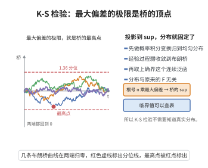

# Kolmogorov-Smirnov 检验的渐近分布

> **一句话大白话**：用来检验数据是否服从某个分布时，最大的偏差距离虽然会随机波动，但它的极限分布是一棵"布朗桥"跑到最高处的高度；K-S 检验就靠这个分布来决定是否拒绝原假设。
>
> **小例子**：老师说班级成绩服从正态分布，学生用 K-S 统计量测样本与正态的最大距离，距离太大就说明"不像正态"。

## 一、定理介绍

> **前置依赖**：经验过程、概率积分变换、中心极限定理、Donsker定理、Brown 桥、连续映射定理、紧性（tightness）

设 $X_1,\dots,X_n$ 独立同分布于连续分布 $F_0$，$D_n = \sup_x|\hat{F}_n(x)-F_0(x)|$。则 $\sqrt{n}D_n$ 依分布收敛到 Brown 桥上确界的绝对值：

$$
\sqrt{n}D_n \xrightarrow{d} \sup_{t\in[0,1]}|B^0(t)|,
$$

其中 $B^0(t)=B(t)-tB(1)$ 为 Brown 桥。

## 几何直观

图意在说明：经验过程弱收敛到布朗桥后，取上确界得到的极限分布与原分布无关，可以统一查表。

## 二、原理思路

通过概率积分变换把一般的分布检验化归到 $U[0,1]$ 情形。经验分布过程 $\alpha_n(t)=\sqrt{n}(\mathbb{G}_n(t)-t)$ 的有限维分布收敛到 Brown 桥（多维 CLT），再结合紧性（tightness）运用 Donsker 定理得到过程弱收敛，最后由连续映射定理投影到 $\sup$ 泛函。

## 三、定理的严格表述

设 $U_i = F_0(X_i)\sim U[0,1]$，$\mathbb{G}_n(t)=\frac{1}{n}\sum_i\mathbf{1}_{\{U_i\le t\}}$，经验过程

$$
\alpha_n(t) = \sqrt{n}\big(\mathbb{G}_n(t) - t\big), \quad t\in[0,1].
$$

则 $\alpha_n$ 在 $D[0,1]$ 上弱收敛到 Brown 桥 $B^0$，从而

$$
\lim_{n\to\infty}\mathbb{P}(\sqrt{n}D_n\le d) = 1 - 2\sum_{k=1}^{\infty}(-1)^{k-1}e^{-2k^2d^2}.
$$

## 四、证明过程

1. **概率积分变换**：$D_n = \sup_{t\in[0,1]}|\mathbb{G}_n(t)-t|$。
2. **有限维收敛**：对 $t_1,\dots,t_k$ 由多维 CLT 得 $\alpha_n$ 有限维收敛，协方差 $\min(t_i,t_j)-t_it_j$ 即 Brown 桥协方差。
3. **紧性**：用经验过程的矩条件（Dvoretzky-Kiefer-Wolfowitz 型估计）验证 $\alpha_n$ 在 $D[0,1]$ 上紧。
4. **Donsker 定理**：有限维收敛＋紧性推出过程弱收敛 $\alpha_n\xRightarrow{d}B^0$。
5. **连续映射**：$\sup$ 泛函连续，故 $\sqrt{n}D_n\xrightarrow{d}\sup|B^0(t)|$；其后验分布由 Kolmogorov 级数给出。

## 五、应用与意义

K-S 检验是最经典的拟合优度检验，可同时用双侧（偏离）形式。其渐近分布不依赖于被检验的具体分布，体现了非参数方法的稳健性。该定理也是经验过程理论发展的里程碑，启发了对 Donsker 类、泛函 CLT 的研究，对统计学习理论有深远影响。

## 课堂问答

**老师**：K-S 统计量的极限分布为什么是布朗桥上确界的绝对值，而不是正态？

**学生**：结论是 $\sqrt{n}D_n\xrightarrow{d}\sup_{t\in[0,1]}|B^0(t)|$。通过概率积分变换 $U_i=F_0(X_i)\sim U[0,1]$ 把一般分布化归均匀情形，经验过程 $\alpha_n(t)=\sqrt{n}(\mathbb{G}_n(t)-t)$ 的有限维协方差为 $\min(t_i,t_j)-t_it_j$，即布朗桥协方差；再加紧性由 Donsker 得过程弱收敛，最后由连续映射定理取 $\sup|\cdot|$。误区：极限是一个 sup 泛函的分布（Kolmogorov 分布），不是单个正态变量。

**老师（追问）**：为什么检验要求 $F_0$ 连续？

**学生**：若 $F_0$ 有跳跃，$\mathbb{G}_n(t)-t$ 会出现与跳跃幅度相关的确定性跳，$\alpha_n$ 的极限不再是标准布朗桥，分布无关性被破坏；只有 $F_0$ 连续，$U_i$ 才是精确均匀分布。

**老师（拓展）**：极限分布的级数是什么，与 Cramér-von Mises 检验什么关系？

**学生**：$\lim_{n\to\infty}\mathbb{P}(\sqrt{n}D_n\le d)=1-2\sum_{k\ge1}(-1)^{k-1}e^{-2k^2d^2}$，即 Kolmogorov 分布；若换成泛函 $\int\alpha_n^2\,dF$ 则得 Cramér-von Mises 的极限分布，本质都是布朗桥泛函分布。
