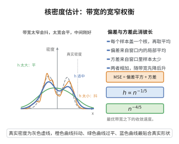

# 核密度估计的均方误差与最优带宽

> **一句话大白话**：用高斯"帽子"堆叠来估计密度时，帽子越宽越平（偏差小不了）、越窄越尖（波动大），存在一个权衡二者、使总误差最小的最优带宽。
>
> **小例子**：用直方图估计收入分布，组距太大看不出峰谷、太小乱摆；核密度估计的最优带宽就好比"既不平滑过度、也不抖出毛刺"的最佳组距。

## 一、定理介绍

> **前置依赖**：密度估计与核函数、期望与方差的展开、Taylor 展开与二阶矩条件、偏差-方差分解（MSE）、最优化求导

核密度估计 $\hat{f}_h(x) = \frac{1}{nh}\sum_{i=1}^n K\big(\frac{x-X_i}{h}\big)$ 的均方误差可分解为偏差平方与方差之和。在密度 $f$ 二阶光滑、核满足矩条件的假设下，其渐近表达式为

$$
\text{MSE}(\hat{f}_h(x)) = \frac{1}{4}h^4\mu_2(K)^2[f''(x)]^2 + \frac{1}{nh}\|K\|_2^2 f(x) + o\big(h^4 + (nh)^{-1}\big).
$$

## 几何直观

图意在说明：带宽小则方差大而抖，带宽大则偏差大而平，最优带宽让二者之和最小。

## 二、原理思路

偏差来自核平滑造成的局部平均——在 $x$ 处是个带移位窗口的均值，其系统性偏移量级为 $h^2$（由二阶矩 $\mu_2(K)$ 与 $f''(x)$ 决定）；方差则来自有限样本随机性，量级为 $1/(nh)$。最小化二者之和即得带宽的 $h\propto n^{-1/5}$ 最优平衡，收敛速度为 $n^{-4/5}$。

## 三、定理的严格表述

设 $\int K=1$、$\int uK=0$、$\int u^2K=\mu_2(K)$、$\int K^2=\|K\|_2^2$，$f''$ 存在且 $f''(x)\neq0$。则

$$
\text{Bias}(\hat{f}_h(x)) = \frac{1}{2}h^2\mu_2(K)f''(x) + o(h^2),
$$

$$
\text{Var}(\hat{f}_h(x)) = \frac{1}{nh}\|K\|_2^2 f(x) + o\Big(\frac{1}{nh}\Big).
$$

局部最优带宽与全局最优带宽分别为

$$
h_{\text{opt}}(x) = \Big(\frac{\|K\|_2^2 f(x)}{n\mu_2(K)^2[f''(x)]^2}\Big)^{1/5},\qquad
h_{\text{opt}} = \Big(\frac{\|K\|_2^2}{n\mu_2(K)^2\int[f''(x)]^2dx}\Big)^{1/5}.
$$

此时 $\text{MSE}_{\text{opt}} = O(n^{-4/5})$。

## 四、证明过程

1. **偏差**：由变量代换与核条件，对 $f(x-hu)$ 作二阶 Taylor 展开得 $\text{Bias}=\frac12h^2\mu_2(K)f''(x)+o(h^2)$。
2. **方差**：对独立和求方差，利用 $\int K^2$ 与 $\mathbb{E}[\hat f_h]\to f(x)$ 得 $\text{Var}=\frac{1}{nh}\|K\|_2^2f(x)+o(1/(nh))$。
3. **MSE 合成**：$\text{MSE}=\text{Bias}^2+\text{Var}$。
4. **最优带宽**：对 $h$ 求导置零，解出 $h_\text{opt}$，代回得 $O(n^{-4/5})$ 收敛速度。

## 五、应用与意义

核密度估计是最基础的非参数密度估计方法，最优带宽理论揭示了非参数估计中"偏差—方差"权衡的本质，其 $n^{-4/5}$ 收敛速度慢于参数估计的 $n^{-1}$，这是非参数化的固有代价。该理论直接推广到局部多项式回归、分类中的核方法等，是平滑参数选择（如交叉验证）的理论基础。

## 课堂问答

**老师**：核密度估计的偏差和方差为什么分别是 $h^2$ 与 $1/(nh)$ 两个量级？

**学生**：结论是 $\text{MSE}(\hat{f}_h(x))=\frac{1}{4}h^4\mu_2(K)^2[f''(x)]^2+\frac{1}{nh}\|K\|_2^2f(x)+o(\cdot)$。偏差来自窗口平均：对 $f(x-hu)$ 作二阶 Taylor 展开，一阶项因 $\int uK=0$ 消掉，主项为 $\frac{1}{2}h^2\mu_2(K)f''(x)$；方差来自独立和，为 $\frac{1}{nh}\|K\|_2^2f(x)$。对 $h$ 求导置零得 $h_{\text{opt}}\propto n^{-1/5}$，此时 $\text{MSE}_{\text{opt}}=O(n^{-4/5})$。

**老师（追问）**：为什么最优带宽是 $n^{-1/5}$ 这个幂次？

**学生**：令偏差平方与方差同阶，即 $h^4\sim1/(nh)$，得 $nh^5\sim1$，解出 $h\asymp n^{-1/5}$；这是 $h^4$ 与 $1/(nh)$ 平衡的唯一标度。

**老师（拓展）**：这个 $n^{-4/5}$ 与非参数回归的 $n^{-2p/(2p+1)}$ 有何联系？

**学生**：核密度相当于光滑度 $p=2$，代入即 $n^{-4/5}$，完全一致；在 $d$ 维下变为 $n^{-2p/(2p+d)}$，随维数增大急剧变慢，这正是非参数化的"维数灾难"。
