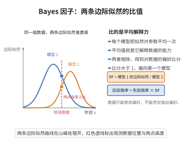

# Bayes 因子的边际似然表示

> **一句话大白话**：要在两个模型间做选择，就看数据"天然偏好"哪一个——这个偏好度等于两个模型各自把数据解释得多好的比值，也就是边际似然之比。
>
> **小例子**：线性模型 vs 二次模型，Bayes 因子大于 1 表示数据更支持线性模型，等于数据的"支持度比分"。

## 一、定理介绍

> **前置依赖**：贝叶斯定理、先验与似然、边际似然、条件概率、积分与归一化、后验赔率

设模型 $M_1$、$M_2$ 分别带参数 $\theta_1$、$\theta_2$ 与先验 $\pi_1$、$\pi_2$。$M_1$ 对 $M_2$ 的 Bayes 因子为两个边际似然之比：

$$
BF_{12} = \frac{f(\boldsymbol{x}\mid M_1)}{f(\boldsymbol{x}\mid M_2)} = \frac{\int_{\Theta_1} f(\boldsymbol{x}\mid\theta_1,M_1)\pi_1(\theta_1)d\theta_1}{\int_{\Theta_2} f(\boldsymbol{x}\mid\theta_2,M_2)\pi_2(\theta_2)d\theta_2}.
$$

## 几何直观

图意在说明：Bayes 因子是两模型把似然对参数平均后的比值，读出数据更偏袒哪一个模型。

## 二、原理思路

由贝叶斯定理，模型后验概率比 = 先验概率比 × Bayes 因子。而对每个模型，其边际似然 $f(\boldsymbol{x}\mid M_k)=\int f(\boldsymbol{x}\mid\theta_k,M_k)\pi_k(\theta_k)d\theta_k$ 是对参数求平均后的"模型对数据的总体解释能力"。总概率归一化（$m(\boldsymbol{x})=BF_{12}P(M_1)+P(M_2)$式）后可反解出 Bayes 因子。

## 三、定理的严格表述

设先验概率 $P(M_1)$、$P(M_2)$ 满足 $P(M_1)+P(M_2)=1$。则模型 $M_1$ 的后验为

$$
P(M_1\mid\boldsymbol{x}) = \frac{f(\boldsymbol{x}\mid M_1)P(M_1)}{f(\boldsymbol{x}\mid M_1)P(M_1) + f(\boldsymbol{x}\mid M_2)P(M_2)},
$$

由此后验赔率（odds）为

$$
\frac{P(M_1\mid\boldsymbol{x})}{P(M_2\mid\boldsymbol{x})} = \frac{P(M_1)}{P(M_2)} \times BF_{12}.
$$

## 四、证明过程

1. **边际似然**：$f(\boldsymbol{x}\mid M_k)=\int_{\Theta_k} f(\boldsymbol{x}\mid\theta_k,M_k)\pi_k(\theta_k)d\theta_k$。
2. **模型后验**：对模型先验用贝叶斯定理得后验公式。
3. **后验赔率**：取两个模型后验之比，分子分母出现 $f(\boldsymbol{x}\mid M_1)$ 与 $f(\boldsymbol{x}\mid M_2)$ 的比值即 $BF_{12}$。
4. **独立于先验 $P(M_1)$**：$BF_{12}$ 本身只取决于模型与数据，不含模型先验。

## 五、应用与意义

Bayes 因子是贝叶斯框架下的模型选择与假设检验工具，自然地对模型复杂度进行惩罚（边际似然自动折衷拟合优度与参数体积），避免了过度拟合。它被广泛用于变量选择、模型平均（Bayesian model averaging）、以及科学假设评估，是频率学派似然比检验的贝叶斯对应物。

## 课堂问答

**老师**：Bayes 因子如何用边际似然表示，它为什么自动惩罚模型复杂度？

**学生**：结论是 $BF_{12}=\frac{f(\boldsymbol{x}\mid M_1)}{f(\boldsymbol{x}\mid M_2)}=\frac{\int_{\Theta_1}f(\boldsymbol{x}\mid\theta_1,M_1)\pi_1(\theta_1)\,d\theta_1}{\int_{\Theta_2}f(\boldsymbol{x}\mid\theta_2,M_2)\pi_2(\theta_2)\,d\theta_2}$，即两个边际似然之比。由贝叶斯定理，后验赔率 $=\frac{P(M_1)}{P(M_2)}\times BF_{12}$，$BF$ 只含模型与数据、不含模型先验。复杂度惩罚来自对参数的积分：参数空间大而先验散时峰值似然被"平均"稀释，无需额外加罚项。误区：$BF$ 依赖先验 $\pi_k$ 本身，先验过于扩散会引发 Lindley 悖论。

**老师（追问）**：为什么说它是似然比检验的贝叶斯对应物？

**学生**：频率派似然比固定参数在 MLE 处比较拟合优度；Bayes 因子对参数按先验加权积分、用边际似然比较，天然对参数维数施加 Occam 惩罚。两者经 Bernstein-von Mises 在渐近上相连，但并不等同。

**老师（拓展）**：$BF>1$ 就能断定模型 1 更好吗？

**学生**：$BF_{12}>1$ 只说明数据相对更支持 $M_1$；最终结论还取决于模型先验赔率与损失。Jeffreys 等给出 3、10、30 的分级经验标准，但决策须结合先验，不能只看 $BF$。
