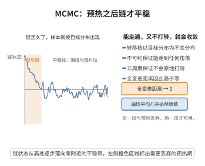

# MCMC 的收敛性

> **一句话大白话**：用随机游走的抽样机器去"采"复杂分布时，只要每一步规则对称友好、从头到尾能走到任何地方又不卡死，最终抽出来的样本分布会收敛到想抽的那个分布。
>
> **小例子**：Metropolis 算法在参数空间里随机漫步，走得时间足够长后，走过的频率就逼近目标后验分布。

## 一、定理介绍

> **前置依赖**：马尔可夫链、转移核与不变分布、不可约性与非周期性、全变差距离、小集与漂移条件（Lyapunov 函数）、Nummelin 分裂、Birkhoff遍历定理、鞅收敛定理

设 $P$ 为状态空间 $\mathcal{X}$ 上以 $\pi$ 为不变分布的马尔可夫链转移核。若 $P$ 是 $\pi$-不可约且非周期的，则对 $\pi$-几乎处处所有 $x$：

$$
\lim_{n\to\infty}\|P^n(x,\cdot) - \pi\|_{\text{TV}} = 0,
$$

且对 $\int|g|d\pi<\infty$ 的可测函数 $g$ 有遍历平均几乎必然收敛。

## 几何直观

图意在说明：不可约加非周期的链全变差收敛到不变分布，预热之后样本才近似目标分布。

## 二、原理思路

应用马尔可夫链遍历理论。$\pi$-不可约保证链能到达任何正测集，非周期保证不会陷入规则的周而复始。利用小集（small set）与几何漂移条件（Lyapunov 函数不等式 $PV\le\lambda V + b\mathbf{1}_C$）建立几何遍历性与收敛速率，再由鞅的收敛性得到强大数律。

## 三、定理的严格表述

设在完备可分度量空间 $\mathcal{X}$ 上，转移核 $P$ 满足 $\pi(A)=\int P(x,A)\pi(dx)$（不变分布）。若 $P$ 为 $\pi$-不可约且非周期，则

$$
\lim_{n\to\infty}\|P^n(x,\cdot)-\pi\|_{\text{TV}} = 0 \quad\text{对 }\pi\text{-几乎处处 }x,
$$

且对 $\int|g|d\pi<\infty$ 的函数 $g$ 有

$$
\frac{1}{N}\sum_{t=1}^N g(X_t) \xrightarrow[N\to\infty]{\text{a.s.}} \int g(x)\pi(dx).
$$

## 四、证明过程

1. **小集**：存在 $C$、$m\ge1$、概率测度 $\nu$ 与 $\varepsilon>0$ 使 $P^m(x,\cdot)\ge\varepsilon\nu(\cdot)$ 对 $x\in C$。
2. **漂移条件**：存在 $V:\mathcal{X}\to[1,\infty)$ 与 $\lambda\in(0,1)$、$b<\infty$ 使 $PV(x)\le\lambda V(x)+b\mathbf{1}_C(x)$。
3. **Nummelin 分裂**：由不可约非周期＋漂移条件，得几何收敛 $\sum_n r^n\|P^n(x,\cdot)-\pi\|_{\text{TV}}<\infty$（含 $r>1$）。
4. **遍历定理**：由鞅差收敛得 $S_N=\frac1N\sum(g(X_t)-\int g\,d\pi)\to0$ a.s.。
5. **MH 应用**：Veré the MH 转移核以接受概率 $\alpha(x,y)=\min\{1,\frac{\pi(y)q(y,x)}{\pi(x)q(x,y)}\}$ 保证 $\pi$ 为不变分布，适当选择提议 $q$ 即满足不可约性。

## 五、应用与意义

MCMC 是贝叶斯计算的核心引擎，使得在复杂、高维、无解析后验的模型（如层次模型、隐变量模型）中也能进行推断。其收敛定理为抽样算法的正确性与效率提供了理论保证，通过诊断（如遍历均值稳定、有效样本量）检验是否已收敛，并推广到吉布斯采样、Hamiltonian MCMC 等方法。

## 课堂问答

**老师**：一条以 $\pi$ 为不变分布的马尔可夫链，凭什么能代表从 $\pi$ 抽样？

**学生**：结论是若 $P$ 为 $\pi$-不可约且非周期，则 $\|P^n(x,\cdot)-\pi\|_{\text{TV}}\to0$ 对 $\pi$-a.e. $x$ 成立，且 $\frac{1}{N}\sum_{t=1}^N g(X_t)\to\int g\,d\pi$ 几乎必然。不可约保证能到达任何正测集，非周期保证不陷入周期循环；借助小集、漂移条件 $PV\le\lambda V+b\mathbf{1}_C$ 与 Nummelin 分裂可得几何遍历与收敛速率，遍历平均由鞅收敛得到。误区：收敛是分布收敛，样本之间仍高度相关。

**老师（追问）**：Metropolis-Hastings 如何保证 $\pi$ 是不变分布？

**学生**：接受概率取 $\alpha(x,y)=\min\{1,\frac{\pi(y)q(y,x)}{\pi(x)q(x,y)}\}$ 时，细致平衡 $\pi(x)P(x,y)=\pi(y)P(y,x)$ 成立，从而 $\pi$ 不变；再配合合适的提议 $q$ 满足不可约与非周期，即可收敛到 $\pi$。

**老师（拓展）**：收敛定理给使用者哪些实际要求？

**学生**：它要求做诊断——链充分长、燃烧期足够、有效样本量足够，否则样本未必已收敛到 $\pi$；还提示可通过提高接受率或改进提议（如 Hamiltonian MCMC）提升效率，但几何遍历性需漂移条件支撑，不能仅凭"跑得久"下结论。
