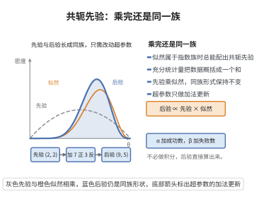

# 共轭先验的存在性（指数族）

> **一句话大白话**：当似然属于指数族时，可以挑一个这么凑巧的先验，让"先验乘似然"后还长成同一模样，只是参数变了——这样后验算起来就免去了繁琐积分。
>
> **小例子**：抛硬币用 Beta 先验，掷完若干次后先验仍是 Beta，只需把先验的两个数加上正反面次数即可得后验。

## 一、定理介绍

> **前置依赖**：指数族分布（自然参数与充分统计量）、贝叶斯定理、先验与后验的乘法更新、积与指数运算、归一化常数

设似然属于指数族 $f(x\mid\theta) = h(x)\exp\{\eta(\theta)^\top T(x) - A(\theta)\}$。则存在一簇共轭先验 $\pi(\theta\mid\tau,\nu)\propto \exp\{\tau^\top\eta(\theta) - \nu A(\theta)\}$，其后验仍属同一族，超参数更新为 $\tau' = \tau + \sum_i T(x_i)$、$\nu' = \nu + n$。

## 几何直观

图意在说明：指数族似然配上共轭先验，后验与先验同族，只需把充分统计量与样本数加到超参数上。

## 二、原理思路

指数族似然对 i.i.d. 样本的乘积可整理为 $\exp\{\eta(\theta)^\top\sum_i T(x_i) - nA(\theta)\}$ 形式，充分统计量 $\sum_i T(x_i)$ 与样本数 $n$ 完全概括了数据。将其与指数族形式的先验相乘后，得到的仍是同一族形式，仅超参数被**加性更新**，共轭性由此成立。

## 三、定理的严格表述

设 $f(x\mid\theta)=h(x)\exp\{\eta(\theta)^\top T(x)-A(\theta)\}$，先验取

$$
\pi(\theta\mid\tau,\nu) = C(\tau,\nu)\exp\{\tau^\top\eta(\theta) - \nu A(\theta)\}.
$$

则后验与先验同为指数族共轭形式

$$
\pi(\theta\mid\boldsymbol{x},\tau,\nu) \propto \exp\{\tau'^\top\eta(\theta) - \nu' A(\theta)\},
$$

其中 $\tau' = \tau + \sum_{i=1}^n T(x_i)$，$\nu' = \nu + n$。例如 Bernoulli 似然的共轭先验为 Beta 分布。

## 四、证明过程

1. **指数族似然**：得 $\prod_i f(x_i\mid\theta)=\big(\prod_i h(x_i)\big)\exp\{\eta(\theta)^\top\sum_i T(x_i)-nA(\theta)\}$。
2. **先验定义**：$\pi(\theta\mid\tau,\nu)=C(\tau,\nu)\exp\{\tau^\top\eta(\theta)-\nu A(\theta)\}$。
3. **相乘**：后验 $\propto$ 先验 × 似然，指数部分合并得 $\eta(\theta)^\top(\tau+\sum_iT(x_i))-(\nu+n)A(\theta)$。
4. **识别**：令 $\tau'=\tau+\sum_iT(x_i)$、$\nu'=\nu+n$，恰为先验族形式。
5. **示例**：对 Bernoulli，$\eta(p)=\log\frac{p}{1-p}$、$T(x)=x$，其共轭先验为 Beta 分布。

## 五、应用与意义

共轭先验极大简化了贝叶斯计算，使后验具解析形式，便于做渐进式在线学习（先验 → 后验 → 新后验）与解释。虽然现代 MCMC 使任意先验也可计算，但指数族共轭结构仍是变分贝斯、贝叶斯线性回归、层次模型与指数族模型统一理论的核心工具。

## 课堂问答

**老师**：为什么指数族似然一定存在共轭先验，后验更新为什么只是超参数相加？

**学生**：结论是取 $\pi(\theta\mid\tau,\nu)\propto\exp\{\tau^\top\eta(\theta)-\nu A(\theta)\}$，则后验仍属同族，$\tau'=\tau+\sum_{i=1}^nT(x_i)$、$\nu'=\nu+n$。因为 i.i.d. 乘积似然为 $\big(\prod_i h(x_i)\big)\exp\{\eta(\theta)^\top\sum_iT(x_i)-nA(\theta)\}$，与先验相乘后指数部分同类相加，充分统计量 $\sum_iT(x_i)$ 与样本数 $n$ 完全概括数据。误区：共轭是相方便而选出的先验族，并非似然对应的唯一先验。

**老师（追问）**：$\nu$ 在共轭先验里扮演什么角色？

**学生**：$\nu$ 是 $A(\theta)$ 的系数，可解释为"先验的等效样本量"；$\nu'=\nu+n$ 表示数据与先验按同一标度相加，对 Bernoulli/Beta 情形就是把先验参数直接加上正反面次数。

**老师（拓展）**：举 Bernoulli 的例子，并说明共轭的局限。

**学生**：Bernoulli 的 $\eta(p)=\log\frac{p}{1-p}$、$T(x)=x$，先验 $\propto\exp\{\tau\eta(p)-\nu A(p)\}$ 即 Beta 分布，后验只需加次数即得。局限是共轭族有限，复杂或高维模型常无共轭先验，需转向 MCMC 或变分推断。
