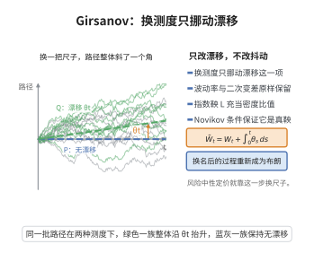

# Girsanov 定理

> **一句话大白话**：换一个"重新加权"过的概率视角时，原本只做布朗运动的随机过程，会变成带漂移的平移过程；或反过来，把一个带漂移的过程在某个新测度下"扶正"成标准布朗运动。
>
> **小例子**：从风险中性概率看，股票的实际走势被"平移后"恰好变成无漂移的鞅，这让期权定价公式成立。

## 一、定理介绍

> **前置依赖**：Brown 运动、指数鞅与 Novikov 条件、测度变换（Radon-Nikodym 导数）、Bayes 公式、Itô 引理、Lévy 鞅刻画定理、二次变差

设 $W_t$ 为 $\mathbb{P}$ 下的 $d$ 维 Brown 运动，$\theta_t$ 为适应过程且满足 Novikov 条件。定义指数鞅 $L_t=\exp\{-\int_0^t\theta_s^\top dW_s - \frac12\int_0^t\|\theta_s\|^2ds\}$ 与新测度 $\frac{d\mathbb{Q}}{d\mathbb{P}}\big|_{\mathcal{F}_T}=L_T$。则在 $\mathbb{Q}$ 下，$\tilde{W}_t = W_t + \int_0^t\theta_s ds$ 是 Brown 运动。

## 几何直观

图意在说明：换测度只平移漂移，抖动与二次变差不动，指数鞅正是这次换尺子的密度。

## 二、原理思路

Novikov 条件保证 $L_t$ 是一个真鞅，从而 $\mathbb{Q}$ 是概率测度。要证 $\tilde{W}_t$ 是 $\mathbb{Q}$-鞅与二次变差为 $t$，再由 Lévy 鞅刻画定理判定其为 Brown 运动。鞅性通过 Bayes 公式把 $\mathbb{Q}$ 下条件期望转化为 $\mathbb{P}$ 下的比值，配合对 $L_t\tilde{W}_t$ 用 Itô 引理证明其是 $\mathbb{P}$-鞅。

## 三、定理的严格表述

设 $L_t=\exp\{-\int_0^t\theta_s^\top dW_s-\frac12\int_0^t\|\theta_s\|^2ds\}$ 为 $\mathbb{P}$-鞅。定义 $\mathbb{Q}$ 使 $\frac{d\mathbb{Q}}{d\mathbb{P}}\big|_{\mathcal{F}_T}=L_T$。则过程

$$
\tilde{W}_t = W_t + \int_0^t\theta_s ds,\quad 0\le t\le T,
$$

在 $\mathbb{Q}$ 下为 Brown 运动。

## 四、证明过程

1. **鞅性**：Novikov 条件保证 $L_t$ 为 $\mathbb{P}$-鞅且 $\mathbb{E}[L_T]=1$，故 $\mathbb{Q}$ 为概率测度。
2. **Bayes 公式**：$\mathbb{E}^{\mathbb{Q}}[\tilde{W}_t\mid\mathcal{F}_s]=\frac{\mathbb{E}^{\mathbb{P}}[L_t\tilde{W}_t\mid\mathcal{F}_s]}{\mathbb{E}^{\mathbb{P}}[L_t\mid\mathcal{F}_s]}$。
3. **Itô 计算**：$d(L_t\tilde{W}_t)=L_tdW_t-L_t\theta_t^\top\tilde{W}_tdW_t$，故 $L_t\tilde{W}_t$ 为 $\mathbb{P}$-鞅。
4. **二次变差**：$\tilde{W}$ 与 $W$ 有相同二次变差 $t$（漂移项是有界变差）。
5. **Lévy 刻画**：连续鞅＋二次变差 $t$ ⇒ Brown 运动。

## 五、应用与意义

Girsanov 定理是金融数学的枢纽，用于风险中性测度与期权定价（通过改变测度消除漂移）、随机控制中的测度变换、以及统计中的随机检验（似然比）。它还奠基了测度变换与等价鞅测度理论，与布朗运动的拉普拉斯框架和大偏差方法紧密相连。

## 课堂问答

**老师**：换一个测度为什么能把带漂移的过程"扶正"成布朗运动？

**学生**：先给结论——取指数鞅 $L_t=\exp\{-\int_0^t\theta_s^\top dW_s-\frac12\int_0^t\|\theta_s\|^2ds\}$，令 $\frac{d\mathbb{Q}}{d\mathbb{P}}\big|_{\mathcal{F}_T}=L_T$，则在 $\mathbb{Q}$ 下 $\tilde W_t=W_t+\int_0^t\theta_s\,ds$ 是布朗运动。

**老师（追问）**：证明分几步走？

**学生**：第一步由 Novikov 条件 $\mathbb{E}\exp\{\frac12\int_0^T\|\theta_s\|^2ds\}<\infty$ 保证 $L_t$ 为真鞅、$\mathbb{Q}$ 是概率测度；第二步用 Bayes 公式与 Itô 计算证 $\tilde W$ 为 $\mathbb{Q}$-鞅；第三步因漂移有界变差不改二次变差，$[\tilde W]_t=t$，最后由 Lévy 鞅刻画定理定调。

**老师（拓展）**：它在金融里扮演什么角色？

**学生**：它用 $\theta_t=(\mu_t-r)/\sigma_t$ 消去真实漂移，得到风险中性测度，使贴现价格成为 $\mathbb{Q}$-鞅，从而 $V_t=e^{-r(T-t)}\mathbb{E}^{\mathbb{Q}}[\Phi(S_T)]$。常见误区是忘记 Novikov 或等价性条件，导致 $\mathbb{Q}$ 不是概率或与原测度不等价。
