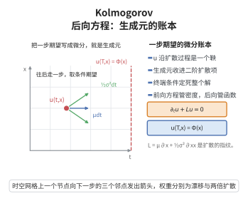

# Kolmogorov 后向方程

> **一句话大白话**：想知道"从某点 $x$ 出发的随机过程在将来某个时刻的期望"，不用模拟路径，只要解一个关于起始时刻与起始点 $(t,x)$ 的偏微分方程即可；这个方程就是 Kolmogorov 后向方程。

> **小例子**：Brown 运动 $dX_t=dW_t$ 的后向方程是热方程 $\partial_t u+\tfrac12\partial_{xx}u=0$，终端条件 $u(T,x)=f(x)$ 的解正是 $u(t,x)=\mathbb E[f(x+W_{T-t})]$。

## 一、定理介绍

> **前置依赖**：Itô引理、SDE解的存在唯一性定理、条件期望的存在唯一性、Brown运动的存在性

Kolmogorov 后向方程描述扩散过程的**生成元**与"函数沿过程的期望"之间的关系。设 $X_t$ 满足随机微分方程 $dX_t=\mu(t,X_t)dt+\sigma(t,X_t)dW_t$，其（后向）生成元记作

$$
L=\mu(t,x)\frac{\partial}{\partial x}+\frac12\sigma^2(t,x)\frac{\partial^2}{\partial x^2}.
$$

则对给定终端函数 $f$，定义 $u(t,x)=\mathbb E\bigl[f(X_T)\,\big|\,X_t=x\bigr]$，函数 $u$ 满足终端值问题

$$
\frac{\partial u}{\partial t}+Lu=0,\qquad u(T,x)=f(x).
$$

这条方程之所以称为"后向"，是因为它把时间 $t$ 与空间 $x$ 都视为**初始**变量，从终端条件倒推回早先时刻；与之相对的 Fokker–Planck 方程是"前向"的，描述密度随时间的演化。它是 Feynman–Kac 公式与 Black–Scholes 方程的公共骨架。

## 几何直观

图意在说明：把一步条件期望写成微分就得到生成元，终端条件从 T 时刻倒着定住整个解。

## 二、原理思路

核心是**鞅性**：若 $u$ 满足后向方程，则把 $u$ 沿过程复合，$M_s=u(s,X_s)$ 会是一个鞅——其 Itô 微分的漂移项恰是 $\partial_su+Lu$，方程使之变成 $0$。于是 $M_t=\mathbb E[M_T\mid X_t]$ 立刻给出概率表示 $u(t,x)=\mathbb E[f(X_T)]$。

反过来，若已知概率表示，用"条件期望在短时间内的增量"除以时间步长并令步长趋于 $0$，其极限正是 $\partial_tu+Lu$，必须有 $0$，从而反推出满足后向方程。两个方向合起来说明：**后向方程的解等价于相应的条件期望**。

## 三、定理的严格表述

设 $\mu,\sigma$ 关于 $(t,x)$ 连续、关于 $x$ 满足局部 Lipschitz 与线性增长条件，$X^{t,x}_s$（$s\ge t$）为相应 SDE 从 $X_t=x$ 出发的解（由 SDE解的存在唯一性定理保证初值问题存在唯一）。设 $L$ 如上。

（Kolmogorov 后向方程）设 $u\in C^{1,2}([0,T]\times\mathbb R)$ 且有界，满足

$$
\frac{\partial u}{\partial t}(t,x)+L u(t,x)=0,\qquad u(T,x)=f(x),
$$

则对 $0\le t\le T$ 有

$$
u(t,x)=\mathbb E\bigl[f(X^{t,x}_T)\bigr].
$$

带源项 $g$ 的推广为：若 $\partial_tu+Lu+g=0$、$u(T,x)=f(x)$，则

$$
u(t,x)=\mathbb E\Bigl[f(X^{t,x}_T)+\int_t^T g(s,X^{t,x}_s)\,ds\Bigr].
$$

## 四、证明过程

**证明（鞅论证，先源项为零的情形）。**

**步骤 1（复合过程的 Itô 微分）。** 固定 $(t,x)$，记 $X_s=X^{t,x}_s$，$Y_s=u(s,X_s)$。由 Itô 引理（$u\in C^{1,2}$），

$$
dY_s=\Bigl(\frac{\partial u}{\partial s}+L u\Bigr)(s,X_s)\,ds+\sigma(s,X_s)\frac{\partial u}{\partial x}(s,X_s)\,dW_s .
$$

**步骤 2（漂移项消去）。** 因 $u$ 满足后向方程，漂移项为零，于是

$$
dY_s=\sigma(s,X_s)\frac{\partial u}{\partial x}(s,X_s)\,dW_s ,
$$

即 $Y_s$ 是局部鞅；由于 $u$ 有界、且系数满足增长条件，随机积分项是可积的，故 $Y$ 是（真）鞅。

**步骤 3（取条件期望）。** 对 $Y_T-Y_t=\int_t^T\sigma\,\partial_xu\,dW_s$ 取条件期望（条件期望的存在唯一性保证其定义），随机积分的（条件）期望为零：

$$
\mathbb E\bigl[u(T,X_T)-u(t,X_t)\,\big|\,\mathcal F_t\bigr]=0 .
$$

**步骤 4（得到表示）。** 代入 $X_t=x$、$u(T,X_T)=f(X_T)$ 并用 $u(t,x)$ 是 $\mathcal F_t$-可测的常数，得

$$
u(t,x)=\mathbb E\bigl[f(X_T)\,\big|\,X_t=x\bigr],\qquad X_T=X^{t,x}_T .
$$

**步骤 5（源项情形）。** 令 $Z_s=u(s,X_s)+\int_t^s g(r,X_r)dr$，则

$$
dZ_s=\bigl(\partial_su+Lu+g\bigr)(s,X_s)ds+\sigma\partial_xu\,dW_s=\sigma\partial_xu\,dW_s ,
$$

同样是鞅；取期望得 $u(t,x)=\mathbb E\bigl[f(X_T)+\int_t^T g(s,X_s)ds\bigr]$。

**步骤 6（反向导出方程）。** 反过来设 $u(t,x)=\mathbb E[f(X^{t,x}_T)]$ 且 $u\in C^{1,2}$。对充分小 $h>0$，利用 $X^{t,x}_{t+h}$ 与 $X^{t+h,X^{t,x}_{t+h}}_T$ 的复合（强马尔可夫性），得

$$
0=\mathbb E\bigl[u(t+h,X_{t+h})-u(t,x)\,\big|\,X_t=x\bigr].
$$

对 $u(t+h,X_{t+h})$ 用 Itô 引理并把上式除以 $h$、令 $h\to0^+$，左端趋于 $\partial_tu(t,x)+Lu(t,x)$（随机积分项期望为零），故 $u$ 满足后向方程，终端条件由 $u(T,x)=f(x)$ 显然成立。$\square$

## 五、应用与意义

Kolmogorov 后向方程是随机分析与偏微分方程之间的桥梁：给定随机过程可写出对应的定解问题，反之可用概率方法（蒙特卡洛、鞅方法）求解 PDE。它是 Feynman–Kac 公式的直接来源，也是 Black–Scholes 型抛物方程的原型；在扩散近似、随机控制（HJB 方程的后向部分）、粒子系统与多尺度建模中被反复使用。

## 课堂问答

**老师**：为什么"求条件期望"这件事等价于"解一条偏微分方程"？

**学生**：先给结论——$u(t,x)=\mathbb{E}[f(X_T)\mid X_t=x]$ 满足 $\partial_tu+Lu=0$、$u(T,x)=f(x)$，其中生成元 $L=\mu\partial_x+\frac12\sigma^2\partial_{xx}$。

**老师（追问）**：证明靠的什么机制？

**学生**：靠鞅性。对 $Y_s=u(s,X_s)$ 用 Itô 引理，其漂移项为 $\partial_su+Lu$，方程使之恒为零，故 $Y$ 是鞅；于是 $u(t,x)=\mathbb{E}[u(T,X_T)\mid X_t=x]=\mathbb{E}[f(X_T)]$。带源项时改令 $Z_s=u(s,X_s)+\int_t^sg\,dr$ 仍为鞅。

**老师（拓展）**：为什么叫"后向"，与别的方程什么关系？

**学生**：因为它把 $(t,x)$ 当初始变量、从终端条件 $t=T$ 往回推，与描述密度演化的 Fokker-Planck 前向方程互为对偶。它是 Feynman-Kac 公式与 Black-Scholes 方程的公共骨架，也是随机控制中 HJB 方程的来源。常见误区是把终端条件当成初值。

## 相关条目

- [Feynman-Kac公式](./Feynman-Kac公式.md)：在后向方程中加入折现与源项后的概率表示。
- [Black-Scholes型抛物方程](./Black-Scholes型抛物方程.md)：几何布朗运动对应的后向方程加折现项。
- [Itô引理](./Itô引理.md)：步骤 1 计算复合过程微分所用。
- [SDE解的存在唯一性定理](./SDE解的存在唯一性定理.md)：保证 $X^{t,x}_s$ 存在唯一。
- [条件期望的存在唯一性](../第24级-概率论基础/条件期望的存在唯一性.md)：步骤 3 取条件期望的依据。
