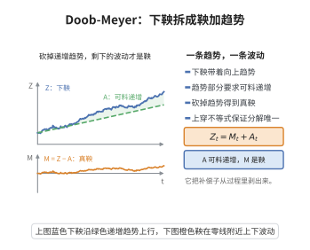

# Doob-Meyer 分解定理

> **一句话大白话**：一个"平均趋势只升不降"的随机过程，一定能拆成一个"公平的鞅"和一个"只增不减的确定性部分"，且这个拆法是唯一的。
>
> **小例子**：每日财富的期望总在增长，可把它理解为"运气带来的无偏波动"（鞅）加"稳定向上升的储蓄线"（递增过程）。

## 一、定理介绍

> **前置依赖**：下鞅与鞅、停时与一致可积（D 类条件）、上穿不等式、离散化与 dyadic 网格、可料过程与可料二次变差

设 $\{Z_t\}$ 为满足右连续性、可积性与 D 类条件（一致可积）的下鞅。则存在唯一分解

$$
Z_t = M_t + A_t,
$$

其中 $M_t$ 是右连续鞅，$A_t$ 是可料递增过程且 $A_0=0$。

## 几何直观

图意在说明：把可料递增的补偿子从下鞅里剥掉，剩下的波动部分就是真鞅。

## 二、原理思路

把时间离散成 dyadic 网格，在离散水平上定义"可料补偿子" $A^{(n)}$（即 $\mathbb{E}[Z_{t_j}\mid\mathcal{F}_{t_{j-1}}]-Z_{t_{j-1}}$ 的累积和），$M^{(n)}=Z-A^{(n)}$ 为离散鞅。用下鞅上穿不等式与 D 类条件证明 $A^{(n)}$ 收敛，得到连续情形的分解；唯一性由"既是鞅又是可料有界变差过程必为常数"推出。

## 三、定理的严格表述

设 $\{Z_t\}$ 是右连续、可积且属于 D 类（$\{Z_\tau:\tau$ 有界停时$\}$ 一致可积）的下鞅。则存在唯一的可料递增右连续过程 $A_t$（$A_0=0$）与右连续鞅 $M_t$，使得

$$
Z_t = M_t + A_t.
$$

特别地，对平方可积鞅 $M$，$M_t^2 = \langle M,M\rangle_t + \text{鞅}$，其中 $\langle M,M\rangle_t$ 为可料二次变差。

## 四、证明过程

1. **离散化**：$t_k^{(n)}=kT/2^n$，离散下鞅 $Z_{t_k^{(n)}}$。
2. **上穿不等式**：$\mathbb{E}[U_n[a,b]]\le\frac{\mathbb{E}[(Z_T-a)^-]}{b-a}$，控制上穿次数。
3. **补偿子**：$A_{t_k}^{(n)}=\sum_{j=1}^k(\mathbb{E}[Z_{t_j}\mid\mathcal{F}_{t_{j-1}}]-Z_{t_{j-1}})$ 递增，$M^{(n)}=Z-A^{(n)}$ 为离散鞅。
4. **极限**：D 类条件保证 $A^{(n)}\to A$ a.s.，$M$ 有右连续修改。
5. **可料性与唯一性**：构造使 $A$ 可料；若 $M-M'=A'-A$ 既鞅又有界变差，则恒为常数。

## 五、应用与意义

Doob-Meyer 分解是连续时间随机分析的基石，定义了可料二次变差（角括号），从而允许构造 Itô 积分与随机微分方程。它是局部鞅、平方可积鞅理论、随机测度与谱积分的基础，也是证明 Girsanov、鞅表示等定理的前提，在金融与遍历性分析中无处不在。

## 课堂问答

**老师**：一个下鞅为什么一定能拆成"鞅加可料递增"？

**学生**：先给结论——右连续、可积且属 D 类的下鞅 $Z$ 有唯一分解 $Z_t=M_t+A_t$，其中 $M$ 是鞅、$A$ 是可料递增过程、$A_0=0$。

**老师（追问）**：离散化里 $A$ 怎么定，为什么天然可料？

**学生**：在 dyadic 网格上取 $A^{(n)}_{t_k}=\sum_{j\le k}(\mathbb{E}[Z_{t_j}\mid\mathcal F_{t_{j-1}}]-Z_{t_{j-1}})$，它由 $\mathcal F_{t_{j-1}}$-可测量定义，故天然可料且递增；再由上穿不等式 $\mathbb{E}[U_n[a,b]]\le\frac{\mathbb{E}[(Z_T-a)^-]}{b-a}$ 与 D 类条件证 $A^{(n)}\to A$。唯一性来自"既鞅又有界变差必恒为常数"。

**老师（拓展）**：它给整个随机分析带来了什么？

**学生**：它定义了可料二次变差角括号 $\langle M,M\rangle$（由 $M_t^2-\langle M,M\rangle_t$ 为鞅刻画），因而是构造 Itô 积分、局部鞅理论与证明 Girsanov、鞅表示的前提。常见误区是丢掉 D 类或可料性这两个条件。
