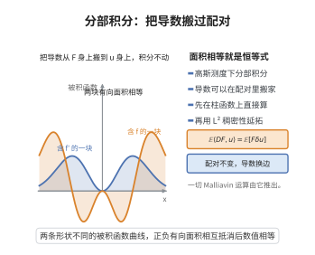

# 分部积分公式

> **一句话大白话**：在 Malliavin 计算里，"求导"可以从一个随机变量身上搬到另一个身上，代价是把它换成 Skorokhod 积分——这正是随机版本的"分部积分"。
>
> **小例子**：对光滑柱函数 $F$ 与 $h\in L^2[0,T]$ 有 $\mathbb{E}[F\,W(h)]=\mathbb{E}[\partial_hF]$，它就是高斯测度下 $\int f'g\,d\gamma=-\int f g'\,d\gamma$ 的随机翻版。

## 一、定理介绍

> **前置依赖**：Malliavin 导数 $D$、Skorokhod 积分（伴生算子 $\delta$）、对偶恒等式、Itô 积分、光滑柱函数的稠密性与 $L^2$ 延拓。

分部积分公式（integration by parts formula）是 Malliavin 计算（随机变分法）最基本的运算恒等式：它把 Malliavin 导数 $D$ 与 Skorokhod 积分 $\delta$ 配成一对伴随算子，使 $\mathbb{E}[F\delta(u)]=\mathbb{E}[\int_0^T D_tF\,u_t\,dt]$。该公式在 1970–80 年代由 Malliavin、Bismut、Nualart–Zakai 等人发展，动机是研究随机微分方程解的光滑密度存在性（Hörmander 型条件）。它把无穷维高斯空间上的"分部积分"移植到 Wiener 空间，使随机分析获得与有限维分布理论平行的工具；也是推导 Clark–Ocone 公式、Skorokhod 积分 Itô 引理以及金融 Greeks 计算方法的基础。

## 几何直观

图意在说明：高斯测度下的分部积分让导数在配对中换边，两块面积相等正是对偶恒等式。

## 二、原理思路

1. 先在光滑柱函数上直接验证：$F=f(W(h_1),\dots,W(h_n))$ 时 $D_tF=\sum_i\partial_if\,h_i(t)$，而 $W(h)$ 的 Skorokhod 积分等于 Itô 积分，逐一用一维高斯分部积分即可。
2. 用光滑柱函数在 $\mathbb D^{1,2}$ 与 $\mathrm{Dom}(\delta)$ 中的稠密性，通过 $L^2$ 连续性把恒等式延拓到一般 $F,u$。
3. 由此确立 $D$ 与 $\delta$ 的伴随关系，并把 $\delta$ 解释为 Skorokhod 积分，进而导出乘积法则、链式法则等运算规则。

## 三、定理的严格表述

设 $W$ 为 Wiener 空间上的标准布朗运动，$H=L^2[0,T]$，$D$ 为 Malliavin 导数，$\delta$ 为其伴生算子（Skorokhod 积分），定义域为 $\mathrm{Dom}(\delta)$。则对 $F\in\mathbb D^{1,2}$ 与 $u\in\mathrm{Dom}(\delta)$，

$$
\mathbb{E}\Big[F\,\delta(u)\Big]=\mathbb{E}\Big[\int_0^T D_tF\cdot u_t\,dt\Big]=\mathbb{E}\big[\langle DF,u\rangle_H\big].
$$

当 $u$ 适应（可预测）时 $\delta(u)=\int_0^T u_t\,dW_t$（Itô 积分），公式化为

$$
\mathbb{E}\Big[F\int_0^T u_t\,dW_t\Big]=\mathbb{E}\Big[\int_0^T D_tF\cdot u_t\,dt\Big].
$$

柱函数情形：若 $F=f(W(h_1),\dots,W(h_n))$、$h\in H$，则

$$
\mathbb{E}\big[F\,W(h)\big]=\mathbb{E}\big[\partial_h F\big],\qquad \partial_h F=\int_0^T D_tF\,h(t)\,dt .
$$

## 四、证明过程

**步骤 1（一维高斯分部积分）。** 设 $g\in C_b^1(\mathbb{R})$、$\xi\sim\mathcal N(0,1)$。利用 $\frac{d}{dx}e^{-x^2/2}=-x\,e^{-x^2/2}$ 作分部积分：

$$
\mathbb{E}[g'(\xi)]=\int_{\mathbb{R}} g'(x)\frac{e^{-x^2/2}}{\sqrt{2\pi}}\,dx=\int_{\mathbb{R}} g(x)\,x\,\frac{e^{-x^2/2}}{\sqrt{2\pi}}\,dx=\mathbb{E}[g(\xi)\,\xi].
$$

**步骤 2（柱函数情形）。** 取 $F=f(W(h_1),\dots,W(h_n))$、$h\in H$，$f\in C_b^\infty(\mathbb R^n)$。把 $h$ 正交分解为 $h=\sum_i c_ih_i+g'$，其中 $g'\perp h_i$，故 $W(g')$ 与 $(W(h_1),\dots,W(h_n))$ 独立且 $\mathbb E W(g')=0$。对 $W(h)$ 的各高斯分量逐一用步骤 1：

$$
\mathbb{E}\big[F\,W(h)\big]=\sum_{i=1}^{n} c_i\,\mathbb{E}\big[\partial_i f\,(W(h_1),\dots,W(h_n))\big]=\mathbb{E}\Big[\sum_{i=1}^{n}\partial_i f\,\langle h_i,h\rangle_H\Big]=\mathbb{E}[\partial_hF].
$$

又 $D_tF=\sum_i\partial_if\,h_i(t)$，故 $\partial_hF=\int_0^T D_tF\,h(t)\,dt$。因柱函数下 $W(h)=\delta(h)$，即得 $\mathbb E[F\delta(h)]=\mathbb E\langle DF,h\rangle_H$。对 $u=\sum_j G_jh^{(j)}$ 线性组合并重复上述论证即得柱形 $u$ 的情形。

**步骤 3（逼近与延拓）。** 光滑柱函数在 $\mathbb D^{1,2}$ 与 $\mathrm{Dom}(\delta)$ 中稠密。取 $F_k\to F$（$\mathbb D^{1,2}$ 范数）与 $u^{(m)}\to u$（$L^2(\Omega;H)$ 且 $\delta(u^{(m)})\to\delta(u)$），对每个 $(F_k,u^{(m)})$ 步骤 2 的等式成立。由 $D$ 与 $\delta$ 的图闭性，等式两端分别 $L^2$ 收敛到 $\mathbb E[F\delta(u)]$ 与 $\mathbb E\langle DF,u\rangle_H$，故等式对一般 $F,u$ 成立。

**步骤 4（适应情形的解释）。** 当 $u$ 可预测时，Skorokhod 积分与 Itô 积分一致：对简单可预测过程 $u=\sum_i u_i\mathbf 1_{(t_i,t_{i+1}]}$ 直接验证 $\delta(u)=\sum_i u_i(W_{t_{i+1}}-W_{t_i})=\int_0^T u_t\,dW_t$，再由 $L^2$ 极限即得一般可预测过程。$\square$

## 五、应用与意义

- 证明随机微分方程解密度的光滑性与存在性（Malliavin–Hörmander 定理）。
- 推导 Clark–Ocone 公式、Skorokhod 积分的 Itô 引理与乘积法则。
- 金融数学中给出 Greeks（敏感性指标）的 Malliavin 权重表示，支持 Monte-Carlo 计算。

## 课堂问答

**老师**：随机版本的"分部积分"怎样把导数从一个因子搬到另一个？

**学生**：先给结论——$\mathbb{E}[F\,\delta(u)]=\mathbb{E}[\int_0^TD_tF\,u_t\,dt]$。把 Malliavin 导数 $D$ 从等式一边搬到另一边，代价是把被搬的那一侧换成 Skorokhod 积分 $\delta$。

**老师（追问）**：最简单的一维情形长什么样？

**学生**：柱函数情形是 $\mathbb{E}[F\,W(h)]=\mathbb{E}[\partial_hF]$，其中 $\partial_hF=\int_0^TD_tF\,h(t)dt$。它就是高斯测度下的 $\mathbb{E}[g'(\xi)]=\mathbb{E}[g(\xi)\xi]$（$\xi\sim\mathcal N(0,1)$）在无穷维 Wiener 空间上的翻版。

**老师（拓展）**：它有什么重要应用？

**学生**：它是 Malliavin-Hörmander 定理证明 SDE 解具有光滑密度的核心工具，并用于推导 Clark-Ocone 公式、Skorokhod 积分的 Itô 引理与金融 Greeks 的 Malliavin 权重表示。常见误区是忽略 $u$ 需可预测（适应）才能取 Itô 积分这一前提。

## 相关条目

- [对偶恒等式](./对偶恒等式.md)：与本公式等价，强调 $D$ 与 $\delta$ 的伴随关系。
- [Clark-Ocone公式](./Clark-Ocone公式.md)：由本公式与鞅表示定理导出。
- [Malliavin导数的链式法则](./Malliavin导数的链式法则.md)：本公式所需的求导运算规则。
- [Skorokhod积分的Itô引理推广](./Skorokhod积分的Itô引理推广.md)：以本公式与对偶恒等式为前置依赖。
- [Itô积分](../第41级-随机过程/Itô积分.md)：适应过程下 Skorokhod 积分的经典特例。
