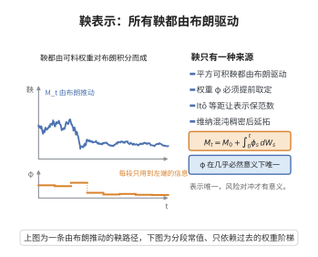

# 随机积分表示定理（鞅表示定理）

> **一句话大白话**：一个只见布朗运动信息的平方可积鞅，其实没有"自己的新信息"——它的所有随机波动都能表达成对布朗运动的加权积分。
>
> **小例子**：只要市场只有一只股票（布朗运动驱动），任何公平赌局式的价格过程都能写成"买了多少份股票"的积分形式，这是期权对冲的理论依据。

## 一、定理介绍

> **前置依赖**：Brown 运动与平方可积鞅、Itô 等距、可料过程、Wiener 混沌与稠密逼近（指数随机变量）、Itô 积分

设 $\{W_t\}$ 为 $d$ 维 Brown 运动，$\{M_t\}$ 为其自然流上的平方可积鞅（$\mathbb{E}[M_T^2]<\infty$）。则存在唯一的 $L^2$ 可料过程 $\{\phi_t\}$ 使

$$
M_t = M_0 + \int_0^t \phi_s^\top dW_s, \quad 0\le t\le T.
$$

## 几何直观

图意在说明：任何平方可积鞅都能写成可料过程对布朗运动的随机积分，权重唯一。

## 二、原理思路

先在稠密子集（指数型随机变量 $F$）上验证表示：由伊藤指数与 Girsanov 证明 $M_t^F=\mathbb{E}[F\mid\mathcal{F}_t]$ 可写成伊藤积分。再由稠密性对所有 $L^2(\mathcal{F}_T)$ 随机变量延拓，利用 Itô 等距保持 $\phi^{(n)}$ 的 Cauchy 性，取极限得到一般表示，最后由 Itô 等距推出被积函数在 $L^2$ 意义下唯一。

## 三、定理的严格表述

设 $\{M_t\}_{t\in[0,T]}$ 为 $\mathcal{F}_t$-鞅且 $\mathbb{E}[M_T^2]<\infty$。则存在唯一（$L^2$ 意义下）可料过程 $\phi$ 满足 $\mathbb{E}\int_0^T\|\phi_t\|^2dt<\infty$，使

$$
M_t = M_0 + \int_0^t \phi_s^\top dW_s.
$$

## 四、证明过程

1. **指数随机变量表示**：$F=\exp\{\int h^\top dW-\frac12\int\|h\|^2dt\}$，$M_t^F=1+\int_0^t M_s^Fh^\top dW_s$。
2. **稠密性**：上述 $F$ 的线性组合在 $L^2(\mathcal{F}_T)$ 稠（Wiener 混沌分解）。
3. **$L^2$ 等距延拓**：用 Itô 等距 $\mathbb{E}(M_t^{(n)}-M_t^{(m)})^2=\mathbb{E}\int_0^t\|\phi^{(n)}-\phi^{(m)}\|^2ds$ 保持 Cauchy 性。
4. **取极限**：Itô 积分的连续性给出表示。
5. **唯一性**：两表示差 $\int_0^t(\phi-\tilde\phi)^\top dW=0$，由等距推得 $\phi=\tilde\phi$ a.e.。

## 五、应用与意义

鞅表示定理是完备市场对冲与风险中性定价的理论基础：在由布朗运动生成的完备市场中，任何 contingent claim 都可被动态交易复制。它是股票-债券模型、Malliavin 计算（Clark-Ocone 公式）的出发点，也解释了为何可积鞅"缺少布朗运动之外的信息"这一结构性质。

## 课堂问答

**老师**：为什么布朗流上的平方可积鞅没有"额外信息"？

**学生**：先给结论——若 $M$ 是 $\mathbb{F}^W$ 上的平方可积鞅，则存在唯一（$L^2$ 意义下）可料过程 $\phi$，使 $M_t=M_0+\int_0^t\phi_s^\top dW_s$，即布朗流上的鞅本质上都是 Itô 积分。

**老师（追问）**：证明是怎么搭起来的？

**学生**：先在稠密集上验证：对 $F=\exp\{\int h^\top dW-\frac12\int\|h\|^2dt\}$ 有 $M^F_t=1+\int_0^tM^F_s\,h^\top dW_s$；再由 Wiener 混沌分解（指数随机变量的线性组合在 $L^2(\mathcal F_T)$ 中稠），用 Itô 等距 $\mathbb{E}(M^{(n)}_t-M^{(m)}_t)^2=\mathbb{E}\int_0^t\|\phi^{(n)}-\phi^{(m)}\|^2ds$ 保持 Cauchy 性并取极限。

**老师（拓展）**：这意味着什么？

**学生**：市场若只由布朗运动驱动便是完备市场，任何 $\mathcal{F}_T$-可测权益都能被动态交易复制，这也是 Clark-Ocone 公式的出发点。唯一性由 Itô 等距推出。常见误区是忽略"自然流"与"平方可积"这两个前提。
